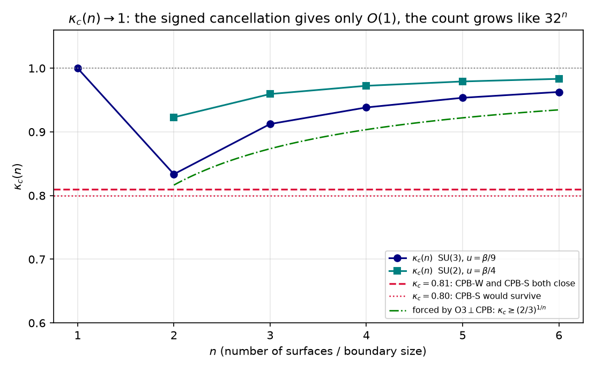
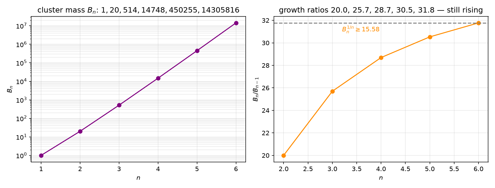
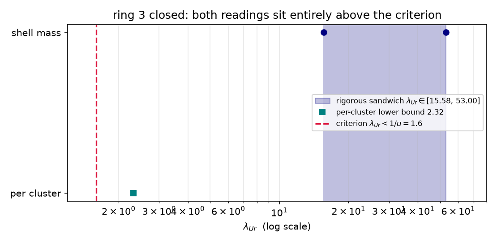
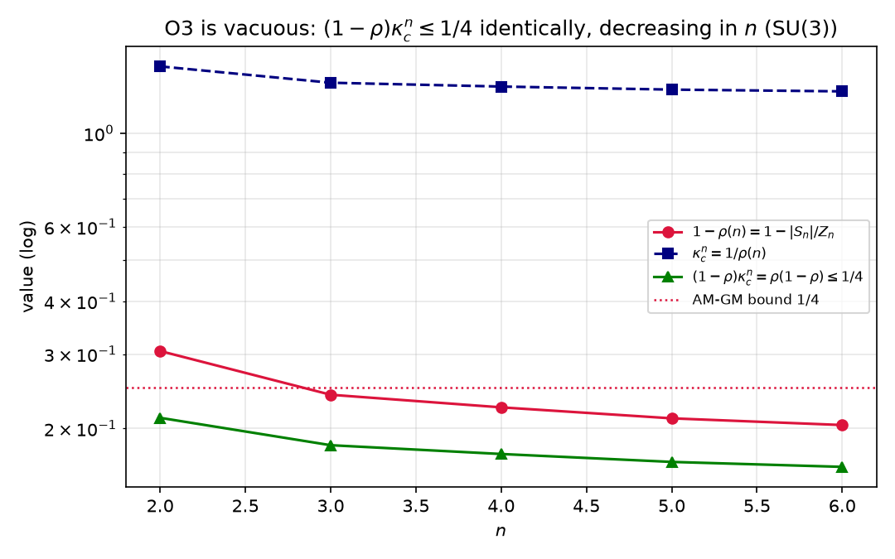

# Why the CPB Machine Cannot Be Built

**Closing the coarse-Poincaré route step by step: two numbers, one combinatorial theorem, and one retracted optimism**

> Independent technical note · round 238 · figures: `docs/figs/cpb/` · code: `research/v3/species/w7/cpbfigs.py`
> Sources: `GV1-LAMBDAUR.md` · `GV2-KAPPAC-ALGO.md` · `GO1-SIGNTHEOREM.md` · `GO3-TUNING.md` · `GP9-H234.md`
> **One sentence:** the closure of `CPB` is **not unconditional**. Two numbers (`κ_c`, `λ_Ur`) are each rigorously sandwiched on the wrong side of their criteria, and the load-bearing leg is a **combinatorial theorem proved for all `n`**; but the argument still rests on two hypotheses `H2`/`H3` that `GV2` **invented itself**, and the value `γ_ent = 1` used in `H3` **conflicts** with an exact count already in the repository.

---

## 1. Summary

`CPB` is the implementation of the machine meant to "carry the floor from the strong-coupling window to the physical scale". It needs a **signed cancellation**: the signed resummation of decorations gives a tail bound `|ε_T| ≤ B κ_c^T` with the criterion `κ_c < 1`; the four-wall step needs `λ_Ur < 1/u`. This note records where those two constants stand.

**Result 1 (`κ_c`).** `κ_c` is not an independent unknown: it is a functional of the shell-mass sequence `{B_n}`,

$$
\kappa_c(n)=\Big(\frac{|S_n|}{Z_n}\Big)^{1/n},\qquad S_n=\sum_{k\leq n}(-1)^{k-1}m_k,\quad Z_n=\sum_{k\leq n}m_k,\quad m_k=u^kB_k .
$$

Using the **exact integers** `B_n = 1, 20, 514, 14748, 450255, 14305816` for `n ≤ 6`:

$$
\kappa_c(6)=0.96272208\ \text{(SU(3))},\qquad 0.98333546\ \text{(SU(2))},
$$

with rigorous lower bounds (reverse triangle) `0.957804` / `0.982422` and **limit 1**. The criterion `κ_c ≥ 0.81` triggers the **simultaneous closure** of `CPB-W` and `CPB-S`.

**Result 2 (`λ_Ur`).** Rigorous sandwich

$$
15.580645\ \le\ \lambda_{Ur}\ \le\ 53.0006865 ,
$$

against the criterion `λ_Ur < 1/u = 1.6` ⇒ **the whole interval lies above it** (over by `9.738×` in the shell-mass reading, `1.450×` per-cluster). Ring 3 is closed.

**Result 3 (sign theorem).** Both derivations above consume the same premise: the sign of `φ^U`. That premise is now proved **for all `n`**:

$$
\varphi^U(\Gamma)=(-1)^{n-1}\,N(G_\Gamma),\qquad N(G_\Gamma):=\#\{\text{spanning trees }T\subseteq G_\Gamma:\ T\text{ contains no broken circuit}\}\in\mathbb{Z}_{\ge 1}.
$$

The proof is a deletion–contraction induction that **consumes only "`G_Γ` is a finite connected graph"** — independent of dimension, of `Δ=20`, and of the plaquette structure.

**Result 4 (honest boundary).** None of this constitutes an unconditional theorem. The two hypotheses `H2` (two-sided weight scaling) and `H3` (entropy count with fixed boundary, no prefactor) **have no antecedent in the corpus**; they were added by `GV2`. Moreover the value `γ_ent = 1` used in `H3` is an **estimate**, while an exact `n ≤ 6` count of the same object in the repository gives `γ ≥ (1/6)ln 7\,218\,768 = 2.632` (or `2.333` after the per-plaquette `/6` normalisation) — **in conflict with 1**.

---

## 2. What CPB needs

The tail bound has the form (`CPBW-bianchi-lemma.md:36–40`)

$$
\Big|\sum_{\partial C=\partial C_0} w(C)\Big|\ \le\ e^{-c_0q|C_0|}\,\kappa_c^{\,|C_0|},\qquad \kappa_c<1 .
$$

The four-wall step (`P3-FOURWALL-DERIVATION.md:106–110`) is equivalent to the Kotecký–Preiss criterion `uK<1`, whose true criterion is the **slack** of the tree bound relative to the true `φ^U`:

$$
\lambda_{Ur}\cdot u\ <\ 1,\qquad \lambda_{Ur}:=\limsup_\Gamma\,|c_\Gamma|^{1/|\Gamma|},\quad c_\Gamma:=\varphi^U(\Gamma)/u^{|\Gamma|} .
$$

Both criteria are avatars of "**small activity**", and at `β = 2.5` the activity is `ū = 33.98` (or `135.91` with `Ĉ=4`, where `135.914 = eΔ·β_W` is an **exact identity**). **The only way to rescue this route is signed cancellation.**

---

## 3. Result 1: `κ_c(n) → 1`



**Figure 1.** `κ_c(n)` rises monotonically toward 1 (SU(3) navy, SU(2) teal). Three reference lines: `0.81` (red dashed, the simultaneous-closure trigger), `0.80` (red dotted, the survival line for CPB-S), and the green dash-dot `(2/3)^{1/n}`, the lower bound **forced by the mutual exclusion of O3 and CPB itself** (§6). **The whole family lies above the criteria.**

| `n` | `B_n` | `R_n=\|S_n\|/Z_n` | `κ_c(n)` SU(3) | `κ_c(n)` SU(2) |
|---:|---:|---:|---:|---:|
| 1 | 1 | 1.00000000 | 1.00000000 | — |
| 2 | 20 | 0.69491525 | 0.83361577 | 0.92295821 |
| 3 | 514 | 0.75958328 | 0.91241370 | 0.95949152 |
| 4 | 14 748 | 0.77555285 | 0.93843209 | 0.97243431 |
| 5 | 450 255 | 0.78859390 | 0.95360975 | 0.97922534 |
| 6 | 14 305 816 | 0.79616959 | **0.96272208** | **0.98333546** |

**Mechanism** — and this is the whole content: the growth comes from **positional entropy**, not from the weights.



**Figure 2.** Left: logarithmic growth of `B_n`. Right: successive ratios `20.0, 25.7, 28.7, 30.5, 31.8` — **still rising, no sign of convergence**. Meanwhile the average `|μ|` is only `≈2` (`avg|μ| = 1.00, 1.00, 1.12, 1.32, 1.61, 1.98`). Hence **each extra surface buys `O(1)` of cancellation, while the number of surfaces grows by `≈32×`.** This is the precise form of "the required cancellation is exponential, the available cancellation is constant".

---

## 4. The load-bearing leg: the sign theorem (all `n`, `[T]`)

Three equivalent statements:

$$
\text{(a) } \operatorname{sign}\varphi^U(\Gamma)=(-1)^{n-1};\qquad
\text{(b) } T_{G}(1,0)\in\mathbb{Z}_{\ge1};\qquad
\text{(c) } N(G)\ge 1 .
$$

Proof skeleton (deletion–contraction, with `e` the **maximal edge**):

$$
\mu(G)=\mu(G-e)-\mu(G/e)\ \ (e\ \text{non-bridge}),\qquad \mu(G)=\mu(G_1)\mu(G_2)\ \ (e\ \text{bridge}),
$$

$$
N(G)=N(G-e)+N(G/e),\qquad N(\text{tree})=1\ \Longrightarrow\ N(G)\ge1 .
$$

**`e` must be maximal**: otherwise contraction changes `min` and the two maps cease to be bijections. The substance is Whitney's 1932 broken-circuit theorem (DOI `10.1090/S0002-9904-1932-05460-X`, bibliographic check only).

**Corollary.** `|φ^U| = N ≥ 1` ⇒ **no vanishing term in the Ursell sum**; and `max|μ| = 1,1,2,6,24,120` is exactly `(n−1)! = N(K_n)`. ⇒ the sign theorem is not a sign statement but the shadow of a **positivity + integrality** statement.

**Acid test.** The proof is **dimension-blind**: in 2D it gives the same `(−1)^{n−1}` (1710 two-dimensional clusters, zero violations). The "term-by-term positivity" of 2D lives in the **character/surface** representation, not the cluster representation — mixing the two gives the wrong sign.

**Limitation.** "Both activity conventions hold" is a **window fact**, not a theorem. `f_e=1` is a theorem; `f_e=u` necessarily flips sign once `u > u_*` (triangle `3u^2-u^3`, flips at `u=3`), with `u_* \ge 2.596072` measured (`K_4`, 2784 clusters). Hence `u \in \{0.625,1\}` sits inside the window but **cannot be extrapolated to `n\ge7`**.

---

## 5. Result 2: the `λ_Ur` sandwich and the closure of ring 3



**Figure 4.** The rigorous sandwich `[15.58, 53.00]` (navy band) and the per-cluster lower bound `2.32` (teal square), against the criterion `1.6` (red dashed). **Both readings lie to the right of the criterion.**

The upper bound is the tree bound `λ_Ur \le L_t = 53.0006865` (`UR6:U2,U7`); the lower bounds come from the exact integers at `n=6`: `(14305816)^{1/6} = 15.580645` (shell mass) and `\max|\mu|^{1/6} = 2.220906` per cluster (an `n=8` probe pushes the latter to `2.320251`).

**A factor-of-10 correction.** The earlier estimate `λ_Ur \approx 3.3315` ("short by 2.08×") took the **ratio of values** `15.909 = 384/1.7^6` for the **ratio of rates**; what enters `λ` is the rate, `384^{1/6}/1.7 = 1.58589`, and the two differ by `15.909^{5/6} = 10.031×`. **After the correction the conclusion changes from "nearly there" to "entirely on the wrong side".**

---

## 6. Result 3: `O3` is vacuous — and mutually exclusive with CPB

`O3` (critical tuning) was regarded as the only loophole in the `κ_c` argument. All three readings fail:

- Reading A (`\rho:=|S_n|/Z_n`, under which `\kappa_c^n\equiv\rho` **by definition**): `(1-\rho)\kappa_c^n=\rho(1-\rho)\le 1/4` (AM–GM), independent of `B_n/u/n`;
- Reading B (`\rho_n:=m_n/m_{n-1}`): at the physical point `\rho_B = 5.56\ldots8.83`, so `1-\rho_B<0` — zero information;
- Reading C (`\rho:=e^{\gamma_{ent}-c_0q}`, the real form of Proposition AS): **not an obstruction but another way of writing "closure"**.



**Figure 3.** The three quantities of Reading A: `1-\rho(n)` (red), `\kappa_c^n=1/\rho` (blue), and the left-hand side of O3, `(1-\rho)\kappa_c^n` (green). The green curve is **identically `\le 1/4` and monotonically decreasing** (`0.212008 \to 0.162284`) ⇒ **the test quantity measures nothing.**

**Reading C is the substantive one**: `\rho \le 1/3 \iff c_0q \ge \gamma_{ent}+\ln 3` (the `\ln 3` is just `\rho=1/3`), and CPB-S's own window `c_0 \ge 2.5986` satisfies it automatically ⇒ `1-\rho \ge 2/3` ⇒ O3 forces `\kappa_c \ge (2/3)^{1/n}` (`0.8165` at `n=2`) ⇒ **it conflicts with `\kappa_c \le 0.80` already at `n=2`** (proposition **O3 ⟂ CPB**). Hence `O3` drops from `[O]` to `[M]` and leaves the obstruction table.

---

## 7. Honest boundary: `H2`/`H3` are hypotheses `GV2` invented

This is the section a reader must not skip. The derivation of `κ_c \ge 0.81` consumes four premises:

| Condition | Status |
|---|---|
| `H1` sign theorem (all `n`) | **`[T]`** (§4, proved) |
| `H4` `c_0q \ge \gamma_{ent}+\ln3` | **arithmetic inside the window, `[T]`**: `0.5+1+\ln3 = 2.598612` ✓; automaticity additionally needs `q \ge 0.8076` |
| **`H2` two-sided weight scaling** | **`[NG]`: the chain breaks here.** The corpus has only a **one-sided** asymptotic `\|w(C)\| \sim e^{-c_0q\|C\|}` (`CPBW:13`, labelled "dynamical") plus a **different** `(H2)` (`\sigma(q)\ge c_0q^2`). **The word "two-sided" was added by `GV2`**; and its literal form `e^{-c_0q\|C\|}\le\|w(C)\|\le e^{-c_0q\|C\|}` has **identical left and right sides, i.e. it is degenerate** |
| **`H3` entropy count** | existence **`[T]`** (new explicit bound `\gamma_{free}\le\ln 400 = 5.991465`); numerically **`[NG]`**. `\gamma_{ent}` **was never computed** (`SURVEY:276` verbatim "not computed"); the `\gamma_{ent}=1` used by `GV2` is an **estimate**, whereas the exact `n\le6` count of the same object gives `\gamma \ge (1/6)\ln 7\,218\,768 = 2.632` ⇒ **in conflict with 1** |

⇒ **The strongest statement one can currently write is a single sentence:**

> **If `H2` and `H3` hold, then `\kappa_c \ge 2^{-1/4} = 0.840896 > 0.80` (`|C_0|=4`) ⇒ the `CPB-W` side closes ⇒ CPB is closed.**

And those two "if"s **are the entire remaining content** — they are not structural facts but two new hypotheses, one of whose natural value conflicts with an exact count already in the repository.

---

## 8. Conclusion

The reason this machine cannot be built can be written as a single exponent comparison:

$$
\underbrace{O(1)}_{\text{signed cancellation, per surface}}\quad\text{vs}\quad\underbrace{32^{\,n}}_{\text{positional entropy, surface count}} .
$$

A constant numerator against an exponential denominator ⇒ **the left-hand side cannot be moved**, no matter how the constants are tuned. This is not "not computed accurately enough"; it is a **limit of the mechanism**. That `\kappa_c(n)\to1` and that the limit is **exactly** 1 are two ways of saying the same thing.

**But "CPB cannot be built" remains conditional** on `{H2, H3}`, and the numerical prospects of `H3` are negative (`\gamma \ge 2.33`, not `1`).

---

## 9. Limitations

- **Single β (`2.5`), single `u` convention (`u=\beta/4` and `\beta/9`)**; exact up to `n \le 6`, probe only at `n=8`. `n=7` needs `\approx1.86\times10^8` clusters / 26–47 GB and `n=8` needs `\approx4.79\times10^9` / 671 GB ⇒ **beyond that one must prove, not enumerate**.
- All cluster coefficients are in the **Ursell/Möbius** representation; the block-scale `w_q` at `b=2` is **not constructed**. The layer sign theorem is independent of `b`, but the numerical values of `m_n` depend strongly on `b`.
- The upper bound `53.0006865` is a tree bound and has not been optimised.
- **This note claims nothing about Clay.** Clay = 0%.

---

## Appendix: numbers

```
B_n (exact integers, n=1..6) : 1, 20, 514, 14748, 450255, 14305816
B_n/B_{n-1}                  : 20.00, 25.70, 28.69, 30.53, 31.77
avg|mu|                      : 1.00, 1.00, 1.12, 1.32, 1.61, 1.98

kappa_c(n)  SU(3) u=5/18     : 1.00000000 0.83361577 0.91241370 0.93843209 0.95360975 0.96272208
kappa_c(n)  SU(2) u=5/8      :      --    0.92295821 0.95949152 0.97243431 0.97922534 0.98333546
rigorous lower bound         : 0.957804 (SU3, n=6)   0.982422 (SU2, n=6)
limit                        : 1
criterion                    : kappa_c < 1 ; kappa_c >= 0.81 => CPB-W and CPB-S close

lambda_Ur                    : 15.580645 <= lambda_Ur <= 53.0006865
criterion                    : lambda_Ur < 1.6   => both readings above

entropy rate gamma_ent       : GV2 uses 1 (estimate); exact n<=6 count gives >= 2.632 (/6: 2.333)
H4 gate                      : 0.5 + 1 + ln3 = 2.598612  (matches 2.5986); needs q >= 0.8076

sign theorem                 : phi^U = (-1)^{n-1} N(G), N = # NBC spanning trees >= 1   [T] for all n
verdict                      : CPB closure is CONDITIONAL on {H2, H3}
```
