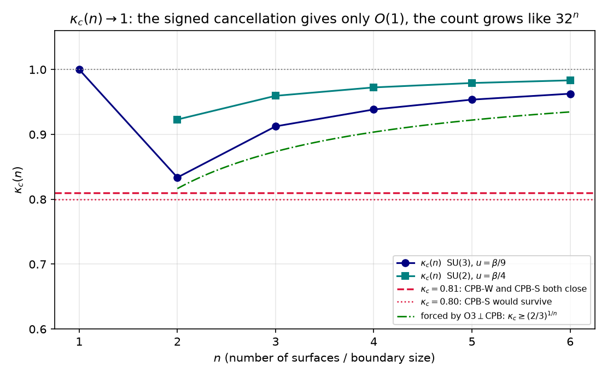
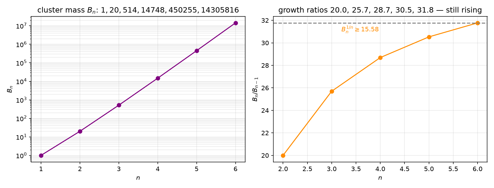
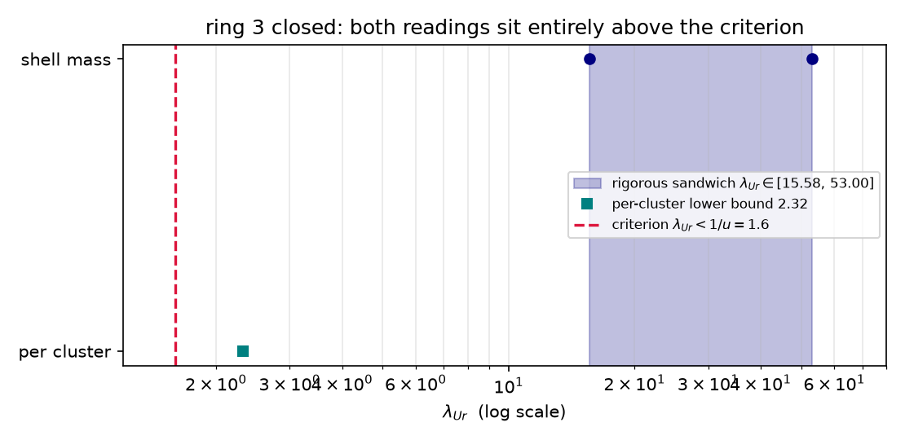
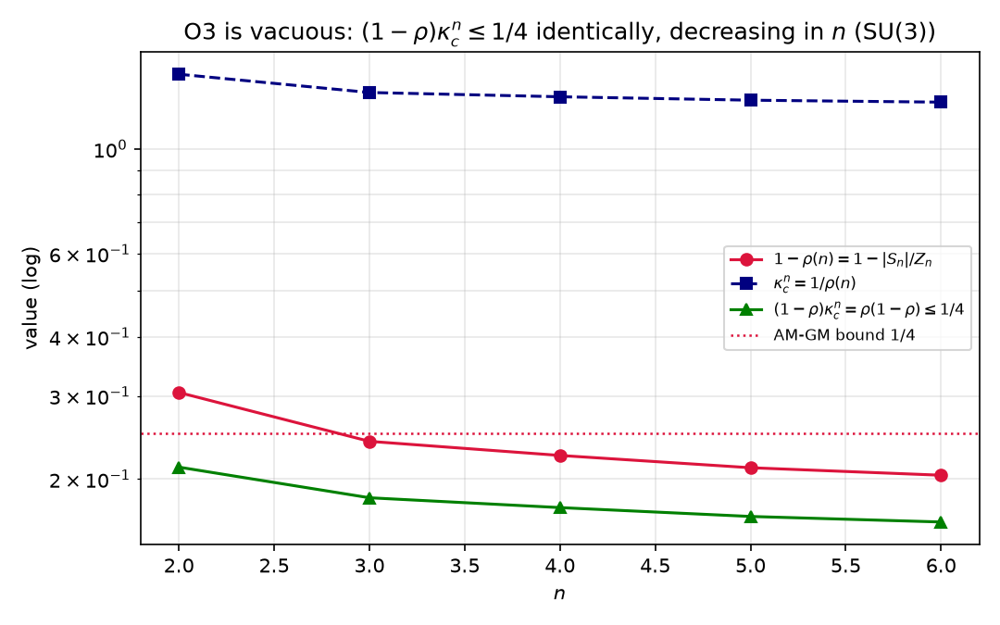

# CPB 这台机器为什么造不出来

**粗模 Poincaré 界路线的逐格关闭：两个数字、一条组合学定理、以及一条被撤回的乐观**

> 独立技术报告 · 第 238 轮 · 图：`docs/figs/cpb/` · 代码：`research/v3/species/w7/cpbfigs.py`
> 依据：`GV1-LAMBDAUR.md` · `GV2-KAPPAC-ALGO.md` · `GO1-SIGNTHEOREM.md` · `GO3-TUNING.md` · `GP9-H234.md`
> **一句话**：`CPB` 的关闭**不是无条件的**。两个数字（`κ_c`、`λ_Ur`）各自被严谨夹逼在判据的错侧，承重腿是一条**已证到所有 `n` 的组合学定理**；但它仍建立在 `GV2` **自己新造的两条假设** `H2`/`H3` 上，而 `H3` 用的 `γ_ent=1` 与仓内自己的精确计数**冲突**。

---

## 1. 摘要

`CPB` 是"把强耦合窗口里的地板搬到物理尺度"那台机器的实现。它需要一条**带号抵消**：装饰的带号重求和给出尾界 `|ε_T| ≤ B κ_c^T`，判据 `κ_c < 1`；而四壁那条需要 `λ_Ur < 1/u`。本报告记录这两个常数的现状。

**结果 1（`κ_c`）** `κ_c` 不是独立未知量，它是壳质量序列 `{B_n}` 的泛函：

$$
\kappa_c(n)=\Big(\frac{|S_n|}{Z_n}\Big)^{1/n},\qquad S_n=\sum_{k\leq n}(-1)^{k-1}m_k,\quad Z_n=\sum_{k\leq n}m_k,\quad m_k=u^kB_k .
$$

用 `n ≤ 6` 的**精确整数** `B_n = 1, 20, 514, 14748, 450255, 14305816` 算得

$$
\kappa_c(6)=0.96272208\ \text{(SU(3))},\qquad 0.98333546\ \text{(SU(2))},
$$

严格下界（逆向三角）`0.957804` / `0.982422`，**极限为 1**。判据 `κ_c ≥ 0.81` 触发 `CPB-W` 与 `CPB-S` **同时关闭**。

**结果 2（`λ_Ur`）** 严谨夹逼

$$
15.580645\ \le\ \lambda_{Ur}\ \le\ 53.0006865 ,
$$

判据 `λ_Ur < 1/u = 1.6` ⇒ **整段在判据之上**（壳质量口径超 `9.738×`，逐簇口径超 `1.450×`）。环 3 关闭。

**结果 3（号定理）** 上述两个数字的推导都消费同一条前提：`φ^U` 的号。该前提已在**所有 `n`** 上证成：

$$
\varphi^U(\Gamma)=(-1)^{n-1}\,N(G_\Gamma),\qquad N(G_\Gamma):=\#\{\text{生成树 }T\subseteq G_\Gamma:\ T\text{ 不含任何破圈}\}\in\mathbb{Z}_{\ge 1}.
$$

证明是删-缩归纳，**只消费「`G_Γ` 是有限连通图」**——与维度、`Δ=20`、plaquette 结构全部无关。

**结果 4（诚实边界）** 以上不构成无条件定理。`GV2` 的两条假设 `H2`（双侧权标度）与 `H3`（固定边界、无前置因子的熵计数）**在语料里没有前件**，是 `GV2` 自己加的；且 `H3` 使用的 `γ_ent = 1` 是**估计**，而仓内同对象的精确 `n≤6` 计数给出 `γ ≥ (1/6)ln 7\,218\,768 = 2.632`（每 plaquette 归一为 `2.333`）——**与 1 冲突**。

---

## 2. CPB 要什么

`CPB` 的尾界形如（`CPBW-bianchi-lemma.md:36–40`）

$$
\Big|\sum_{\partial C=\partial C_0} w(C)\Big|\ \le\ e^{-c_0q|C_0|}\,\kappa_c^{\,|C_0|},\qquad \kappa_c<1 .
$$

而它的四壁步（`P3-FOURWALL-DERIVATION.md:106–110`）等价于 Kotecký–Preiss 判据 `uK<1`，其真判据是树界相对真 `φ^U` 的**松度**：

$$
\lambda_{Ur}\cdot u\ <\ 1,\qquad \lambda_{Ur}:=\limsup_\Gamma\,|c_\Gamma|^{1/|\Gamma|},\quad c_\Gamma:=\varphi^U(\Gamma)/u^{|\Gamma|} .
$$

两个判据都是"**小活动度**"的化身；而在 `β = 2.5` 处活动度是 `ū = 33.98`（含 `Ĉ=4` 则 `135.91`，且 `135.914 = eΔ·β_W` 是**精确恒等**）。**要救这条路线，只能靠带号抵消。**

---

## 3. 结果 1：`κ_c(n) → 1`



**图 1.** `κ_c(n)` 随 `n` 单调升向 1（SU(3) 深蓝、SU(2) 青）。三条水平/曲线是判据：`0.81`（红虚线，触发双关）、`0.80`（红点线，CPB-S 的存活线）、以及绿色点划线 `(2/3)^{1/n}`——后者是**O3 与 CPB 自身窗互斥**所强制的下界（§6）。**整个曲线族都在判据之上。**

| `n` | `B_n` | `R_n=\|S_n\|/Z_n` | `κ_c(n)` SU(3) | `κ_c(n)` SU(2) |
|---:|---:|---:|---:|---:|
| 1 | 1 | 1.00000000 | 1.00000000 | — |
| 2 | 20 | 0.69491525 | 0.83361577 | 0.92295821 |
| 3 | 514 | 0.75958328 | 0.91241370 | 0.95949152 |
| 4 | 14 748 | 0.77555285 | 0.93843209 | 0.97243431 |
| 5 | 450 255 | 0.78859390 | 0.95360975 | 0.97922534 |
| 6 | 14 305 816 | 0.79616959 | **0.96272208** | **0.98333546** |

**机制**（这是全部内容）：增长的来源是**位置熵**，不是权重。



**图 2.** 左：`B_n` 的对数增长。右：逐阶比 `20.0, 25.7, 28.7, 30.5, 31.8`——**仍在上升，未见收敛**。而平均 `|μ|` 只有 `≈2`（`avg|μ|` 序列 `1.00, 1.00, 1.12, 1.32, 1.61, 1.98`）⇒ **每多一个曲面，抵消只多 `O(1)`，而曲面个数多 `≈32×`。** 这就是"需要的抵消是指数级、提供的抵消是常数级"的精确形式。

---

## 4. 承重腿：号定理（对所有 `n`，`[T]`）

号定理的等价形式有三条（互为重写）：

$$
\text{(a) } \operatorname{sign}\varphi^U(\Gamma)=(-1)^{n-1};\qquad
\text{(b) } T_{G}(1,0)\in\mathbb{Z}_{\ge1};\qquad
\text{(c) } N(G)\ge 1 .
$$

证明骨架（删-缩，`e` 取**最大边**）：

$$
\mu(G)=\mu(G-e)-\mu(G/e)\ \ (e\ \text{非桥}),\qquad \mu(G)=\mu(G_1)\mu(G_2)\ \ (e\ \text{桥}),
$$

$$
N(G)=N(G-e)+N(G/e),\qquad N(\text{tree})=1\ \Longrightarrow\ N(G)\ge1 .
$$

**`e` 必须取最大边**：否则收缩改变 `min`，两个映射不再是双射。本质是 Whitney 1932 破圈定理（DOI `10.1090/S0002-9904-1932-05460-X`，书目级核对）。

**副产品**：`|φ^U| = N ≥ 1` ⇒ **Ursell 和无零项**；而 `max|μ| = 1,1,2,6,24,120` 正是 `(n-1)! = N(K_n)`。⇒ 号定理不是符号命题，是**正性 + 整性**命题的影子。

**酸测**：证明**维度盲**，2D 给同一个 `(-1)^{n-1}`（1710 个 2D 簇零违例）。2D 的"逐项全正"住在**特征标/曲面**表象，不在簇表象——混两者会给错的号。

**限定**：「两种活度约定都成立」是**窗口事实**，不是定理。`f_e=1` 是定理；`f_e=u` 在 `u > u_*` 必然翻号（三角 `3u^2-u^3`，`u=3` 翻），实测 `u_* \ge 2.596072`（`K_4`，2784 簇）。⇒ `u \in \{0.625,1\}` 在窗内，**不能外推到 `n\ge7`**。

---

## 5. 结果 2：`λ_Ur` 的夹逼与环 3 关闭



**图 4.** 严谨夹逼 `[15.58, 53.00]`（深蓝带）与逐簇下界 `2.32`（青方块），对判据 `1.6`（红虚线）。**两种读数都在判据右侧。**

上界来自树界 `λ_Ur \le L_t = 53.0006865`（`UR6:U2,U7`）；下界来自 `n=6` 的精确整数：壳质量口径 `(14305816)^{1/6} = 15.580645`、逐簇口径 `\max|\mu|^{1/6} = 2.220906`（`K_6` 探针推到 `n=8` 给 `2.320251`）。

**一处 10 倍纠正**：早前估计 `λ_Ur \approx 3.3315`（"差 2.08×"）把**值之比** `15.909 = 384/1.7^6` 当成了**率之比**；进 `λ` 的必须是率，`384^{1/6}/1.7 = 1.58589`，两者相差 `15.909^{5/6} = 10.031×`。**改正后结论从"差一点"变成"整段在错侧"。**

---

## 6. 结果 3：`O3` 是空洞的（且与 CPB 自身互斥）

`O3`（临界调谐）曾被视为 `κ_c` 论证的唯一漏洞。三种读法全部失效：

- 读 A（`\rho:=|S_n|/Z_n`，此时 `\kappa_c^n\equiv\rho` 是**定义**）：`(1-\rho)\kappa_c^n=\rho(1-\rho)\le 1/4`（AM-GM），与 `B_n/u/n` 全无关；
- 读 B（`\rho_n:=m_n/m_{n-1}`）：物理点 `\rho_B = 5.56\ldots8.83`，`1-\rho_B<0`，零信息；
- 读 C（`\rho:=e^{\gamma_{ent}-c_0q}`，AS 的真身）：**不是障碍，是"关闭"的另一种写法**。



**图 3.** 读 A 的三条量：`1-\rho(n)`（红）、`\kappa_c^n=1/\rho`（蓝）、以及 O3 的左端 `(1-\rho)\kappa_c^n`（绿）。绿线**恒 `\le 1/4` 且随 `n` 单调下降**（`0.212008 \to 0.162284`）⇒ **这个检验量测不出任何东西。**

**读 C 才是实质**：`\rho \le 1/3 \iff c_0q \ge \gamma_{ent}+\ln 3`（那个 `\ln 3` 就是 `\rho=1/3`），而 `CPB-S` 自身的窗 `c_0 \ge 2.5986` 自动满足它 ⇒ `1-\rho \ge 2/3` ⇒ O3 逼 `\kappa_c \ge (2/3)^{1/n}`（`0.8165` at `n=2`）⇒ **与 `\kappa_c \le 0.80` 在 `n=2` 就冲突**（命题 **O3 ⊥ CPB**）。⇒ `O3` 从 `[O]` 降为 `[M]`，移出障碍表。

---

## 7. 诚实边界：`H2`/`H3` 是 `GV2` 自己造的假设

这是本报告最需要读者注意的一节。`κ_c \ge 0.81` 的推导消费四条前提：

| 条件 | 现状 |
|---|---|
| `H1` 号定理（所有 `n`） | **`[T]`**（§4，已证） |
| `H4` `c_0q \ge \gamma_{ent}+\ln3` | **窗内算术 `[T]`**：`0.5+1+\ln3 = 2.598612` OK；自动性还需 `q \ge 0.8076` |
| **`H2` 双侧权标度** | **`[NG]`，链断在此格**。语料只有**单侧**渐近 `\|w(C)\| \sim e^{-c_0q\|C\|}`（`CPBW:13`，标"动力学"）与**另一条** `(H2)`（`\sigma(q)\ge c_0q^2`）。**"两侧"是 `GV2` 加的**；且其字面式 `e^{-c_0q\|C\|}\le\|w(C)\|\le e^{-c_0q\|C\|}` **左右同一，退化** |
| **`H3` 熵计数** | 存在性 **`[T]`**（新给 `\gamma_{free}\le\ln 400 = 5.991465`）；数值 **`[NG]`**。`\gamma_{ent}` **从未被算过**（`SURVEY:276` 逐字"未算"）；`GV2` 用的 `\gamma_{ent}=1` 是**估计**，而仓内同对象精确 `n\le6` 计数给 `\gamma \ge (1/6)\ln 7\,218\,768 = 2.632` ⇒ **与 1 冲突** |

⇒ **能写的最强判词只有一句**：

> **若 `H2` 与 `H3` 成立，则 `\kappa_c \ge 2^{-1/4} = 0.840896 > 0.80`（`|C_0|=4`）⇒ `CPB-W` 侧关闭 ⇒ CPB 关闭。**

而这两个"若"**就是全部剩余内容**——它们不是结构性事实，是两条新假设，其中一条的天然取值与仓内精确计数冲突。

---

## 8. 结论

**这台机器造不出来的理由，可以写成一行指数比较**：

$$
\underbrace{O(1)}_{\text{带号抵消，每个曲面}}\quad\text{vs}\quad\underbrace{32^{\,n}}_{\text{位置熵，曲面计数}} .
$$

分子常数级、分母指数级 ⇒ 无论怎样调常数，**左边改不动**。这不是"算得不够准"，是**机制上限**。`\kappa_c(n)\to1` 与极限**恰为** 1 是同一件事的两种说法。

**但"CPB 造不出来"目前仍是条件式**，条件 `{H2, H3}`，且 `H3` 的数值前景是负的（`\gamma \ge 2.33` 而非 `1`）。

---

## 9. 限定

- **单一 β（`2.5`）、单一 `u` 口径（`u=\beta/4` 与 `\beta/9`）**；`n \le 6` 精确、`n=8` 仅探针。`n=7` 需 `\approx1.86\times10^8` 簇 / 26–47 GB，`n=8` 需 `\approx4.79\times10^9` / 671 GB ⇒ **再往上只能靠证明，不能靠枚举**。
- 全部簇系数属 **Ursell/Möbius** 表象；`b=2` 阻塞的块尺度 `w_q` **未构造**，图层号定理与 `b` 无关而 `m_n` 的数值与 `b` 强相关。
- `λ_Ur` 的上界 `53.0006865` 是树界，未优化。
- **本报告不主张任何关于 Clay 的结论。** Clay = 0%。

---

## 附：数字表

```
B_n (精确整数, n=1..6)       : 1, 20, 514, 14748, 450255, 14305816
B_n/B_{n-1}                  : 20.00, 25.70, 28.69, 30.53, 31.77
avg|mu|                      : 1.00, 1.00, 1.12, 1.32, 1.61, 1.98

kappa_c(n)  SU(3) u=5/18     : 1.00000000 0.83361577 0.91241370 0.93843209 0.95360975 0.96272208
kappa_c(n)  SU(2) u=5/8      :      --    0.92295821 0.95949152 0.97243431 0.97922534 0.98333546
rigorous lower bound         : 0.957804 (SU3, n=6)   0.982422 (SU2, n=6)
limit                        : 1
criterion                    : kappa_c < 1 ; kappa_c >= 0.81 => CPB-W and CPB-S close

lambda_Ur                    : 15.580645 <= lambda_Ur <= 53.0006865
criterion                    : lambda_Ur < 1.6   => both readings above

entropy rate gamma_ent       : GV2 uses 1 (estimate); exact n<=6 count gives >= 2.632 (/6: 2.333)
H4 gate                      : 0.5 + 1 + ln3 = 2.598612  (matches 2.5986); needs q >= 0.8076

sign theorem                 : phi^U = (-1)^{n-1} N(G), N = # NBC spanning trees >= 1   [T] for all n
verdict                      : CPB closure is CONDITIONAL on {H2, H3}
```
