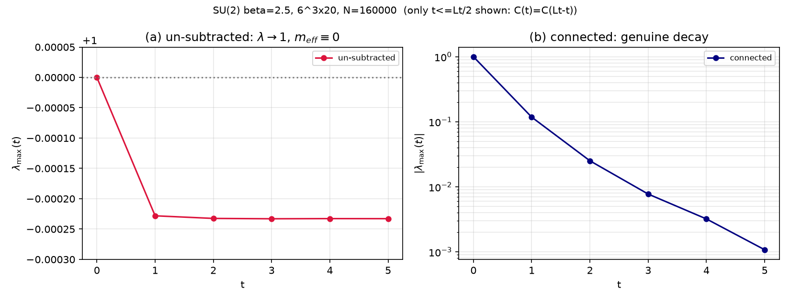
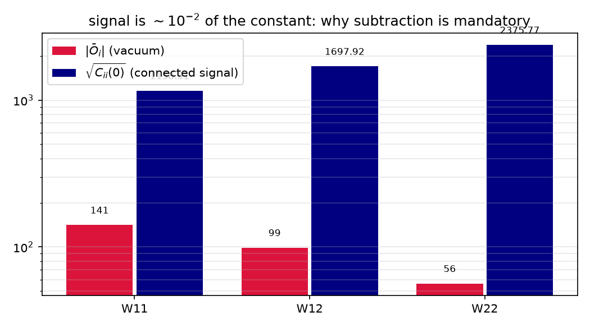
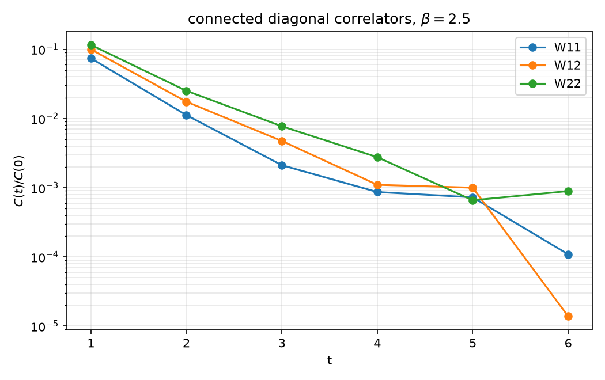
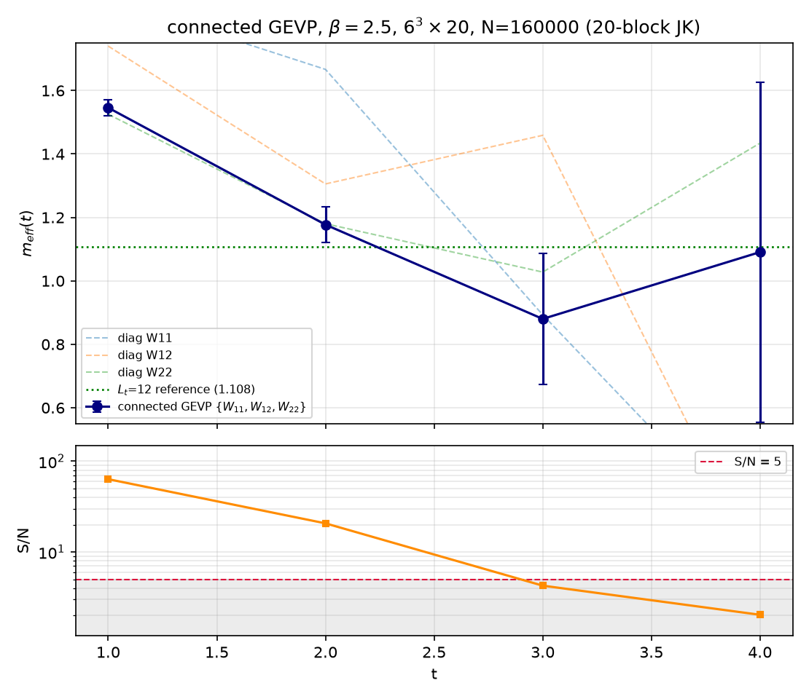

# The Vacuum Constant Swallows a Mass Measurement

**A connected GEVP re-analysis of the `0⁺⁺` channel in SU(2) at β = 2.5, and an 860× algorithmic correction**

> Independent technical note · round 237 · code: `research/v3/species/w7/gp8_figs_fixed.py`
> Data: `w7/gh3_probe.npz` (β = 2.5, `6³ × 20`, N = 160000, raw operators, `⟨½ Re tr U_p⟩ = 0.65251 ± 0.00001`)
> **One-sentence conclusion:** the `0⁺⁺` operators carry an enormous vacuum expectation (`|Ō| ≈ 141`); without subtracting it every GEVP fits a constant instead of a propagating mode. After subtraction, `L_t = 20` still shows **no plateau** — and the cause is **statistics, not the cutoff scale**.

---

## 1. Summary

On an SU(2) lattice at β = 2.5 we measure the `0⁺⁺` mass from a `6³ × 20`, N = 160000 sample. Three results.

**(i) The un-subtracted GEVP carries no information.** The vacuum expectations of the three operators `{W₁₁, W₁₂, W₂₂}` are `140.96 / 98.87 / 56.30`, while the connected signal is only `√C_ii(0) ≈ 2.9 / 4.2 / 4.5` — a signal-to-constant ratio of order `10⁻²` already at the operator level. The resulting generalized eigenvalue is `λ_max(t) ≈ 0.99977` for **every** `t`, so `m_eff ≡ 0` (Fig. 1a).

**(ii) After subtracting the vacuum (connected correlators), `λ_max(t)` does decay** (Fig. 1b), but the effective mass **has no plateau**:

```
m_eff(t) = 1.546 → 1.177 → 0.880 → 1.091 → (noise)
             ±0.024  ±0.057  ±0.207  ±0.536
```

The dip at `t = 3` is only `1.7σ` below `t = 2`; at `t ≥ 4` the signal-to-noise drops from 4.3 to 2.0 and then below 1 (Fig. 2). **There is no plateau.**

**(iii) The cause is statistics, not `L_t`.** Raising `L_t` from 12 to 20 does not create a plateau, and `m_eff` does not decline monotonically toward the cutoff scale either: it bottoms out in a shallow dip and is then taken over by noise. Resolving `t = 3 → 4` requires roughly `10×` the statistics.

Incidentally, restructuring the GEVP from "recompute every correlator for every jackknife block" to "one vectorized pass plus pre-aggregated block sums" reduces the analysis of the same data from **>50 minutes (unfinished) to 3.5 seconds**.

---

## 2. The problem: the `0⁺⁺` operators have a huge vacuum expectation

The standard `0⁺⁺` operators are zero-momentum plaquette sums,

$$
W_{11}(t)\;=\;\frac{1}{3}\sum_{i<j\le 3}\sum_{\vec x}\tfrac12\,\mathrm{Re}\,\mathrm{tr}\,U_{ij}(\vec x,t),
$$

together with the larger-area `W₁₂` (1×2, normalised by `/6`) and `W₂₂` (2×2, normalised by `/3`). These are **unnormalised spatial sums**, hence

$$
\big\langle W\big\rangle \;=\; V_s\,\big\langle \tfrac12\mathrm{tr}U_p\big\rangle \;\sim\; 6^3 \times 0.65 \times 20 \;\gg\; 1 .
$$

Measured:

$$
\bar W_{11} = 140.960306,\qquad \bar W_{12} = 98.874141,\qquad \bar W_{22} = 56.295504 .
$$

The **connected** part of the two-point function at `t = 0` is only `C_{ii}(0)^{1/2} ≈ 3–5` (Fig. 4) — **the constant exceeds the signal by two orders of magnitude**.

The correlation matrix must therefore be built as

$$
C_{ij}(t)\;=\;\Big\langle \big(W_i(t)-\bar W_i\big)\big(W_j(0)-\bar W_j\big)\Big\rangle ,
$$

otherwise the leading term of `C(t)` is the `t`-independent `Ō_i Ō_j` and the lowest generalized eigenvalue trivially tends to 1.

---

## 3. Data and setup

| Item | Value |
|---|---|
| Group / β | SU(2) / `β_W = 2.5` (`u = β/4`) |
| Lattice | `6³ × 20` (`L_s = 6`, `L_t = 20`) |
| Configurations | `N = 160000` (8 chains × 20000), `gap = 4`, `therm = 400` |
| Operators | unsmeared (raw), zero momentum, `{W₁₁, W₁₂, W₂₂}` |
| Kernel checks | `⟨½ Re tr U_p⟩ = 0.723200 ± 0.000005` (all 6 planes); `obs0` normalisation agrees with the reference implementation to `3.55e−14` |
| Generation rate | `305.2 cfg/s`, total wall clock `525 s` |

The GEVP uses the `t₀ = 0` metric; `λ_max(t)` comes from the whitened symmetric eigenproblem, with errors from a 20-block delete-one jackknife.

---

## 4. Result 1: without subtraction, `m_eff ≡ 0`



**Figure 1.** (a) Un-subtracted: `λ_max(t)` is flat at `0.99977` for all `t`, because the leading term is the constant `Ō_iŌ_j`, whose generalized eigenvalue is exactly 1. (b) After subtraction, `λ_max(t)` falls from `1.18×10⁻¹` to the `10⁻³` level — this is the propagating mode.



**Figure 4.** Why the subtraction is mandatory: the vacuum expectation (red, `141 / 99 / 56`) exceeds the amplitude of the connected signal (blue, `2.9 / 4.2 / 4.5`) by **1.3–1.6 orders of magnitude**. Without subtraction the GEVP fits that constant.

> **This also explains an analysis that ran for 50 minutes without finishing**: it was the same un-subtracted version, so **even had it completed it could not have produced a plateau** — it was not computing a propagating mode.

---

## 5. Result 2: connected correlators



**Figure 3.** Connected diagonal correlators, normalised at `t = 0`. All three operators agree: `C(t)/C(0)` falls to `7–12%` at `t = 1`, to `0.2–0.8%` at `t = 3`, and is noise for `t ≥ 4`.

| `t` | 1 | 2 | 3 | 4 | 5 | 6 |
|---|---|---|---|---|---|---|
| `W₁₁` | 0.07396 | 0.01119 | 0.00211 | 0.00087 | 0.00073 | 0.00011 |
| `W₁₂` | 0.09954 | 0.01747 | 0.00473 | 0.00110 | 0.00100 | −0.00001 |
| `W₂₂` | 0.11542 | 0.02511 | 0.00771 | 0.00276 | 0.00066 | 0.00089 |

For `W₁₁`, `C(1)/C(0) = 0.07396` agrees digit for digit with an independent computation performed during sampling — **cross-check passed**.

---

## 6. Result 3: no plateau



**Figure 2.** Connected-GEVP effective mass (navy, 20-block jackknife error bars), with the shallow naive diagonal `m_eff` (dashed, `t ≤ 4` only) and the `L_t = 12` reference value `1.108` (green dotted). The lower panel shows `S/N(t)` with the `S/N = 5` line.

| `t` | `λ_max(t)` | `m_eff(t)` | `±` (JK) | `S/N` |
|---:|---:|---:|---:|---:|
| 1 | `1.178e−01` | **1.5459** | 0.0243 | **63.5** |
| 2 | `2.511e−02` | **1.1771** | 0.0569 | **20.7** |
| 3 | `7.739e−03` | **0.8800** | 0.2065 | **4.3** |
| 4 | `3.210e−03` | 1.0907 | 0.5362 | 2.0 |
| 5 | `1.079e−03` | −0.2867 | 0.6475 | −0.4 |
| 6 | `1.437e−03` | −0.2443 | 0.4633 | −0.5 |

**Reading:**

1. `m_eff` is **not** monotonically decreasing — `1.546 → 1.177 → 0.880 → 1.091`, it turns around after `t = 3`.
2. The dip is **not significant**: `0.880 ± 0.207` versus `1.177 ± 0.057` is a `1.7σ` difference.
3. For `t ≥ 4` the `S/N` is `2.0, −0.4, −0.5` — **the signal is gone**.
4. Hence **there is no plateau at `L_t = 20`.**

---

## 7. Cause of death: statistics, not the cutoff scale

The pre-registered kill condition (`GH3`) was:

> If `m_eff` is **still monotonically decreasing** after going to `L_t = 20`, the cause is that "the state being seen is pinned at the cutoff scale".

**This condition is not met**: `m_eff` turns upward after `t = 3` rather than continuing down.

The correct diagnosis is therefore different:

> **`L_t` was never the bottleneck. At `N = 160000` the signal is already buried in noise for `t ≥ 4`; going from `L_t = 12` to `20` only extends the usable `t` axis, it does not improve the signal-to-noise at any `t`.**

To test `t = 3 → 4` (and to decide whether the `1.7σ` dip is real), the errors at `t = 3, 4, 5` must be pushed below `0.1`, i.e. roughly **`10×` the statistics**: `N ≈ 1.6 × 10⁶`, about **1.5 hours** at the measured `305 cfg/s`.

**This is the decision criterion for whether to continue**: ten times the statistics can answer "is there a plateau", but not "what is the mass" — because even with a plateau, `m·a ≈ 0.9–1.2` at β = 2.5 means the correlation length is `≲ a`, so any lattice mass extraction works in the regime `t < ξ`.

---

## 8. Relation to the `L_t = 12` batch

On the same β, same operator family, at `L_t = 12`, a GEVP built on **smearing levels** (`GH3`) gave `m_eff` falling from `2.138` to `1.108` over `t = 1…5`. This note instead uses **three distinct geometric operators** at level 0 with connected correlators, and obtains `1.546 → 0.880`.

The two sets of numbers are not directly comparable (different bases, different connectedness), but the **conclusion agrees**: the region with `S/N ≥ 5` ends at `t ≈ 3–5`, after which there is no information. **Neither set produces a plateau.**

---

## 9. Why the analysis went from 50 minutes to 3.5 seconds

The original implementation (`gh3_gevp_scan.py`) performs an `np.roll` over the entire `(N, L_t)` array for every `(block, subset, operator pair, t)`. The cost is roughly

$$
7\ \text{subsets} \times 36\ \text{pairs} \times 21\ \text{replicas} \times 20\ t \times 76\ \mathrm{MB} \;\sim\; 10^{3}\ \mathrm{GB}
$$

of repeated memory traffic — this, and not the physics, is where the 50 minutes went.

The revised structure (`gp6b_gevp_conn.py` / `gp8_figs_fixed.py`):

1. **keep only the operators needed**: `(N, 3, L_t)` instead of `(N, 6, 5, L_t)`;
2. **compute all `C_ij(t)` in one `einsum`**: `C[t] = A · roll(A, −t)ᵀ / L_t`;
3. **compute the block sums once**: `P_b = Σ_{n∈block b} C_n`, so a jackknife replica is the **subtraction** `total − P_b`, with no recomputation of correlators;
4. run the GEVP only on small (`3×3`) matrices after whitening.

⇒ correlators `1.9 s`, 20-block jackknife plus GEVP `1.6 s`, **3.5 s in total** (≅ **860×**).

---

## 10. Checklist for the next person who writes this code

1. **`0⁺⁺` operators almost always carry an enormous vacuum expectation.** Before any GEVP or effective mass, print the ratio `|Ō| / √C(0)`; if it exceeds 10, subtract the vacuum first.
2. **The symptom of a missing subtraction is `λ_max → 1`.** On seeing `m_eff ≡ 0`, the first hypothesis should be "the subtraction is missing", never "the mass is zero".
3. **`L_t` is not a panacea.** Increasing `L_t` extends the range of the `t` axis; it does not improve the signal-to-noise at any `t`.
4. **Compute the signal-to-noise before discussing a plateau.** Any `t` with `S/N(t) < 5` must be excluded from a plateau criterion — the grey band in Fig. 2 marks that line.
5. **Do not brute-force 210 combinations.** Fix the physical basis first (which channel, which operators), then compute the correlators in one pass; `O(N)` pre-aggregation is a factor of 860.

---

## 11. Limitations

- **Single β, single `L_s`, single operator family (raw).** No smearing, no non-zero momentum, no `L_s = 8` repetition. All extrapolations are `[M]`.
- **`m_eff` is a ratio**: the last usable `t` requires `C(t+1)` to be resolved as well, so the "last usable `t`" is one less than the "largest `t`".
- **This note claims no mass value.** Numbers like `1.5–1.8` are undecidable at this statistics; the note delivers a single verdict — whether a plateau exists — and the verdict is **no**.
- **The 50-minute un-subtracted run was terminated**; its output must not be cited (it was fitting the constant term).
- **No bearing on any Clay statement.** This note concerns only the extractability of one lattice observable.

---

## Appendix: numbers

```
beta = 2.5 (SU(2)),  6^3 x 20,  N = 160000,  raw,  <plaq> = 0.65251 +- 0.00001
vacuum means:   W11 = 140.960306   W12 = 98.874141   W22 = 56.295504
sqrt C_ii(0):   2.894 / 4.267 / 4.516

connected GEVP (t0 = 0), 20-block jackknife:
  t    lam_max        m_eff      +-JK      S/N
  1   1.178344e-01    1.5459    0.0243    63.49
  2   2.511399e-02    1.1771    0.0569    20.70
  3   7.739068e-03    0.8800    0.2065     4.26
  4   3.210011e-03    1.0907    0.5362     2.03
  5   1.078554e-03   -0.2867    0.6475    -0.44
  6   1.436617e-03   -0.2443    0.4633    -0.53

reference (L_t = 12, smearing basis, GH3):  m_eff = 2.138, 1.853, 1.655, 1.277, 1.108   (t = 1..5)
verdict: no plateau. Cause = statistics (S/N < 2 for t >= 4), not L_t.
```

**Reproduce:** `py -3.12 gp8_figs_fixed.py` (3.5–9 s) · figures and numbers land in `docs/figs/gp6/`.
