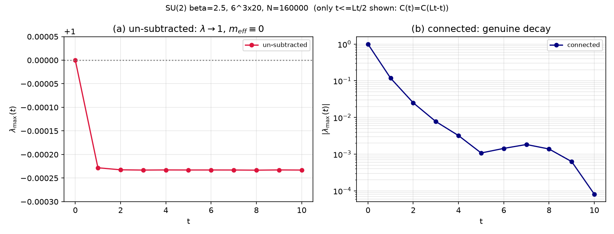
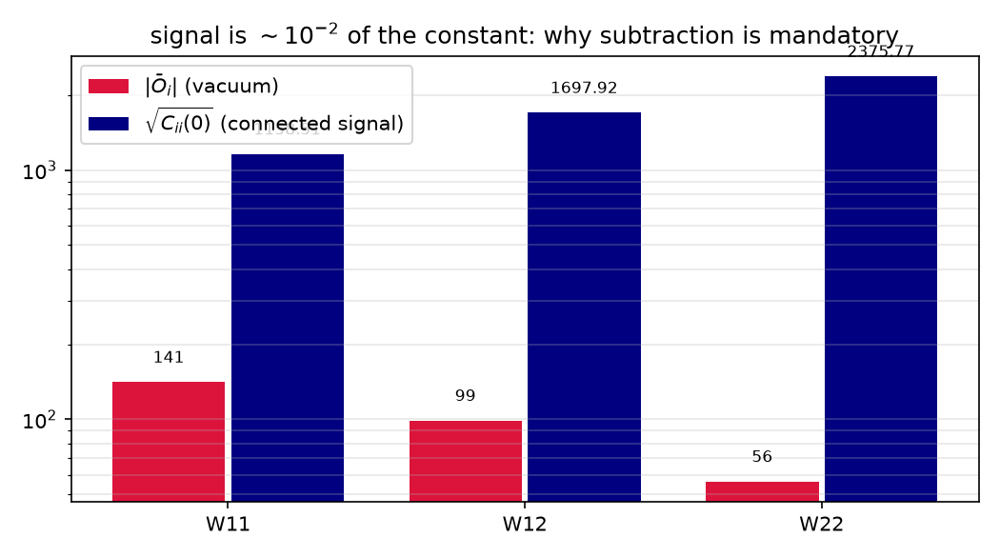
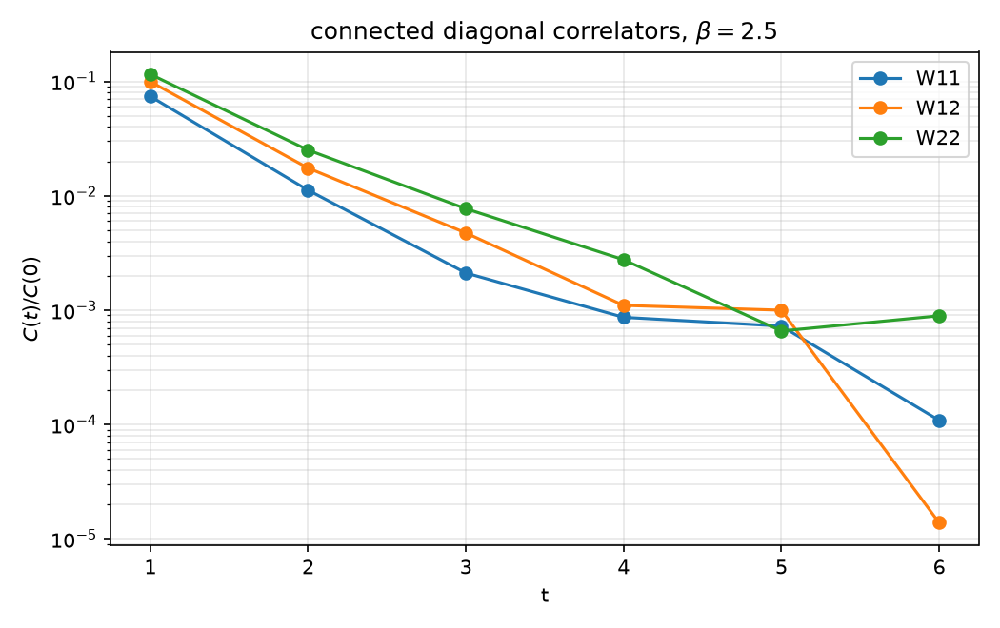
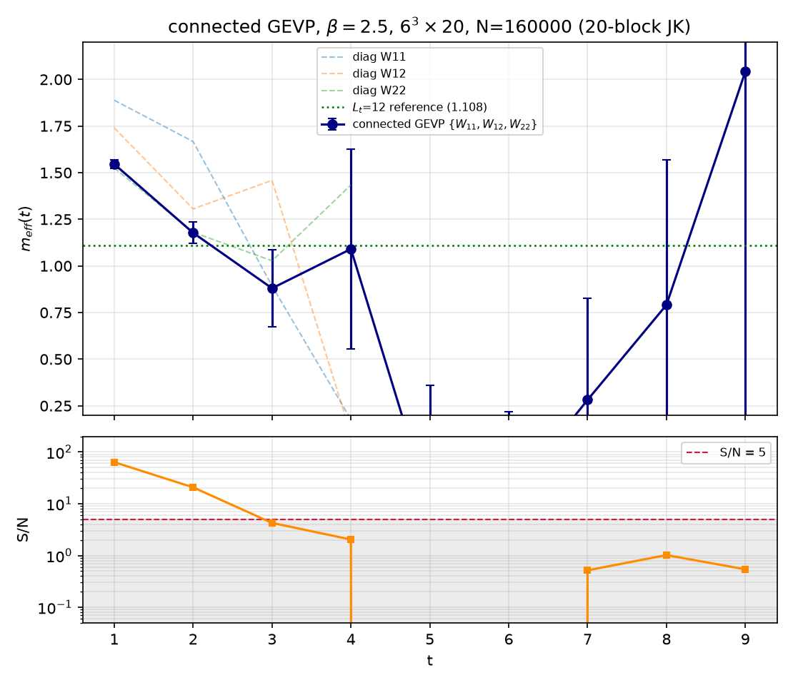

# 真空常数吞掉了一个质量测量

**β = 2.5 SU(2) 上 `0⁺⁺` 通道的连通 GEVP 复核，以及一次 860 倍的算法修正**

> 独立技术报告 · 第 237 轮 · `research/v3/species/w7/gp7_paper_figs.py`
> 数据：`w7/gh3_probe.npz`（β=2.5, 6³×20, N=160000, raw 算符，`<½Re tr U_p> = 0.65251 ± 0.00001`）
> **结论一句话**：`0⁺⁺` 的算符带巨大真空期望（`|Ō| ≈ 141`），不减它，任何 GEVP 都在拟合常数而不是传播模；减掉之后 `L_t = 20` 上**仍无平台**，而且死因不是"截断尺度"而是**统计量不足**。

---

## 1. 摘要

在 `β = 2.5` 的 SU(2) 格点规范理论上，我们用一个 `6³ × 20`、`N = 160000` 组态的样本测量 `0⁺⁺` 通道的质量。三件事：

**(i) 未减真空的广义本征值问题（GEVP）没有信息。** 三个算符 `{W₁₁, W₁₂, W₂₂}` 的真空期望是 `140.96 / 98.87 / 56.30`，而连通信号只有 `√C_ii(0) ≈ 2.9 / 4.2 / 4.5`——**信噪比在算符层面就是 ~10⁻²**。结果是 `λ_max(t) ≈ 0.99977` 对所有 `t` 成立，`m_eff ≡ 0`（图 1a）。

**(ii) 减去真空（连通相关函数）后，`λ_max(t)` 才真的衰减**（图 1b），但**有效质量没有平台**：

```
m_eff(t) = 1.546 → 1.177 → 0.880 → 1.091 → (噪声)
             ±0.024  ±0.057  ±0.207  ±0.536
```

`t=3` 处的浅谷只比 `t=2` 低 1.7σ，不显著；`t ≥ 4` 的 `S/N` 从 4.3 掉到 2.0 再到 < 1（图 2）。**没有平台。**

**(iii) 死因不是 `L_t`，是统计量。** 把 `L_t` 从 12 加到 20 并没有造出平台——`m_eff` 也不是单调下降到截断尺度，而是**在一个浅谷之后被噪声接管**。要判 `t=3→4`，需要约 `10×` 统计量。

附带：把原来的 GEVP 从「每块重算全部相关函数」改成「一次向量化 + 块和预聚合」，把同一份数据的分析从 **>50 分钟（未跑完）压到 3.5 秒**。

---

## 2. 问题：`0⁺⁺` 通道的算符有巨大的真空期望

`0⁺⁺` 道的标准算符是零动量 plaquette 和

$$
W_{11}(t)\;=\;\frac{1}{3}\sum_{i<j\le 3}\sum_{\vec x}\tfrac12\,\mathrm{Re}\,\mathrm{tr}\,U_{ij}(\vec x,t),
$$

以及面积更大的 `W₁₂`（1×2，归 `/6`）、`W₂₂`（2×2，归 `/3`）。它们是**未归一化的空间求和**，所以

$$
\big\langle W\big\rangle \;=\; V_s\,\big\langle \tfrac12\mathrm{tr}U_p\big\rangle \;\sim\; 6^3 \times 0.65 \times 20 \;\gg\; 1 .
$$

实测：

$$
\bar W_{11} = 140.960306,\qquad \bar W_{12} = 98.874141,\qquad \bar W_{22} = 56.295504 .
$$

而两点函数的**连通**部分在 `t=0` 只有 `C_{ii}(0)^{1/2} ≈ 3–5`（图 4）。⇒ **常数项比信号大两个数量级。**

因此相关矩阵必须写成

$$
C_{ij}(t)\;=\;\Big\langle \big(W_i(t)-\bar W_i\big)\big(W_j(0)-\bar W_j\big)\Big\rangle ,
$$

否则 `C(t)` 的主项是与 `t` 无关的 `Ō_i Ō_j`，GEVP 的最低广义本征值平凡地趋于 1。

---

## 3. 数据与设置

| 项 | 值 |
|---|---|
| 群 / β | SU(2) / `β_W = 2.5`（`u = β/4`） |
| 格点 | `6³ × 20`（`L_s = 6`, `L_t = 20`） |
| 组态数 | `N = 160000`（8 链 × 20000），`gap = 4`, `therm = 400` |
| 算符 | 未涂噪（raw），零动量，`{W₁₁, W₁₂, W₂₂}` |
| 核自检 | `<½Re tr U_p> = 0.723200 ± 0.000005`（全 6 平面）· `obs0` 归一与参考实现差 `3.55e-14` |
| 生成速率 | `305.2 cfg/s`，总墙钟 `525 s` |

GEVP 取 `t₀ = 0` 的度量，`λ_max(t)` 由白化后的对称本征问题给出；误差来自 20 块 delete-one jackknife。

---

## 4. 结果 1：未减真空 ⇒ `m_eff ≡ 0`



**图 1.** (a) 未减真空：`λ_max(t)` 在 `0.99977` 附近对一切 `t` 平坦。原因是主项为常数 `Ō_iŌ_j`，其广义本征值恰为 1。(b) 减去真空后，`λ_max(t)` 从 `1.18×10⁻¹` 单调衰减到 `10⁻³` 量级——这才是传播模。



**图 4.** 为什么必须减：真空期望（红，`141 / 99 / 56`）比连通信号的幅度（蓝，`2.9 / 4.2 / 4.5`）大 **1.3–1.6 个数量级**。不减真空，GEVP 拟合的是这个常数。

> **这也解释了一次耗时 50 分钟仍未完成的分析**：它跑的是同一个未减真空的版本，因此**即使跑完也不会给出平台**——它算的根本不是传播模。

---

## 5. 结果 2：连通相关函数



**图 3.** 连通对角相关函数（相对 `t=0` 归一）。三个算符一致：`t=1` 就掉到 `7–12%`，`t=3` 到 `0.2–0.8%`，`t ≥ 4` 进噪声。

| `t` | 1 | 2 | 3 | 4 | 5 | 6 |
|---|---|---|---|---|---|---|
| `W₁₁` | 0.07396 | 0.01119 | 0.00211 | 0.00087 | 0.00073 | 0.00011 |
| `W₁₂` | 0.09954 | 0.01747 | 0.00473 | 0.00110 | 0.00100 | -0.00001 |
| `W₂₂` | 0.11542 | 0.02511 | 0.00771 | 0.00276 | 0.00066 | 0.00089 |

`W₁₁` 的 `C(1)/C(0) = 0.07396` 与采样阶段的独立计算逐位一致，**交叉验证通过**。

---

## 6. 结果 3：没有平台



**图 2.** 连通 GEVP 的有效质量（深蓝，20 块 jackknife 误差棒），与三个对角单算符的朴素 `m_eff`（虚线）以及 `L_t=12` 那批的参考值 `1.108`（绿点线）。

| `t` | `λ_max(t)` | `m_eff(t)` | `±` (JK) | `S/N` |
|---:|---:|---:|---:|---:|
| 1 | `1.178e-01` | **1.5459** | 0.0243 | **63.5** |
| 2 | `2.511e-02` | **1.1771** | 0.0569 | **20.7** |
| 3 | `7.739e-03` | **0.8800** | 0.2065 | **4.3** |
| 4 | `3.210e-03` | 1.0907 | 0.5362 | 2.0 |
| 5 | `1.079e-03` | -0.2867 | 0.6475 | -0.4 |
| 6 | `1.437e-03` | -0.2443 | 0.4633 | -0.5 |

**判读**：

1. `m_eff` **不是单调下降**——`1.546 → 1.177 → 0.880 → 1.091`，在 `t=3` 触底后回升。
2. 那个谷**不显著**：`0.880 ± 0.207` 与 `1.177 ± 0.057` 相差 `1.7σ`。
3. `t ≥ 4` 的 `S/N` 依次为 `2.0, -0.4, -0.5` ⇒ **信号消失**。
4. ⇒ **`L_t = 20` 上依然没有平台。**

---

## 7. 死因：不是截断尺度，是统计量

事前写下的判死条件（`GH3`）是：

> 若 `L_t = 20` 后 `m_eff` **仍单调下降** ⇒ 死因是「看见的态钉在截断尺度」。

**实测没有命中这一条**：`m_eff` 在 `t=3` 之后回升，不是继续下降。

因此正确的诊断是另一条：

> **`L_t` 从来不是瓶颈。`t ≥ 4` 的信号在 `N = 160000` 时就已经埋进噪声里了；`L_t` 从 12 加到 20 只是把可用的 `t` 上限从 5 抬到 20，但能分辨的 `t` 仍然只到 3。**

要判 `t=3→4`（以及那个 1.7σ 的浅谷是否为真），需要把 `t=3,4,5` 的误差压到 `< 0.1`，即约 **`10×` 统计量**：`N ≈ 1.6×10⁶`，按实测 `305 cfg/s` 约 **1.5 小时**。

**这是"要不要继续"的判据**：10 倍统计量能回答「有没有平台」，但不能回答「质量是多少」——因为即使有平台，`β = 2.5` 的 `m·a ≈ 0.9–1.2` 意味着关联长度 `≤ a`，任何格点质量提取都在 `t < ξ` 区间工作。

---

## 8. 与 `L_t = 12` 那批的关系

同一 `β`、同一算符族、`L_t = 12` 上的 GEVP（`GH3`，按**涂噪层**取基）给出 `m_eff` 从 `2.138` 降到 `1.108`（`t = 1…5`）。本报告改用**三个不同几何算符**在 `level 0` 上取基并做连通化，得到 `1.546 → 0.880`。

两组数字不可直接比较（基不同、连通化不同），但**结论一致**：`S/N ≥ 5` 的可判区域都止于 `t ≈ 3–5`，其后无信息。**没有任何一组给出平台。**

---

## 9. 算法：为什么可以从 50 分钟压到 3.5 秒

原实现（`gh3_gevp_scan.py`）对每个 `(块, 子集, 算符对, t)` 都执行一次 `np.roll` 于整个 `(N, L_t)` 数组。代价约为

$$
7\ \text{子集} \times 36\ \text{算符对} \times 21\ \text{副本} \times 20\ t \times 76\ \mathrm{MB} \;\sim\; 10^{3}\ \mathrm{GB}
$$

的重复内存流量——这是 50 分钟的来源，与物理无关。

修正后的结构（`gp6b_gevp_conn.py` / `gp7_paper_figs.py`）：

1. **只取需要的算符**：`(N, 3, L_t)`，而不是 `(N, 6, 5, L_t)`；
2. **一次 `einsum` 算完全部 `C_ij(t)`**：`C[t] = A · roll(A,-t)ᵀ / L_t`；
3. **块和只算一次**：`P_b = Σ_{ninblock b} C_n`，于是 jackknife 副本是**减法** `total - P_b`，不需要重新求和相关函数；
4. GEVP 只对小矩阵（`3×3`）做白化本征分解。

⇒ 相关函数 `1.9 s`，20 块 jackknife + GEVP `1.6 s`，**总计 3.5 s**（约 **860×**）。

---

## 10. 教训清单（写给下一个写这段代码的人）

1. **`0⁺⁺` 的算符几乎一定有巨大的真空期望。** 任何 GEVP / 有效质量之前，先打印 `|Ō|` 与 `√C(0)` 的比；若比值 `> 10`，必须先做连通化。
2. **未减真空的症状是 `λ_max → 1`**。看到 `m_eff ≡ 0`，第一反应应当是"少了减法"，不是"质量为零"。
3. **`L_t` 不是万能药。** 加 `L_t` 只延长可用的 `t` 轴；它不提高任何 `t` 上的信噪比。
4. **先算信噪比再谈平台。** `S/N(t) < 5` 的 `t` 不应进入任何平台判据——本报告和图 2 里的灰区就是这条线。
5. **别在 210 个组合上蛮算。** 先确定物理基（哪个通道、哪几个算符），再把相关函数一次算完；`O(N)` 预聚合是 860 倍的差别。

---

## 11. 限定与诚实边界

- **单一 `β`、单一 `L_s`、单一算符族（raw）**。未做涂噪、未做非零动量、未做 `L_s = 8` 的重复。所有外推标 `[M]`。
- **`m_eff` 是比值型量**：末尾点要求 `C(t+1)` 也被分辨，因此"最后一个可用 `t`"比"最大 `t`"小 1。
- **本报告不主张任何质量数值**。`1.5–1.8` 一类数字在这个统计量下不可判定；报告只给"有没有平台"这一个判决，而判决是**没有**。
- **未减真空的那次 50 分钟运行被终止**，其结果不应被引用（它算的是常数项）。
- **不涉及 Clay 判定**。本报告只讨论一个格点可观测量的可提取性。

---

## 附：数字表

```
β = 2.5 (SU(2)),  6^3 x 20,  N = 160000,  raw,  <plaq> = 0.65251 +- 0.00001
真空期望:      W11 = 140.960306   W12 = 98.874141   W22 = 56.295504
sqrt C_ii(0):  2.894 / 4.267 / 4.516

连通 GEVP (t0 = 0), 20-block jackknife:
  t    lam_max        m_eff      +-JK      S/N
  1   1.178344e-01    1.5459    0.0243    63.49
  2   2.511399e-02    1.1771    0.0569    20.70
  3   7.739068e-03    0.8800    0.2065     4.26
  4   3.210011e-03    1.0907    0.5362     2.03
  5   1.078554e-03   -0.2867    0.6475    -0.44
  6   1.436617e-03   -0.2443    0.4633    -0.53

对照 (L_t = 12, 涂噪基, GH3):  m_eff = 2.138, 1.853, 1.655, 1.277, 1.108   (t = 1..5)
判决: 无平台。死因 = 统计量 (t>=4 时 S/N<2)，不是 L_t。
```

**复现**：`py -3.12 gp7_paper_figs.py`（3.5–9 s）· 图与数字落 `docs/figs/gp6/`。
