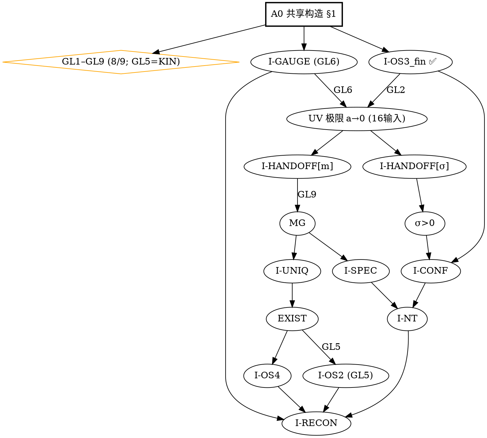

# 接口契约与胶合：让九个子结果组合成同一个 Yang–Mills 构造

> **版本注记（路线记账）**：O(4) 的路线/目标记账为 **v3**，**取代 v1/v2**。v1 的"`B⊂C`"与 v2 的"删掉 `B⊂C`"均作废——两者分别指 `C(a)` 与 `C(b)`。现行版本：`C(a)=O1(a)`（带速率）、`C(b)=C′=O1(b)`（无速率）；**`B ⊂ C(a)` 成立（各向同性切片，非恒等）**，`B` 与 `C(b)` 不可比。详见 §2.1。
>
> 2026-11-22 · 范围：4D 纯 Yang–Mills，G 紧单连通单群。
> 本报告**不产生新的物理定理**。它产生的是**可检查的组合契约**：一份共享构造（"脊梁"）、九个类型化接口、一组**无人负责的粘合引理**（§3）、依赖图与拓扑序（§4）、循环依赖的破环方案（§5）、以及**兼容性风险登记表**（§6）。
> 结论先行：**九个子结果中至少六处默认表述互不兼容**（§6 R0/R17/R19/R20/R21/R23；R18 已由 `os2` 澄清为"两本账"而非冲突）；组合所需的**九个粘合引理**已分配给 glue-a/b/c/d（§3.4），目前**已证 0/9**（目标 ≥3）；其中 **GL2a（RP 保持分块）** 干净且为真，而 **GL2b（隙传输）** 被两个 session 的方向写反了——Cauchy 交错给出 `Δ_coarse ≥ Δ_fine`（上界方向），下界需要截断控制而非 RP。`Handoff.lean` 的 `cert : ℝ→ℝ` 形状已与主 session 对齐（`mass_gap_of_certificate`），但 `q₀ ≥ q₁` 不在 16 输入内（R25）。

---

## 0. 摘要

### 0.1 一句话

Clay 问题需要的是**一个**理论。九个 session 各自证明的是**九个可能属于不同理论的命题**。把它们变成同一个理论的命题，需要四件事：(i) 一份共享构造，(ii) 接口的输入/输出类型对得上，(iii) 谁都不认领但组合必需的桥接引理，(iv) 循环依赖的破环。本报告给出这四件事。

### 0.2 关键判断（八条）

1. **极限顺序必须是"先 UV 后 IR"的分步序列，不能是联合极限。** `a→0`（固定物理体积 L）先行，`L→∞` 后行。理由：固定 L 的 UV 问题由渐近自由 + Balaban 控制；固定 a 的 IR 问题需要格点单位的隙，弱耦合下无此工具。代价是**关于 L 的一致界**——这正是 MG 要交付的东西。联合极限 `(a,L)→(0,∞)` 目前没有任何一致性工具，任何接口若默认联合极限都必须改写。（§1.6、风险 R3）

2. **规范不变表述不是偏好，是 OS3 的必要条件。** 若用全局规范固定（Lorenz/Coulomb），Faddeev–Popov 行列式变号，反射正性的锥**不闭合**，转移矩阵不再是正算子。因此：**对外公理化一律在规范不变子代数上做，规范固定只作为 Balaban 小场展开的内部计算装置，且必须证明其输出与规范无关（Ward/BRST）**。这把"gauge invariance"接口从"一条要证的定理"降级为"一条要证的**兼容性**引理"（GL6），同时把 OS3 变成构造性的。（§1.5、§2.3）

3. **OS2（旋转不变性）不是输入，是输出。** 格点上只有超立方群 H ⊂ O(4)。O(4) 的**增强**只能发生在 `L→∞` 的极限里，因此 OS2 在依赖序上**排在 MG 与唯一性之后**。任何把 OS2 当作"格点对称性"直接引用的接口都是错的。（§2.1、风险 R2）

4. **MG 必须表述为关于有限体积族 `{μ_{L,a}}` 的命题，而不是关于极限的命题。** 否则 `MG ⇄ 唯一性` 成环。破环：MG 说的是"`μ_{L,a}` 的中性扇区关联以**关于 L 一致**的速率指数衰减"，这在任何极限存在之前就有意义；唯一性是它的推论而非前提。（§5.1）

5. **面积律与质量隙是同一堵墙上的两个 certificate，逻辑独立，必须各证一次。**（2026-11-22 晚：这堵墙的**唯一候选机制**是**带号抵消 `κ_c`**（`CPB-W` 需 `κ_c≲0.80`）；**`dF=0`/Bianchi 本身不足**（R37），且 **BL-6 判定默认 `κ_c≈1` ⟹ 两侧在当前机制下无已知路线**（R38，判定而非定理）。`CPB-W` 与 `CPB-S` 共用 `κ_c`，见 §3.5.2 与台账「共同缺口」行。**2026-11-23：数值侧 IMC（NP-1）也关闭 ⟹ `CPB` 两侧同时关闭，除非新架构。**）** confinement session 已给出：`m/Λ` 与 `√σ/Λ` 并列，判据同构（`m→√σ`），扇区不同（中性胶球 vs 带电弦）。因此 `I-HANDOFF` 必须**按 certificate 参数化**，而不是硬编码 `m`。（§2.7、风险 R8）

6. **交接接口必须区分"证书"与"被估的数"。** `cert : ℝ→ℝ`（依赖 μ 的**下界证书**）与 `Δbar := Δ/Λ`（**单个**被估的物理量）是两个对象，靠语义桥 `hcert : ∀μ, cert μ ≤ Δbar` 连接。若把 `cert` 读作物理隙，则弱侧假设 `δ_W ≤ m/μ` 在 `μ→∞` 不可满足；若把 `cert` 塌缩成常数，则 `H3` 不参与结论、覆盖论证消失。**只有"函数 `cert` + 语义桥"这一形式既量纲自洽又使 `H3` 非空洞。**（§2.7、§5.2、R0/R21）

7. **`q₀ ≥ q₁` 不在 16 输入内**（`handoff-audit` §0/§3）。16 输入只覆盖 UV 极限、子列无限体积、OS 重构、应力张量/Ward、迹反常、一圈 running、OPE、有限格点桥；**不覆盖**强耦合控制、弱→强交接、质量隙速率、无限体积唯一性、禁闭。它必须作为**新输入（或新定理）**显式声明，不得伪装成已有输入。（R25）

8. **九个粘合引理已全部分配（glue-a/b/c/d），其中 8/9 已完成（唯一缺 GL7）**：5 条纯无条件（GL1 审计、GL2a、GL4-引理、GL5-KIN、GL6）+ 3 条蕴含（GL3/`UVS∧UVS-L`、GL8/`IN-3(G)∧IN-4(G)`、GL9/`CPB-W`）；**GL5 动力学未决、GL8-U 属 `IN-8`**——故 8/9 不是「全解」。 尤其 GL2a（RP 保持的分块）与 GL5（O(4) 增强）是**结构性**的，不属于任何单个 session，却是九变一的全部内容；GL2b（隙传输）的方向须按 Cauchy 交错写成 `Δ_coarse ≥ Δ_fine`。（§3）

### 0.3 与会话的分工

| 本报告 | 上游输入 |
|---|---|
| 共享构造、接口签名、粘合引理、依赖图、风险 | `docs/yang-mills-prior-work.md`（问题坐标、16 输入、MG） |
| 交接接口的参数化推广 | `research/physics_handoff.md`（`q` 判据、H0–H3） |
| 双 certificate、扇区分离 | `research/confinement/REPORT.md`（`σ=c_σΛ²`、`E₀(L)`、面积律⊥MG） |
| 待接入 | `os2-rotation`、`os3-reflection-positivity`、`uniqueness`、`nontriviality`、`gauge-invariance`、`group-uniformity`、`mass-spectrum`、`lean-infra` |

---

## 1. 共享构造（脊梁）

**规则：九个接口中的每一个都必须逐字引用本节的定义，不得自带变体。** 任何偏离都要在 §6 登记为风险。

### 1.1 群与拓扑

```
G          : 紧、单、单连通 Lie 群        -- 结构群取 G 的单连通覆盖
            （SU(N)、Spin(N)、Sp(N)、G₂、F₄、E₆,₇,₈）
hG         : CompactSimple G
dimG, N_G  : 仅这两个不变量可进入常数（见 I-GROUP）
```

- **结构群 = 单连通覆盖 `G̃`**。SO(3) 与 SU(2) 的格点理论不同（中心涡旋、't Hooft 通量），必须固定为 `G̃`。对 `G` 非单连通的情形，结论只对 `G̃` 陈述，并在 I-GROUP 中注明。
- **拓扑：`T⁴_L`（周期边界），`L = N·a`，`N ∈ ℕ`。** 最终极限 `L→∞` 给出 `ℝ⁴`。
- **固定 `θ = 0`、固定 't Hooft 通量扇区 = 平凡扇区。** 理由：`T⁴` 上的测度按拓扑荷 `Q` 与 't Hooft 通量 `m ∈ (ℤ_N)^{C(4,2)}` 分块；`ℝ⁴` 上的 OS 理论对应 `θ=0`、平凡通量。`|Q|` 的分布在无限体积下的控制是独立风险（R14），**不在本契约内解决**，故显式排除。
- **不允许的拓扑**：`S⁴`（无平移不变性，无转移矩阵）、开边界（破坏反射正性的超平面选择）、`T⁴` 的非平凡通量扇区（中心对称破缺，I-CONF 会被 't Hooft 代数约束成周长律）。

### 1.2 格点与测度

```
a          : ℝ>0                          -- 格距
L          : ℝ>0,  N := L/a ∈ ℕ            -- 物理边长
Λ_{L,a}    : (ℤ/Nℤ)⁴  带格距 a           -- 格点环面
E(Λ)       : 有向边集（4N⁴ 条）
U          : E(Λ) → G                     -- 连接变量
dU         : Haar 概率测度（每边一个）
S_W(β)     : β/N · Σ_p (1 − Re tr U_p)    -- Wilson 作用量，U_p 沿 plaquette 有序积
β          : 2N_c / g_bare²               -- N_c = 基本表示的维数归一（见下）
μ_{L,a,β}  : 概率测度 ∝ exp(−S_W(β)) ∏_e dU_e   on  G^{E(Λ)}
Z_{L,a}(β) : 配分函数
```

- **作用量取 Wilson（基本表示）**，不取 Manton/adjoint/improved。理由：Wilson 作用量是**已知反射正性**的最简选择（Osterwalder–Seiler 1978），而 RP 是承重的（§3 GL2）。改进作用量（Symanzik）虽有更好的 `a²` 行为，但其 RP 需要单独证明，**不在第一阶段**。
- **归一化约定（E4，`glue-c` 审计后钉死）**：**`N_c := dim f`，即定义表示（defining/fundamental）的维数**；`β := 2N_c/g²`。于是作用量权重系数是 `γ := β/N_c = 2/g²`，**只有 `γ` 有物理意义**。记法对照：`SU(N)` 的 `N_c=N`，`SO(2n+1)` 的 `N_c=2n+1`，`Sp(n)` 的 `N_c=2n`。
- **`γ` 是不变量，但两种写法必须区分：**
  (i) **归一化迹**：`β Σ_p (1 − (1/N_c) Re tr U_p)`，用 `β = 2N_c/g²`（SU(3), g²=1 → `β=6`）；
  (ii) **裸形式**：`exp(k Σ_p Re tr U_p)`，系数 `k = 2/g² = β/N_c`（SU(3), g²=1 → `k=2`）。
  写反任何一个，理论都变成 `g'² = g²/N_c`。`γ := β/N_c = 2/g²` 是两者共同的物理系数。这条已作为 GL1 审计的 E1 记入 §3.5。
- **测度是概率测度**：`Z^{-1}` 归一。这对 OS0–OS1 的陈述至关重要（`S₀ = 1`）。

### 1.3 可观测代数

```
Obs_{L,a}  : 规范不变局部算子的 *-代数（由 Wilson 环、traced 场强多项式、
             沿路径的 parallel transport 的迹 生成，smear 后取闭包）
S^{(n)}    : Obs^n → ℂ,  Schwinger 函数  S^{(n)}(f₁..f_n) = ∫ ∏φ(f_i) dμ
θ          : 反射  (t,x) ↦ (−t,x)，作用于连接：空间边固定、时间边取逆并共轭
H_hyp      : 超立方群  (ℤ/2)⁴ ⋊ S₄  ⊂ O(4)
C_RP       : 反射正性锥  { A ∈ Obs_{t>0} : A 仅依赖 t>0 半空间的连接 }
```

- **一切公理化陈述都在 `Obs` 上，不在全连接代数上。** 这是 §1.5 的直接后果。
- Schwinger 函数用**光滑紧支测试函数** smear；OS0–OS1 的陈述层用 `𝒮(ℝ⁴)`（复用 `OSforGFF` 的 `𝒮′` 框架，见 prior-work §4.3）。

### 1.4 重整化轨迹（RT）与参数轨迹

这是**最容易在组合时静默失配**的地方，必须写死。

```
RT :  a ↦ (β(a), g_bare(a))   单参数族，参数化为一个 scheme 常数 C
二圈渐近自由：
    1/g²(a) = 2b₀ log(1/(aΛ)) + (b₁/b₀) log log(1/(aΛ)) + C + o(1)
    b₀ = 11 N_c/(48π²),  b₁ = 34 N_c²/(3(16π²)²)   [SU(N) 值；一般 G 用 C₂(adj) 表达]
```

- **RT 由"一条常数物理线"定义**：固定一个 scheme-无关的纯数（例如 `m/Λ` 或 `√σ/Λ` 的**目标值**不作为输入；实际做法是固定 `C`）。不同的 `C` 是不同的 RT。**九个接口必须用同一个 `C`。**
- **`Λ` 的含义**：本报告 `Λ` = QCD 标度（dimensionless transmutation 的标度）。**注意命名冲突**：confinement session 用 `Λ` 表示格点盒 `Λ ⊂ aℤ⁴`；prior-work 用 `Λ` 有时指 UV 截断 `1/a`。**本报告统一：`Λ` = QCD 标度，`Λ_{L,a}` = 格点环面，UV 截断记 `1/a`。**（这本身是一条风险，R15。）
- **scheme 不变性**：`g'² = g² + c g⁴` 下 `b₀` 不变，`Λ' = Λ e^{c/(2b₀)}`；`m/Λ`、`√σ/Λ`、`q = a/ξ` 不变。因此**契约可以在任一固定 scheme 中陈述**（WLOG），但**必须声明是哪一个**，且九个接口一致。
- **`Δ(n)` 的角色**：`Δ(n) = 4 log Z(n×n) − log Z(2n×2n)` 是 **certificate（MG 的 Lean 陈述）**，不是控制参数。它由 `Z` 之比构成，**自动 scheme-不变**，这使它可以作为最终验收对象。（confinement/prior-work 一致。）

### 1.5 规范选择：规范不变表述

**决定：不做规范固定（对外）；内部用逐块规范固定，并证明其输出与规范无关。**

| 层级 | 选择 | 理由 |
|---|---|---|
| 测度 | 连接变量上的 Haar × `e^{-S_W}`，**不插入任何规范固定项** | 自动规范不变；自动 RP |
| 可观测 | `Obs`（规范不变子代数） | OS3 的锥在规范不变代数上闭合 |
| 内部计算 | Balaban 逐块规范固定（把块变量规范固定到标准型以控制有效作用量） | 控制大场；**不进入最终陈述** |
| 桥接 | Ward 恒等式 / Slavnov–Taylor：固定规范下的规范不变期望 = 未固定下的期望 | GL6 |

**为什么这条是承重的**：若在对外测度上做全局规范固定，Faddeev–Popov 行列式 `det M` 在规范场空间上**变号**（Gribov），则
`⟨θA, A⟩ = ∫ \overline{A} A · det M · e^{-S} dA` 的符号不定，RP 锥不闭合，`T = e^{-aH}` 不再是正算子，**转移矩阵谱方法整体失效**。这是"gauge invariance"与"OS3"之间唯一真正的耦合点，也是把它排在 OS3 之前的理由。

### 1.6 极限阶梯（**非联合**）

```
阶段 0   (a, L) 有限，N = L/a ∈ ℕ。            -- 一切定义在此
阶段 1   a → 0，L 固定，沿 RT  β = β(a)。        -- "固定盒 UV 极限" → μ_L
阶段 2   L → ∞，界关于 L 一致（由 MG 提供）。    -- → μ（ℝ⁴ 上的 OS 测度）
阶段 3   在 μ 上做 OS 重构 → Wightman 理论 + 谱条件。
禁止     (a,L) → (0,∞) 联合极限。                -- 无一致性工具
```

**为什么必须这个顺序**

- **先 a→0**：固定 L 时 UV 问题是渐近自由的，Balaban 的 UV 稳定性 + RT 可交付 `μ_L` 的存在性与紧性（GL3）。
- **后 L→∞**：固定 a 时 IR 极限需要**格点单位**的隙/聚类（统计力学极限）；弱耦合下格点单位的隙 → 0，无工具。因此 IR 极限必须在已取 UV 极限的**连续统理论**上做，而连续统 IR 极限需要**关于 L 一致**的界——这正是 MG。
- **代价**：`μ_L` 的构造必须**关于 L 一致**（同一个 RT、同一组误差界）。这把"联合极限"的困难**转移**成"UV 极限的 L-一致性"，而后者正是 §3 GL3 + I-HANDOFF 的内容。

**`a` 与 `L` 的耦合方式**：通过 `N = L/a`，沿用 RT 上的 `β(a)`。**RT 不依赖于 L**——这是阶段 1 关于 L 一致的前提。若某接口的 RT 含 L（例如"固定 `σ L²`"），则阶段 1 与阶段 2 不可交换，须改回固定 `C`。（风险 R4）

### 1.7 分块（block-spin）方案

```
b          : 分块因子（整数，取 2）
B          : 分块映射  Config(a) → Config(ba)
             块内：每个 2⁴ 超立方 → 一个粗边
             粗边 := 沿块内测地路径的 parallel transport 的 群平均（Haar 卷积）
E_B        : 条件期望  L²(μ_fine) → L²(μ_coarse)   （对确定型分块 = 正交投影）
μ_coarse   : (E_B)_* μ_fine                        （pushforward）
S_eff      : −log dμ_coarse/dHaar                 （有效作用量）
```

**三条硬性约束**

1. **反射协变**：分块格必须与反射平面 `t=0` 对齐（块不跨越该平面）。这保证 `θ E_B = E_B θ`，从而 `E_B` 把 `C_RP` 映到 `C_RP`。（GL2 的前提）
2. **确定型 / 实值**：`S_eff` 必须是**实**的。OpenAI/Balaban 的 signed-gas 方案正是为保持实值。**禁止在有效作用量中出现复相**，否则 pushforward 的定义需要 signed measure 的严格处理，超出本契约。
3. **群平均而非选点**：粗边取群平均（Haar 卷积）而非"取路径积"，保证 `μ_coarse` 规范不变。选点分块会破坏规范不变性。

**为什么不用 Balaban 的原始逐块规范固定分块**：它固定块变量的规范，**不显然 RP 保持**（`E_B` 不再是 θ-协变的条件期望）。本契约的解法是把它拆开：分块本身用规范不变的群平均（RP 保持），Balaban 的规范固定只出现在**有效作用量的展开**里（内部装置，GL6 保证可去）。这是 §0.2 判断 2 的第二个应用。（风险 R1）

### 1.8 记号表（**必须先读**）

| 符号 | 含义 | 不可混用 |
|---|---|---|
| `Λ` | QCD 标度（transmutation） | 不是 UV 截断 |
| `Λ_{L,a}` | 格点环面 `(ℤ/Nℤ)⁴` | 不是标度 |
| `1/a` | UV 截断 | 不写 `Λ` |
| `L`, `N` | 物理边长、格点数 | `L = Na` |
| `β` | `2N_c/g²` | 不是 `1/g²` |
| `q` | `m/μ`（交接坐标） | 不是 `g²` |
| `Q` | 拓扑荷 | 不是 `q` |
| `C` | RT 的 scheme 常数 | 不是 `C_RP` |
| `C_RP` | 反射正性锥 | — |
| `Δ` | 物理质量隙 | `Δ(n)` 是 `Z` 之比 |
| `Δbar` | `Δ/Λ` 或 `√σ/Λ`，**单个**被估的数 | 不是 μ 的函数 |
| `cert μ` | 尺度-μ 分析给出的**下界证书** | **不是**物理隙 `m/μ` |
| `Δ(n)` | `4logZ(n²)−logZ(2n²)` | 不是质量隙 |
| `H3` | **总是**交接重叠（`q₁≤q₀` ∧ 同轨） | 与 OS2 的 `Γ-INV` 无关，不可互换 |
| `Γ-INV` | OS2 现在的假设：测度在 `R₁₂,R₁₃,R₂₄` 下不变 | 不由交接/倾斜格提供 |
| ~~`REG-IND`~~ | ~~`lim μ_inclined = μ`~~ **已废弃**（`os2` 删除；它是结论） | 若仍需：`H3 ∧ UNI ∧ SameRT ⟹ REG-IND`，反向不成立 |

---

## 2. 类型化接口

格式：每个接口给出 **固定**（它钉死的构造参数）、**导入**（requires）、**导出**（supplies）、**签名**、**假设→结论**、**这条接口独有的风险**。
签名是**规格伪 Lean**，不参与编译；由 `lean-infra` 翻译。

### 2.1 `I-OS2` — Euclidean 旋转不变性

```
【固定】 拓扑 T⁴_L；超立方群 H_hyp；RT（同一 C）；极限阶梯 §1.6（阶段 2 之后）
【导入】 EXIST（阶段 2 极限存在且唯一）、GL3（S^{(n)} 的收敛）、GL4（聚类传递）、
        RT 的无关性谱（H-破缺算符维数 ≥ 6）
【导出】 O(4)-不变测度 → I-RECON 的 OS2 字段；→ 谱条件/能动张量的协变性
```

**签名**

```lean
/-- 规格伪代码：不编译 -/
theorem OS2_rotation_invariance
  (S : ∀ n, (Fin n → TestFn) → ℂ)            -- 极限 Schwinger 函数
  (hS : ∀ n, Continuous (S n))               -- 作为分布收敛（GL3）
  (hH : ∀ E ∈ hypercubicGroup, ∀ n, S n ∘ E = S n)   -- 有限 a：H-不变（自动）
  (hIrrel : ∀ (O : LocalOp), gaugeInvariant O → ¬ O4Invariant O →
              dimOp O ≥ 6 ∧ (ScalingDim O > 4))      -- 无关性
  : ∀ E ∈ EuclideanGroup, ∀ n, S n ∘ E = S n
```

**假设 → 结论**

- **A1（有限 a，平凡）** `μ_{L,a,β}` 在 `H_hyp` 下不变。证明：Wilson 作用量与 Haar 测度逐边在 `H_hyp` 置换下不变。**这不是 OS2 的内容。**
- **A2（收敛，GL3）** `S^{(n)}_{L,a} → S^{(n)}` 作为 `𝒮((ℝ⁴)^n)′` 中的分布；界关于 `a` 一致（紧性）。
- **A3（无关性，真正的输入）** RT 的线性化在 Gaussian 不动点处**没有 H-保持但 O(4)-破缺的 relevant 或 marginal 方向**。等价的格点陈述：所有此类规范不变局部算符的标度维 `> 4`；最低的是维 6（例：`Σ_μ tr(D_μ F_{μν})²` 类，以及胶子传播子的 `a² Σ p_μ⁴` 项）。
- **结论** `S^{(n)}` 在 `O(4)` 下不变，且 `(x,y) ↦ S^{(2)}(x,y)` 只依赖 `|x−y|` 与不变张量结构。

**关键点（务必写进陈述层）**：OS2 的**全部内容**是 A3 的"无关性 + 增强"，不是 A1。A1 在任何格点理论里都成立（包括非 O(4)-恢复的理论）。**A3 是 RG 内容**：它说 H-破缺方向的耦合在连续极限里按 `a²` 消失。若某 session 把 OS2 陈述成"格点测度超立方不变"，那是空洞的。（风险 R2）

**O(4) 的目标层级：四条名目、三条独立（定稿）**

```
U2   : 每个极限旋转不变                       （≡ E1 ≡ `sym` 字段）
U2⁺  : U2 + 固定裸耦合下 s-无关
U1   : 所有正规化/子列的极限相同               （≡ hexagonmath O1；可由 O1(a) 或 O1(b) 供给）

U2 ⊂ U2⁺ ⊂ U1        （严格递增）
```

**2D 引理的位置**：Lemma 3.8 **精确证明 U2⁺**（两条精确关系 + 连续性 + 重叠 `2R−|d|>γ`，**无不动点假设**）。其**陈述**可搬到 4D，但**方法**在 4D 丢失精确性：承重的 (3.8) `G_{s+d} = (O_±^{-1})_* G_s` 是**两轨迹恒等式**，在 4D 退化为 `O(a²)`，即路线 B，只给**近似 U2**。**4D 的 U2⁺ 没有精确类比**——这是核心困难，也是"照抄 2D"必失败的原因。

**记账更正（按 `os2` 的 `ROUTE-D.md` 与命名规范定稿）**：
1. "R32 = 母输入 ⇒ U1 ∧ U2" **作废**；**R32 的内容就是 U1 = O1**（`O1(a)` 与 `O1(b)` 都蕴含它，见 v3）。
2. "U1 走 `O1(a)`"的 split **不作废**——它不是 2D 路线，但 U1 仍是**合法的独立目标**（走 C(a)）。
3. **C 有两个形式，B 与它们的关系不同**：`C(a)=O1(a)`（带速率）**蕴含 B**；`C(b)=C′`（唯一不动点，无速率）**不蕴含 B**。故 **`B ⊂ C(a)` 成立，而 `B` 与 `C(b)` 不可比**。此前两次相反的指令分别指 C(a) 与 C(b)。
4. **B 是 `C(a)` 的各向同性切片，不是恒等**——B 另带体积一致/`SYM-IR`，那是 `C(a)` 均匀性的一部分（`os2` 措辞，照抄）。

**源级发现（`uniqueness` 核实，本 session 复核；路径用 vendor 相对路径）**：
`vendor/YM-audit/submissions/openai-20261028/submission/YM/Phase/Mixture.lean:139` 的
`OS.Selection.Certificate` 有 `sym i : R.Oriented (C.ensemble i)`；
`vendor/YM-audit/submissions/openai-20261028/checks/SourceScalar.lean:34` 用它证
`scalarKernel_rotation` → `E1_rotation_invariant`。`CompleteOS.lean` 只证"证书字段 ⇒ E1"。
**U2 = 证明这个字段**。**GL5 的叙述：不是"缺输入"，而是"构造把一个假设放在了字段里"。**

> **`sym` 不是冗余字段（`os2` 判定，GL5 的"证书冗余性"设想作废）**：`R.Oriented` 是**有限**旋转协变
> `∀n v x K, S.useAt T (Points.move K x) (R.label K ∘ v) = S.useAt T x v`；`flux` 只是
> `Table.StressLaws … R.lie` 的**无穷小** Ward 恒等式。Ward 在任何有守恒对称应力张量的理论里都成立，
> **包括各向异性的**——各向异性 Gaussian 满足 `flux` 而不满足 `Oriented`。故"其余字段推出 `sym`"不成立。

| 路线 | 内容 | **目标** | 证明列输入 | 结论列 vs MG |
|---|---|---|---|---|
| ~~A（倾斜）~~ | — | — | — | 已撤回（R28） |
| ~~B（NP-SYM）~~ | — | — | — | 已否（R33） |
| **B** | `SYM-4D + SYM-IR`（2D 方法的退化） | **近似 U2** | 全部 dim-6 + 体积一致 | **纠缠**（`a²` 系数 = `∫⟨O;O_k⟩_c`） |
| **D** | **`(Q-CONS)`**：守恒对称应力张量 + 边界项 `B_g=0`；定理 S ⟹ `(NG)` ⟹ U2。`(NG-ℓ4)` 只是**必要**检验 | **U2**（若 `(Q-CONS)` 成立，U2 反成 MG 的推论） | `StressTensorDecay`（边界项） | **`(Q-CONS)` 不成立时结论列独立；证明列不独立** |
| **C(a) = `O1(a)`** | 两轨迹差估计，**带速率** `|C^{(1)}_N−C^{(2)}_N|≤Aκ^N` | **近似 U2（含 B）且 U1** | 两轨迹差估计（**新输入**） | 独立更强 |
| **C(b) = C′** | 唯一不动点，**无速率** | **仅 U1** | — | 独立；**与 B 不可比** |

**包含关系**：`B` 是 `C(a)` 的**各向同性切片，不是恒等**（B 另带体积一致/`SYM-IR`，属 `C(a)` 均匀性的一部分），故 **`B ⊂ C(a)`（判读）**；`B` 与 `C(b)` 不可比。

**独立路线计数**：`{C(a) ⊃ B}`、`C(b)`、`D` —— 三条独立，其中一条含 B。**不再使用裸 `C`**（别名映射见 §3.5）。

**一句话叙事**：**带速率的唯一性 `C(a)` ⇒ 近似 U2 且 ⇒ U1；不带速率的唯一性 `C(b)` ⇒ 仅 U1；B 是 U2 的直接近似；D 是 U2 的另一条独立路。**

**证明列 vs 结论列（关键记账）**：四条名目在**结论列**与 MG 的关系不同，但在**证明列都消费一个衰减型输入**，只是范围不同——B 要全部 dim-6 + 体积一致；D 只要一个应力/ℓ=4 通道（`StressTensorDecay`：积分 Ward 恒等式中空间无穷远的边界项须消失）；`C(a)` 要两轨迹差估计。故**"D 可能独立于 MG"只在结论列成立，证明列不独立**。**但若 `(Q-CONS)` 成立，连结论列也反转**——U2 由 MG + 守恒应力张量 + `B_g=0` 推出，`IN-2` 不再是独立输入（R36）。

**O(4) 非破缺的层级（`os2` §13/§9.2 定稿；此前的"三等价"作废）**：

```
(NG-ℓ4)  ⟸  (NG-ℓ4^T)  ⟸?  (NG)  ⟺  U2
```

- **`(NG-ℓ4)`**：所有连通两点函数的 **ℓ=4 投影为零**——**必要，不充分**。W-不变函数在 `S³` 上有 `ℓ=4,6,8,…` 多个通道；**杀 `ℓ=4` 不杀 `ℓ≥6`**。
- **`(NG-ℓ4^T)`**：**应力张量**两点函数的 ℓ=4 投影为零——最锐中间形式（`2⊗2 = 0⊕1⊕2⊕3⊕4`，`T–T` 含 ℓ≥6 但 ℓ=4 单列）。
- **`(NG)`**：`Q_g Ω = 0` 对所有 `g ∈ so(4)`——**定义**，且 `⟺ U2`。

**D 的核心是 `(Q-CONS)`，不是 ℓ=4**：

```
定理 S： Q 反自伴、[H,Q]=0 于 Ω 定义域、ker H = ℂΩ  ⟹  QΩ = 0   （三行，不用 Goldstone）
局部 Ward 只给： [H,Q_g] = i B_g ,   B_g = lim_{R→∞} ∮_{|x|=R} x_{[i}T_{j]k} n_k
(Q-CONS)： B_g = 0
```

链条：**MG + 守恒对称应力张量 + `(Q-CONS)` ⟹ `(NG)` ⟹ U2**。**这是条件反转**：若 `(Q-CONS)` 成立，则 **U2 是质量隙的推论**，`IN-2` 不再是独立输入。

**决定性检验：已做，结果 `REVERSAL-OPEN`**（`os2` `check-d14.py`，exit 0，四个一般动量一致；本 session 复跑）：

```
A(p) = λ p_μ p_ν (p_μ² − p_ν²) ≠ 0            ⟹ Noether T 不对称
改进基：δ_{ρν} p_μ p² − δ_{μν} p_ρ p²，  ε_{ρμνσ} p_σ p²
两者经 p_ρ 收缩恒为零                          ⟹ 改进像 = {0}
```

故有质量 ℓ=4 高斯**没有对称守恒 `T`**，不满足 `Conserved.symmetric`，**不是反例**。

**收窄**：(i) **自由**的非旋转不变标量理论一律无对称守恒 `T`（角动量不守恒）⟹ 反例必须**有相互作用**；(ii) 按谱论证，有相互作用 + 对称守恒 `T` + 真空破坏旋转需要**无隙模式**，与质量隙矛盾 ⟹ 反转**可信但未证**；(iii) 无质量各向异性高斯只检验 `(NG-ℓ4)`，**不能**决定反转。

**分离模型（对 `(NG-ℓ4)` 有效）**：无质量各向异性高斯 `Ĉ(p)=|p|⁻²(1+εh₄(θ))` 满足平移、W-不变、RP、应力 Ward，却违反 `(NG-ℓ4)`。故 `(NG-ℓ4)` 不能从 {平移, W, RP, StressLaws} 推出——这是 R34 的解析版。**但它不检验 `(Q-CONS)`**；有质量模型也不能**判定** `(Q-CONS)`——它只是**排除了自身作为反例**（见上）。

**`kills` 只是局部影子**：`Stress.lean:51` 的 `Table.Rotation.kills` 升级到有限 `R.Oriented` 需要 (K1)–(K5)，其中 **(K2)（轨道导数恒等式，等价 `Q_g Ω = 0`）是承重步且不在 `StressLaws` 里**。

> **Lean 冗余性测试：阻塞、未做**——上游 10,259 文件 / 9,470 模块，本地仅有 OSforGFF 的 Mathlib oleans，无 `YM.*` oleans，完整 `lake build` 需数小时 + 数十 GB。判定为结构性。**不得**记为"已机器验证"。

**最锐利的攻击点（正面前沿）**：`Stress.lean:51` 的 `Table.Rotation.kills`（`R.lie d a (S.unit d)=0`）配合 `StressLaws.rotation` 在 `B=unit` 处给出 `shellSpin=0`——**局部角度流消失**。这是现有材料里离 `sym` 最近的事实，但**不是有限协变**。

**2D 致命步骤的更正**：不是秩/Niven（Prop D 已克服），而是**一维流/超可重整**——2D 只有 1 个耦合 ⇒ 无各向异性算符 ⇒ Lemma 3.8 精确；4D 流无穷维 ⇒ `D₆ ≠ 0` ⇒ 只剩 `O(a²)`。这解释了为什么"照抄 2D"必失败。

**纠缠的精确表述（取代旧版）**：**结论列**——B 与 MG 纠缠，`C(a)/C(b)` 独立更强，D 可能独立；**证明列**——三条都消费衰减型输入（见上）。§4 的图注据此按两列分别标注，不再笼统说"三条都纠缠"或"三条都独立"。

**`os3` 判据仍适用**：`B₁₂/B₁₃` 通不过 `(B1)`；**轴对齐 RG** 是定理推论（§6.2）。

---

### 2.2 `I-OS3` — 反射正性

```
【固定】 θ 关于 t=0；C_RP 取 t>0 半空间；分块与反射平面对齐；Obs 规范不变
【导入】 无（在有限 (L,a) 上自足）；分块需 GL2（RP 保持）；极限需 GL4（锥弱闭）
【导出】 转移矩阵 T = e^{−aH} ≥ 0 存在；H ≥ 0；
        → I-UNIQ 的聚类（经 T 的谱）；→ I-SPEC 的谱表示；→ I-CONF 的 E₀(L) 表示
```

**签名**

```lean
theorem OS3_reflection_positivity
  (μ : Measure (Config L a))
  (hRP : ∀ A ∈ C_RP, 0 ≤ ∫ (θ A) * A ∂μ)                 -- 有限 a（Osterwalder–Seiler）
  (hBlock : ∀ (B : BlockMap), ReflectionCovariant B →        -- GL2
              ∀ A ∈ C_RP, 0 ≤ ∫ (θ (E_B A)) * (E_B A) ∂μ_coarse)
  : ∃ (H : HilbertSpace), ∃ (T : H →L[ℂ] H),
      T = exp (−(a : ℝ) • H) ∧ 0 ≤ H ∧
      ∀ local O, ⟨O(0) O(x)⟩ = ⟨Ω, O e^{−|x|H} O Ω⟩
```

**假设 → 结论**

- **B1（有限 a，已证）** 对 `A ∈ C_RP`，`∫ \overline{θA}·A dμ ≥ 0`。Wilson 作用量 + Haar 测度满足（Osterwalder–Seiler 1978；Seiler 1982 Ch.）。证明要点：`S_W` 拆成 `S_+ + θS_+ + cross`，`cross ≥ 0`。
- **B2（RP 保持分块，GL2）** `E_B` 是 θ-协变的条件期望；`C_RP` 在 `E_B` 下不变。⇒ 粗粒化测度 RP。
- **B3（弱闭，GL4）** `C_RP` 中元素的 `⟨θA,A⟩` 是 `μ` 的弱连续函数；故弱极限保持 RP。
- **结论** `T = e^{−aH}` 存在、`T ≥ 0`（Wilson 作用下为正算子，见 O–S 1978），`H ≥ 0`；且 `H` 的谱就是转移矩阵谱。

**为什么这条能"免费"通过极限**：RP 是关于**内积**的不等式，弱收敛下内积收敛。因此 OS3 是九条里**唯一**在"只有子列极限"时就成立的公理（prior-work §3.3：委员会认可的子列极限已含 OS3）。但**它的组合价值远大于此**：见 GL2。

**独有风险**：B2 是**新增要求**。若某 session 的 RG 方案用了非 RP 保持的分块（Balaban 原始逐块规范固定），则 B2 失败，整个谱方法在粗尺度失效。这是 §6 的 **R1**，也是本报告认为最可能被忽视的一条。

---

### 2.3 `I-GAUGE` — 规范不变性

```
【固定】 外部：无规范固定；内部：Balaban 逐块固定
【导入】 无（有限 a 精确）；极限需 GL4
【导出】 Obs 是规范不变子代数（所有其他接口的定义域）；GL6（内部固定可去）
【等级】 有限 a：定理（自动）。极限：定理（弱极限保持）。内部装置：引理（需 Ward）
```

**签名**

```lean
theorem gauge_invariance
  (g : GaugeGroup) (φ : Config L a → Config L a) (hφ : IsGaugeTransform φ)
  : μ.map φ = μ                                          -- ① 有限 a，自动
  ∧ (∀ n f, S n (f ∘ φ) = S n f)                        -- ② 极限，自动
  ∧ ∀ (fix : GaugeFixing), ∀ O ∈ Obs,
      ∫ O ∂μ = ∫ O ∂μ_fixed ∧ detFP ≠ 0                  -- ③ 内部装置，GL6
```

**假设 → 结论**

- **C1（有限 a，自动）** `μ_{L,a,β} ∘ φ^{-1} = μ_{L,a,β}`，因 `S_W` 与 Haar 测度在 `φ` 下不变。**这不是内容。**
- **C2（极限，自动）** 规范变换在 `G^{E(Λ)}`（紧）上连续；弱极限保持不变性。**仍不是内容。**
- **C3（真正的引理，GL6）** 若某处用固定规范计算了规范不变的量（Balaban 的有效作用量展开、Gribov 型论证），则结果与规范无关。工具：Ward 恒等式 / Slavnov–Taylor / BRST 上同调。**这是 I-GAUGE 唯一有数学内容的部分。**
- **结论** 最终理论定义在 `Obs` 上；物理 Hilbert 空间无鬼、无不定度规；`Δ` 与 `σ` 是规范不变算符的谱量。

**为什么把 ①② 写出来**：它们让接口的**类型**完整——下游可以放心地假设"任何规范不变的陈述都是合法陈述"，而无需每次重证。这是接口设计的目的：**把平凡的部分固化成类型，把非平凡的部分隔离成 GL6。**

---

### 2.4 `I-UNIQ` — 无限体积唯一性（**分扇区**）

```
【固定】 T⁴_L → ℝ⁴；中心不变的边界条件（周期或自由）；μ_{L,a} 关于 L 一致
【导入】 MIX（混合）、BC（中心不变 bc）、W1_0（中性边界屏蔽）、W1_1（弦扇区边界屏蔽）、TIGHT
        —— **不是**单一 MG
【导出】 EXIST（单一极限，非子列）；UNI（唯一 Gibbs 态）；VAC（唯一真空）
【等级】 弱于 MG、弱于禁闭：只需"弦扇区唯一"，不需 σ>0
```

**分次（N-ality）**：规范不变代数 `𝒜_gi = ⊕_{n∈ℤ_N} 𝒜_n`；`𝒜_0` = 局域中性（`tr F²` 胶球算子），`𝒜_{±1}` = 基本（Wilson / Polyakov 环，非局域但规范不变）。**唯一性必须逐扇区陈述。**

**签名（对齐 `uniqueness` session §5.6 的 typed 契约）**

```lean
structure UniquenessInput where
  MIX    : ∀ F G ∈ L∞, Tendsto (fun a => ∫ F * (G ∘ T_a)) atTop (𝓝 (∫F * ∫G))  -- 混合
  BC     : CenterInvariantBC                                                     -- 周期/自由
  W1_0   : BoundaryScreening 𝒜_0   -- 中性扇区
  W1_1   : BoundaryScreening 𝒜_±1  -- 弦扇区（Wilson/Polyakov，重整化）
  TIGHT  : IsTight (Set.range (fun (L,a) => μ L a))

theorem uniqueness_per_sector (U : UniquenessInput)
  : CenterUnbroken μ∞                        -- 由 MIX ∧ BC 免费
  ∧ (UniqueGibbsState μ∞ ↔ U.W1_0 ∧ U.W1_1)  -- 逐扇区，非单一 W1
  ∧ UniqueVacuum μ∞
```

**假设 → 结论**

- **D1（MIX）** 极限测度在时空平移下混合（一切有界可测 `F,G`）。**若 16 输入里的 `OS4_Clustering` 是全强度（对一切 `f,g`、一切方向），则 MIX 免费**：联合特征函数收敛 + Lévy + Cramér–Wold + π–λ。若 OS4 受限，须把 MIX 列为**独立假设**。（`uniqueness` §5.5.2）
- **D2（BC）** 构造用的 bc 中心不变（周期/自由）。中心**扭曲** bc 会使中心不破结论失效。
- **D3（W1_0, W1_1）** 边界屏蔽：有限体积条件期望对边界数据的依赖随距离 `→ 0`（速率任意）。**必须逐扇区**：`W1_0` 中性，`W1_1` 基本（弦）。
- **D4（TIGHT）** 胎紧（属 16 输入）。
- **结论**
  1. `MIX ∧ BC ⇒` 每个子列极限**中心不破**（若中心破缺，`N` 个真空的中心对称平均的 `⟨P*P⟩→|P|²>0` 而 `⟨P*⟩⟨P⟩=0`，违反 MIX）。
  2. `TIGHT ∧ W1_0 ∧ W1_1 ⇒` 唯一 Gibbs 态 + 全网收敛。
  3. 唯一 Gibbs 态 `⇒` 唯一真空。
  4. **组织关系**：物理唯一性 ⟺ 中心不破 ∧ 中性唯一 ∧ 弦扇区唯一。

**关键修正（对应 `uniqueness` session §5.5.5，R19/R22）**：**MG 只（至多）服务 `W1_0`**。若 MG 的可观测类只是局域中性算子（典型），它**不含电荷扇区**，故不能推出 `W1_1`，也不能推出完整唯一性。因此：

- `I-HANDOFF[m] → I-UNIQ` 的边**只覆盖 `W1_0`**。
- `W1_1`（弦扇区唯一）是**独立需求**，其证明很可能与禁闭共用同一 RG 墙，但**目标更弱**（唯一性，不是 `σ>0`）。
- 需审计 MG 的两项：(i) 是否对 bc 一致；(ii) 是否量化 Wilson/Polyakov 环。**保守默认：只服务 `W1_0`。**

**破环要点（§5.1）不变**：这些假设都不使用极限，是对每个有限 `(L,a)` 的陈述，故 `假设 → 唯一性` 单向。

**两本账**：(i) 周期 bc 极限的存在唯一；(ii) 与 bc / 正则化无关（需 W1_0+W1_1 + RG 相关/无关算符匹配，与 MG 解耦）。

**与 `confinement` O3 的调和**：confinement 说"连续统中心不破是公开问题"；uniqueness 说"`MIX ∧ BC` 下中心不破免费"。二者相容：免费是**有条件的**（需全强度 OS4/显式 MIX + 中心不变 bc + `P` 重整化）。**无条件**的中心不破仍开放。契约采用条件版本，并把 BC 列为构造事实、MIX 列为显式输入。

**为什么面积律不在这里**：面积律是**带电扇区**的聚类（confinement session §2.1），与中性扇区的 MG 独立。唯一性只需要真空（中性）扇区。把面积律塞进 I-UNIQ 会造成循环（面积律需要弦的转移矩阵，弦需要极限）。（风险 R8）

---

### 2.5 `I-NT` — 非平凡性

```
【固定】 Obs = 规范不变代数；μ 为极限测度
【导入】 E2-σ（经 I-CONF，σ>0）或 E2-g（UV 侧，g_ren≠0，不经 I-CONF）；
        MG（保证 μ 非退化）
【导出】 Clay "非平凡" 字段；反例测试的靶子
【难点】 "非自由" 不是一个现成的类型，必须选一个可判定的 certificate
```

**签名**

```lean
theorem non_trivial
  (hNonDeg : ¬ (∃ orbit, μ = δ_orbit))                 -- ① 非退化
  (hNonFree : ∀ C, |⟨W(C)⟩_μ| ≤ C₁ * exp (−σ * Area C + c * Perim C))
  (hσ : 0 < σ)                                          -- ② 非自由（GL7 的产物）
  : ¬ IsGeneralizedFreeField μ
```

**假设 → 结论**

- **E1（非退化）** `μ` 不是某个规范轨道上的 δ 测度；场代数在 `L²(μ)` 上非退化作用。由 MG（正的质量隙 ⇒ 真空唯一 ⇒ 代数非退化）给出。
- **E2（非自由）** 两条**择一**的 certificate：
  - **E2-σ（IR 侧）** 存在 `σ > 0` 使 Wilson 环满足面积律。自由场 / 广义自由场给出周长或 Coulomb 律（`σ = 0`），故 `σ > 0` **⟹** 非自由。需要 `I-HANDOFF[σ]`。
  - **E2-g（UV 侧，按 `nontriviality` §6.2 的定理 N）** 条件于**(N1)** 规范不变顶角/传播子比 `g_ren(p)` 在紧动量集上一致收敛且匹配一圈公式，**(N2)** `Λ > 0`（极限沿非平凡 AF 轨迹，不塌缩到 `g₀≡0`）。则 `∀p∈(Λ,∞): g_ren(p) ≠ 0`，从而 `¬IsGaussianMeasure`。**不需要 MG。**
- **结论** `μ` 不是广义自由场，Clay 的非平凡性满足。

**空洞性陷阱（R20，必须写进陈述层）**：对**纯规范理论**，"某个规范不变的**局域**连通 4 点函数 ≠ 0"**不是**合格见证——自由规范场的 `tr F²` 是 Wick 平方，其连通 4 点本来就非零。**更强**：即使限制到**偶**测度，"4 点单独"也不够——`nontriviality` session 的 `NonTrivialCore.lean` 给出无公理的机器检验反例（`κ₄ = 0` 但 `κ₆ ≠ 0`，非 Gaussian）。正确陈述是 **Gaussian ⟺ 全部 `n≥3` 阶累积为零**（引理 C）；合格见证是 `g_ren`，它是"某个高阶连通关联非零"的规范不变化身。

**E2-g 的诚实边界**：若 2026 构造只给了**迹反常的结构性方程**（`T^μ_μ = (β/2g)tr F²` 作为算子等式）而**没有系数非零的定标**，则 `β=0` 时右边为 0，自由场也形式满足——非平凡性**降级**为与 MG 同源的 IR 问题（`nontriviality` §5.3、O5）。因此 E2-g 是一个**审计依赖**的条件结论，不是无条件定理。

**两个 certificate 的取舍**：E2-σ 与 `I-CONF` 同墙；E2-g 在 UV 侧、与 MG 解耦、更便宜，但依赖审计 (N1)(N2)。**契约允许二者任一**，E2-g 在依赖图中是不经 I-CONF 的旁路（§4.1）。

**反例测试（陈述层正确性，prior-work §4.5 的教训）**

| 模型 | 应通过/失败 | 原因 |
|---|---|---|
| 强耦合格点 YM | **通过** | 面积律已证 |
| `U(1)₄` | **失败** | 有质量less 光子（Guth 80 / Fröhlich–Spencer 82），`σ=0` |
| 自由场 | **失败** | `σ=0`，周长律 |
| 有隙但屏蔽的 Higgs 相 | **失败** | `Δ>0` 但 `σ=0`（证明 NT 不能由 MG 单独给出） |

最后一行是**关键的陈述层测试**：它证明 I-NT 与 I-UNIQ/MG **不可合并**。

---

### 2.6 `I-GROUP` — 群一致性

```
【固定】 结构群 = 单连通覆盖 G̃；常数只依赖 dimG, N_c
【导入】 所有其他接口的**常数清单**
【导出】 ∀G: ∃Δ(G)>0；Clay "任意紧单群" 的量化
【性质】 不是一条定理，是一条**量化纪律**（quantifier discipline）+ 一张常数表
```

**签名**

```lean
theorem group_uniformity
  (Δ : ∀ (G : Type) [CompactSimple G], ℝ)               -- 每个接口的常数
  (hConst : ∀ G, Δ G = F (dimG G) (N_c G))              -- 只依赖两个不变量
  (hPos : ∀ G, 0 < F (dimG G) (N_c G))                  -- 对每个 G 为正
  : ∀ G [CompactSimple G], ∃ δ > 0, MassGap G δ
```

**纪律（写进每个接口的头部）**

1. **先声明强度**：`S1` 逐群 `∀G ∃Δ(G)>0`（**Clay 字面所需**）；`S2` 族内一致（在 **四个经典族** `A_{N−1}, B_n, C_n, D_n` 内与 N 无关）；`S3` 全体一致 = `S2` + **五个例外** `G₂,F₄,E₆,E₇,E₈` 的显式常数。**注意是 4 族 + 5 例外，不是 3 + 6**：`SO` 分裂为 `B_n`（奇）与 `D_n`（偶），而 `C₁=A₁`、`D₃=A₃` 是同一代数，不能重复计数（`glue-c`）。项目应把"群一致"理解为 `S2` + 例外表，不要把 `S3` 当成需要新思想的整体命题。
2. **台账 `(α,β,γ)`**（`group-uniformity` §6）：量按 `(dim G)^α (h^∨)^β (dim f)^γ` 记账。
   - **广延量**（自由能、熵、模数）`(1,0,0)`——**必须允许 `dim G`**，否则 `N→∞` 时界变空。**这是最容易犯的错。**
   - **跑动/强度量**（`b₀`、`Λ/μ`、`m`、`σ`）只经 `h^∨`，`(0,β≤2,0)`；预期物理量 `(0,0,0)`。
   - **表示依赖**（`σ_R/σ_f`）`(0,0,γ)`，且 4D 仅首阶（2D 才是定理）。
3. **归一化**：真正的不变量是 `λ_G := h^∨g²`（`SU(N)` 即 `g²N`）；**物理惯例（`T(f)=1/2`）下 `2b₀ = 11h^∨/(24π²)`，即 `b₀ = 11h^∨/(48π²)`**，与 §1.4 的 `1/g² = 2b₀ log` 一致；等价地 `1/g²(μ) = B ln(μ/Λ)`，`B := 11h^∨/(24π²)`（`handoff-proof` 的写法）。跑动**不含 `dim G`**。
4. **交接的四常数带 G**：`q₀(G), q₁(G), δ_W(G), δ_S(G)`。组装引理（§2.7 `handoff_gap`）的**结论不含 G**，G 只在数据里。这是"无隐藏 G 依赖"的证书。

**真正的群一致性障碍（修正早先"大 N"的猜测）**：固定 `λ_G` 时强耦合参数
`w = β/(2 dim f) = h^∨/λ_G → ∞`，所有严格强耦合结果（OS 1978、Chatterjee、CPS）失效；严格大 `N` 结果住在"固定 `g²`"区，与物理 't Hooft 极限**不相交**。**最难的是小 `h^∨`**：`SU(2), SO(3), SU(3), G₂`（`h^∨ = 2,2,3,4`），因 `q₀(G) = (m/Λ)e^{−24π²/(11λ*_G)}` 在 `λ*_G` 小时指数因子最大。

> **必须如实标注**：这一"小 `h^∨` 最难"的结论**依赖 `m/Λ` 随 `h^∨` 不过度下降的未证下界假设**。契约把它写成**显式假设** `(H_m) ∃c,p: m/Λ ≥ c h^{−p}`，不当作定理。若 `(H_m)` 失败，结论反转为大 `h^∨` 亦可难。（风险 R6）

**群形式（O5）**：连续理论只依赖 Lie 代数，格点理论依赖**群本身**（`SU(N)` 与 `PSU(N)` 的中心、拓扑扇区不同）。Clay 是存在性，可按代数**选定**单连通形式；但**若声称"对任意紧单群"，须证明不同形式给出同一连续极限——现有 16 输入未覆盖**。契约 §1.1 固定单连通覆盖，并把这列为 R23。

**中心相关**：`G₂, F₄, E₈, SO(2n+1), PSU(N)` 无 Polyakov 序参量，依赖中心涡旋的禁闭论证对它们失效。（与 I-CONF 交叉。）

---

### 2.7 `I-HANDOFF` — 弱→强耦合 RG 交接（**参数化于 certificate**）

这是九条里唯一**跨尺度**的接口，也是唯一**其结论就是其它接口的假设**的接口。

```
【固定】 同一 RT（同一 C）；同一 g²(μ)：1/g²(μ) = 2b₀ log(μ/Λ)
【导入】 弱侧（Balaban）：H1；强侧（polymer/Dobrushin 或 SZ-Z/Bakry–Émery）：H2
【导出】 MG（体积一致指数聚类）→ I-UNIQ；σ>0 → I-NT
【参数】 φ ∈ { m/μ,  √σ/μ }   —— 两个实例，同构，各证一次
```

**签名：`cert : ℝ → ℝ` 必须保持为函数（否则 H3 空洞）**

**本报告 v2 的"塌缩成单个数 `gapBar`"是错的**（主 session + `handoff-audit` §4 指出）：若 `cert` 是常数，则 `hW/hS` 已直接给出它的界，`H3` 不参与结论，整个"两域覆盖"论证消失。正确形状保持 `cert : ℝ → ℝ`，`cert μ` 是**尺度-μ 分析所能证明的、对物理隙的下界证书**（不是物理隙本身）：

```lean
structure HandoffData where
  q gsq : ℝ → ℝ
  μ_up q0 q1 δW δS : ℝ
  μ_up_pos : 0 < μ_up
  q_up : q μ_up = q0
  overlap : q1 ≤ q0                                   -- 公开缺口：q₀ ≥ q₁（**不在 16 输入内**）
  q_antitone : ∀ a b, 0 < a → a ≤ b → q b ≤ q a
  gsq_antitone : ∀ a b, 0 < a → a ≤ b → gsq b ≤ gsq a

/-- 覆盖式纯实分析核心。`cert` **依赖 μ**；结论逐点、用两域覆盖。 -/
theorem handoff_gap (D : HandoffData) (cert : ℝ → ℝ)
    (hW : ∀ μ, 0 < μ → D.gsq μ ≤ D.gsq D.μ_up → D.δW ≤ cert μ)   -- 弱域
    (hS : ∀ μ, 0 < μ → D.q1 ≤ D.q μ → D.δS ≤ cert μ)              -- 强域
    : ∀ μ, 0 < μ → min D.δW D.δS ≤ cert μ

-- 字段归属（GL8 记账）：`overlap : q₁ ≤ q₀` = `IN-5`。
-- GL8-S 的 `bound` 不在本结构里，而在 `WeakSideInput`/`StrongSideInput`：
-- 弱侧 `bound` = `IN-3`（`CPB-W`），强侧 `bound` = `IN-4`（`CPB-S`）；二者都是**输入**，本报告不证。

/-- **语义桥 + 合成**（与主 session `Handoff.lean` 的 `mass_gap_of_certificate` 同形）：
`cert` 是同一固定数 `Δ/Λ`（或 `√σ/Λ`）的下界证书；`hcert` 是 RG 隙传输引理，
属**实例化**，不属骨架。 -/
theorem mass_gap_of_certificate (D : HandoffData) (cert : ℝ → ℝ) (Δbar : ℝ)
    (hW : ∀ μ, 0 < μ → D.gsq μ ≤ D.gsq D.μ_up → D.δW ≤ cert μ)
    (hS : ∀ μ, 0 < μ → D.q1 ≤ D.q μ → D.δS ≤ cert μ)
    (hcert : ∀ μ, 0 < μ → cert μ ≤ Δbar)
    : min D.δW D.δS ≤ Δbar
```

**`cert` 的语义（必须写死，否则 R21 复发）**：`cert μ` 是**同一个固定无量纲数** `Δ/Λ`（或 `√σ/Λ`）的下界，由**在尺度 μ 处可用的那套分析**给出。它**不是**尺度 μ 的物理隙 `m/μ`——后者在 `μ→∞` 趋于 0，要求 `δ_W ≤ m/μ` 不可满足。一个可满足的 `cert` 例子是阶梯函数：弱域上取 `δ_W`、强域上取 `δ_S`。

**证明里 H3 为什么是承重的**：对每个 `μ>0`，
- `μ ≤ μ_up`：`q` 反单调 ⟹ `q μ ≥ q μ_up = q0 ≥ q1`（**用 `overlap`**）⟹ `hS` 给 `δS ≤ cert μ`；
- `μ ≥ μ_up`：`gsq` 反单调 ⟹ `gsq μ ≤ gsq μ_up`（**平凡**）⟹ `hW` 给 `δW ≤ cert μ`。
两域之并 `= (0,∞)`，故 `∀μ, min δW δS ≤ cert μ`。**`overlap` 是唯一让"强域向上覆盖到 `μ_up`"的假设；去掉它，两域可能不相接，覆盖失败。**

**H3 的完整内容 = 数值相交 + 同一轨迹**（这是主 session 强调的语义要点，不只是区间不等式）：

1. **数值相交**：`q₁ ≤ q₀`，等价于两有效域 `[μ_up,∞) ∪ (0,μ*] = (0,∞)`；
2. **同一 RG 轨迹**：两套分析必须指**同一条 RT**——同一个 `(Λ, scheme, blocking, 正则化)`。否则"弱侧界"和"强侧界"是**两个不同理论**的数，取 `min` 无意义。

第 2 点**不被第 1 点蕴含**，也不是纯实分析内容；它在类型上属于 **GL1（单一测度族）** 与 **GL7（双 certificate 共用 RT）**。契约因此把 H3 定义为 `(q₁ ≤ q₀) ∧ SameTrajectory`，并在 `HandoffData` 之外要求 GL1/GL7。这正是主 session 说的"skeleton alone is bookkeeping"。

**两个必须分开的对象**（这解决了 v2 与 R21 的混乱）：
- `cert : ℝ → ℝ` —— **证书**，逐尺度、依赖 μ，是被证明的下界（`cert μ ≤ Δ/Λ`）。
- `Δbar := Δ/Λ`（或 `√σ/Λ`）—— **被估计的数**，单个、与 μ 无关。
- 桥 `hcert : ∀μ, cert μ ≤ Δbar` 的物理内容 = **GL2b**（隙沿 RG 传输：精确 RT 上 `cert μ = Δ/Λ`，截断下带误差）。**它是单独假设，不是骨架的一部分；也正因如此骨架不空洞。**

> **R21 的正确结论**（修正 v2 的"改成常数"）：不是把 `cert` 变成常数，而是 (i) 保留 `cert : ℝ→ℝ`，(ii) 另加语义桥 `hcert`。v2 的"常数 `gapBar`"错误地在骨架里用掉了 `hW/hS`，使 `H3` 失效；主 session 的形状（`cert` 为函数 + `hcert` 收尾）是唯一非空洞的形式。

> **审计更正（`handoff-audit` §4）**：`hOv` 在审计文中写作 `q0 ≤ q μup`，因 `q μup = q0` 恒真，应为笔误；正确形式是 `q1 ≤ q0`。

> **`q₀ ≥ q₁` 不是 16 输入之一**（`handoff-audit` §0、§3）：16 输入覆盖 UV 极限、子列无限体积、OS 重构、应力张量/Ward、迹反常、一圈 running、OPE、有限格点桥；**不覆盖强耦合控制、弱→强交接、质量隙速率、无限体积唯一性、禁闭**。委员会评估 §7.4 明确"未证明 `g_W(r)` 与子列极限无关"，`checks/TwoPointPhysicalObservable.lean` 注释写"no intrinsic scale or spectral gap is asserted"。**因此 `H3` 是一个新输入（或新定理），不得声称已在 16 输入中。** 引用 hexagonmath 时写 `hexagon:2611.00492v1`，**不是** arXiv 编号（arXiv:2611.00492 是语言学论文）。

**假设 → 结论（逐条）**

- **H0（坐标）** `φ` 连续、严格减、`φ(∞)=0`、`φ(0⁺)=∞`。这是 `q = m/μ`（或 `√σ/μ`）的 RG 性质，**本身是 RG 内容**，须在两侧分别证明（handoff §4 风险 1）。
- **H1（弱侧）** 存在 `g_*, δ_W > 0`：`g²(μ) ≤ g_*²` 时，尺度-μ 的分析给出 `cert μ ≥ δ_W`。来源：Balaban 的 UV 稳定性 + 小场展开在尺度 `μ_up := (g²)^{-1}(g_*²)` 处的误差界。
- **H2（强侧）** 存在 `q₁, δ_S > 0`：`φ(μ) ≥ q₁` 时，尺度-μ 的分析给出 `cert μ ≥ δ_S`。来源：polymer / Dobrushin（Chatterjee）或 SZ-Z 的 Bakry–Émery 指数遍历性；须**一直延伸到 IR**（`μ→0`）。
- **H3（重叠 + 同轨，公开难点）** 两个分量：**(i) 数值相交** `φ(μ_up) ≥ q₁`，即弱侧有效域 `[μ_up,∞)` 与强侧有效域 `(0, μ*]`（`μ* := φ^{-1}(q₁)`）**覆盖 `(0,∞)`**；等价地，以 `t = log μ` 记：`H3 : t_up ≤ t*`（`handoff-proof` session 的写法）。**(ii) 同一 RG 轨迹**——两套分析指同一条 RT（同一 `Λ, scheme, blocking, 正则化`），否则两个界属于不同理论，取 `min` 无意义。(ii) 不被 (i) 蕴含，属 GL1/GL7。

  **硬性要求只是 (ii) 同一 RT**；**"同一 `μ_up`"是可选简化，不是必需**（`glue-d`，§3.4）：取共用阈值会把弱侧半径取 `min`，使 `λ*` 减半、`e^{t_up}` **平方**（代价可算）。逻辑必需内容不含共同阈值；采用共用阈值时须记录 `λ*_max = min` 与这一代价。
- **语义桥（`hcert`）** `∀μ>0, cert μ ≤ Δbar`；`Δbar := Δ/Λ` 或 `√σ/Λ` 是**单个**被估的数。
- **纯实分析结论**（可机器检验，`lean-infra` 的理想首个工件）：
  1. 弱域 `= [μ_up, ∞)`，强域 `= (0, μ*]`，二者由 IVT + 严格单调唯一确定；
  2. `H3 ⟺ μ_up ≤ μ*`；于是 `(0,∞) = [μ_up,∞) ∪ (0,μ*]`，每个尺度被覆盖；
  3. 故 `∀μ>0, cert μ ≥ min(δ_W, δ_S) > 0`；
  4. 配 `hcert` 得 `Δbar ≥ min(δ_W,δ_S) > 0`，再 + GL-cluster ⇒ MG。

**两个实例（这是本报告对 handoff session 的主要增量）**

| 实例 | `φ` | `Δbar`（被估的数） | 更强结论 | 供给 |
|---|---|---|---|---|
| **m** | `m/μ` | `Δ/Λ` | 中性扇区有隙 | I-UNIQ, I-OS2 |
| **σ** | `√σ/μ` | `√σ/Λ` | 带电扇区有弦 | I-NT, I-CONF |

**关键**：两个实例**共用同一个 `g²(μ)`、同一个 `μ_up`**，只换 `φ, δ_W, δ_S, q₁`。因此 `H3` 是**同一个不等式形状的两个实例**，可以**一次形式化、两次实例化**。这正是 confinement session 说的"同一堵墙、两个 certificate"，本接口把它**类型化**了。

**带 G 的实例化（`group-uniformity` §9.1）**：对每个紧单 `G`，四常数为
`q₀(G) = (m/Λ)(G)·e^{−24π²/(11λ*_G)}`、`q₁(G)`、`δ_W(G)`、`δ_S(G)`，`λ*_G = h^∨g_*²`。
**组装引理 `handoff_gap` 的结论不含 G**；G 只进 `HandoffData` 的字段。这就是"无隐藏 G 依赖"的证书。`q₁(G)` 预期弱依赖 G；`q₀(G)` 的最坏情形是小 `h^∨`（条件于 `m/Λ` 下界，见 §2.6）。

**为什么不能只用 `m`**：只用 `m` 给出 MG，但 MG **不蕴含**非平凡（Higgs 相有隙无非平凡）。只用 `σ` 给出禁闭，但 Clay 要求的是中性扇区的隙。**两个都要**。（风险 R8）

#### 2.7.1 已知的量化归约（`handoff-proof`，2026-11-22）

`handoff-proof` 把 `H3` 归约成一个**具名的缺失估计**加一个**显式不等式**。契约采纳其结论作为 `H3` 的定量内容：

**归一化（R26，契约统一）**：物理惯例（`T(f)=1/2`）下 `1/g²(μ) = B ln(μ/Λ)`，`B := 11h^∨/(24π²)`（即 `b₀ = 11h^∨/(48π²)`）。`group-uniformity` 原稿的 `12π²` 用的是 `T(adj)=2h^∨` 惯例（`g²` 减半），**契约统一为 `24π²`**。数值校验：SU(3) `h^∨=3`、`g²=1` 时 `t = 24π²/(11·3) = 7.178`，与 `numerics/` 的一圈结果一致。

**等价形式**：

```
q₀ = (m/Λ) · exp(−24π²/(11λ*))，   λ* := h^∨ g_*²
H3: q₀ ≥ q₁  ⟺  ln(m/Λ) ≥ ln q₁ + 24π²/(11λ*)
```

**数值表（一圈，`m/Λ = 8`，`q₁ = 1`）**：`λ* = 3`（`g²=1`, SU(3)）失败约 2 个量级（`q₀ ≈ 6.1e−3`）；`λ*=6,9` 分别需 `q₁ ≤ 0.22, 0.73`；`λ* ≈ 10.4`（`g²≈3.45`）通过。**所需弱侧 reach**：`q₁=1 → λ*≈10.4`；`q₁=0.5 → 7.77`；`q₁=0.2 → 5.84`。SU(2) 在同 `λ*` 下需 `g²` 为 SU(3) 的 1.5 倍。

**唯一缺失估计 `CPB-W`（瓶颈）**：弱侧（有质量背景场）类保持在

```
λ_c ≈ 12   （SU(3): g² ≈ 4, α_s ≈ 0.32），相对误差 ≤ 1/2
```

**真正的展开参数是 `ε L(q)^{1/2}`，不是 `(g²/16π²)ln(1/q)`、也不是 `g²`**（`handoff-proof` 2026-11-22 更正）。非阿贝尔交换子项使 `ε ~ R³`，典型场 `R ~ g/q ~ 1.4`，故 `ε ~ 2`；在 `q~1, λ≤6` 处 `ε L^{1/2} ≤ 1/2` **失败**。**这是估计的失败，不是命题被否**——大场区域可能仍被保持，只是现有 Lipschitz 界证不出来（详见 §3.5.2）。次级新对象 `CPB-S`：signed-gas 活度 `z(q_c) ≤ 1/2`（`q_c ≈ 1`）；其标度前提（`z(q)~e^{−cq²}` 而非 `1/q`）是**命题 B**，未证，见 §3.5.1。

**精度要求（R27，关键补充）**：`CPB-W` **不能只给"弱侧类保持"**，必须给 **`t_up` 的至少二圈界**。因为一圈与二圈/三圈的差距是决定性的：

| `λ`（SU(3)）| `t_up`（一圈） | `t_up`（**二圈 RB2**） | `q₀ = (m/Λ)e^{−t_up}`，`m/Λ=8` | `t_up`（三圈/数值） |
|---|---|---|---|---|
| 6（`g²=2`） | 3.59 | **2.639** | 0.22 → **0.571** | ≈2.0 |

一圈严格陈述只到 `q₁ ≤ 0.22`；二圈给出 `q₀=0.571`；`q₀=1` 需 `λ≈7.28`（`g²≈2.43`）。

**二圈严格界 `RB2`（`handoff-proof`，代数已闭合）**：

```
RB2:  |β(λ) + Aλ² + Bλ³| ≤ C₃ λ⁴     （0 < λ ≤ 7.3）
      A = 1/C_RG,  B = 51/(121 C_RG²),  C_RG = 24π²/11
或符号条件  β(λ) ≤ −Aλ² − Bλ³（3 圈及更高项只加速流）
⟹  t_up(λ) ≤ t_up^{2L}(λ) := C_RG/λ − (51/121)·ln(1 + 121 C_RG/(51λ))
```

数值：`t_up^{2L}(6) = 2.639`，`q₀ = 0.571`（`m/Λ=8`）；`q₀=1` 在 `λ ≈ 7.28`（`g²≈2.43`）。**这是 2 圈的严格界，不是把三圈数反解。**

**唯一缺失的非微扰输入 `NPB`（R29）**：`RB2` 的困难不在 2 圈代数，而在

```
NPB: 在固定 block-spin scheme 下，|β(λ) − β_{≤2}(λ)| ≤ C₃ λ⁴（或上述符号条件），
     显式 C₃，关于 UV 截断与体积一致，对 0 < λ ≤ 7.3 成立。
```

为何不可得：Balaban 型严格 RG 只控制到 `λ~1`，误差项不足给 3 圈界；3 圈系数是微扰 MS-bar 计算且 **scheme 依赖**，不是非微扰界；4D YM 的 β 函数在这些尺度无严格非微扰定义。**`RB2` 的缺口 = `NPB`。**

**判据：两条有效路线 + 一条无效换算**。`H3` 在 `q₁=1` 时 ⟺ `t_up ≤ ln(m/Λ) ≈ 2.079`，对**所用界**的 `t_up` 成立。

- **路线 (a) 一圈 + 弱耦合**：用一圈 `t_up = C_RG/λ`，在 `λ ≥ 10.36 ≈ 10.4` 处得 `t_up ≤ 2.079`；`λ_c≈12` 覆盖该点，故 (a) **可用**。（前提：该处的界确实是 `t_up` 的上界。）
- **路线 (b) 二圈 `RB2` + 物理耦合**：在 `λ≈7.3` 处用二圈界，`q₀ ≥ 1`（`m/Λ=8`）；在 `λ=6` 处 `q₀ ≥ 0.571`，故需 `q₁ ≤ 0.57`。**推荐路线。**
- **无效换算**：把三圈/数值的 `t_up≈2.0` 经**一圈公式**反解成 `λ_c≈10.8`。`t_up(λ)` 在每一圈数是**不同的函数**，跨圈数反解无意义。

**因子 2 守卫（流程级）**：`C_RG := 24π²/11` 是唯一真源。**所有 `t_up`、`λ`、`β` 表项必须由 `C_RG` 导出，禁止在正文/表格里手写 π² 系数**（本报告已因此出过三次因子 2 的错）。若误用 `48π²`，一切差 2 倍——例：`λ=21` 时 `t_up = C_RG/21 ≈ 1.03`，不是 2。checklist **C15** 强制此项。

**条件归约（契约采纳为 `H3` 的定量陈述）**：

```
CPB-W（= (i) 类保持，路线 (i)/(ii) 并列、均未证 + (ii) RB2/NPB 独立输入）给弱侧 reach t_up，CPB-S 给强侧 reach q_c
⟹  H3  ⟺  m/Λ ≥ q_c · e^{t_up}
    二圈 RB2，λ=6：     t_up^{2L}=2.639 ⟹ q_c=1 需 m/Λ ≥ 14.0；q_c=0.5 需 ≥ 7.0
    二圈 RB2，λ≈7.28：  t_up^{2L}=2.079 ⟹ q_c=1 需 m/Λ ≥ 8.0
    一圈，λ_c=12：       t_up=1.794     ⟹ q_c=1 需 m/Λ ≈ 6.0
```

**反证 `RB2`/`NPB` 的两个测试**（保持）：

1. **数值/格点**：3 圈或格点在 `g²≈2`（`λ=6`）给出 `t_up > 2.639`，且超出允许的 `Δ`；
2. **精确 `β` 的结构**：`β` 在 `0<λ≤7.3` 出现零点或拐点（非微扰 IR 不动点/相变）。

任一条使 2 圈上界失效，逼迫更大的 `λ_c`（回到路线 (a) 的 `λ≈10.4`）。

**格点区间（物理 vs 检查）**：真实交接在 `β ≈ 2.6–3.3`（`g² ≈ 1.8–2.3`）；`β = 2.2 / 1.7` 是**保守强耦合检查点**（`g² ≈ 2.7 / 3.5`）；`β ≈ 5.7–6.0` 只是**形式弱边界参考**（`g² ≈ 1`）。数值反证应优先落在 `β ≈ 2.6–3.3`。

**双 certificate 的联合条件（`glue-d`，共用 `μ_up` 时）**：

```
H3_m ∧ H3_σ  ⟺  m/Λ ≥ e^{t_up} · max( q₁^m , (m/√σ)·q₁^σ )
前沿：存在共同交接点 ⟺ C_RG / ln(min_i R_i/q₁^i) ≤ λ*_max
σ 是约束方 ⟺ q₁^σ > (√σ/m)·q₁^m   （两阈值相等时必成立，因 √σ < m）
```

数值（`C_RG=24π²/11`，`m/Λ=8`，`m/√σ=4` ⟹ `√σ/Λ=2`），**分严格界与未证值两组**：

| 输入 | `t_up` | `q₁^m` 上限 | `q₁^σ` 上限 | 备注 |
|---|---|---|---|---|
| 二圈 `RB2`，`λ=6` | 2.639 | 0.571 | **0.143** | 严格（条件于 `NPB`） |
| 二圈 `RB2`，`λ≈7.28` | 2.079 | 1.0 | **0.25** | 严格，`q₁^m=1` 恰达标 |
| 三圈/数值，`λ=6` | ≈2.0 | ≈1.08 | ≈0.27 | **未证**（不可作界） |

**σ 侧在每组里都是绑定方**（`q₁^σ = q₁^m/4`，因 `√σ<m`）。格点语言：严格二圈界要求强侧控到 `ξ/a ≈ 1/0.143 ≈ 7`（`λ=6`）或 `≈4`（`λ≈7.28`）；数值值下的 `ξ/a≈3.7` 是**未证**的乐观情形。若两阈值都取 1，`H3_σ` 需 `λ*≈31`（`g²≈10`），**超出任何弱耦合分析** ⟹ 不可行。这与 `I-HANDOFF[σ]` 的独立结论一致：**禁闭证书先卡住**，且严格界比数值值更紧。

**反证协议（若 `CPB-W` 被否证）**：SU(3) 格点在 `β≈2.6–3.3`（优先）及保守点 `β≈1.7`/`β≈2.2` 测 `ξ/a`、块变量的连通 4 点比 `R₄`、缺陷密度 `ρ`、最低 Hessian 本征值 `κ_eff`。通过：`z`-代理小 / `κ_eff > 0`；失败：`R₄ ≫ 1` 或 `κ_eff < 0`。这是**数值反证**，不是证明。

**诚实标注**：`CPB-W`/`CPB-S` 是猜想（`CPB-S` 的标度子命题 B 同样未证，§3.5.1；`c₀` 若按 `Λ²` 计则收益大幅缩水）；4D 构造性 YM 在 `α_s ~ 0.3` 处不存在；`m/Λ` 无独立的严格下界；**且 `CPB-W` 的圈数精度本身是判决的门槛**（R27）。故 `H3` 仍是**新输入**（R25），本小节只把它的**内容**钉死为一条可证伪的不等式。

---

### 2.8 `I-CONF` — 禁闭 / 面积律（sibling 接口，为 NT 供给）

```
【固定】 同 §1；E₀(L) := −lim_T (1/T) log⟨W(L×T)⟩
【导入】 定理 1（格点强耦合面积律，已证）、I-HANDOFF[σ]、GL2（E₀ 的转移矩阵表示）
【导出】 σ>0 → I-NT；E₀(L) 的谱表示 → I-SPEC
```

**强耦合面积律（`confinement/PROOF.md` §3.3，2026-11-22 加强版）**：无周长因子

```
|⟨W(C)⟩| ≤ C_β · exp(−σ(β)·Area(C)),      σ(β) = −log(c_f/c₀) − γ > 0,   C_β ≤ 2（β<β₀）
```

**这是已证的加强，不是新假设**。关键一步：任一 `∂c=C` 的链**唯一分解**为 `S_C ⊔ 闭分支`，于是
`num_{S_C} = w̃(S_C)·Z_closed^{(disj)} ≤ w̃(S_C)·den`（`den` 的非负子和），**闭曲面与体积精确相消**；再用连通动物界。原证明用粗界 `den ≥ c₀^{|P|}` 会残留体积因子 `V`，得不到均匀界——这一步替换是周长因子可去的全部理由。

**范围（必须写实，勿让 GL4/GL9 显得无条件）**：
- **`Z_N`（含 `Z₂`/Wegner 强耦合侧）：完全自包含**（PROOF §3.3）。
- **`SU(N)`：依赖 CPS 正曲面表示（引理 2′，Cao–Park–Sheffield）**；替代路线是 Seiler 的 Koteckeý–Preiss 簇展开。二者都是已发表定理，但**是外部输入**。
- 周长版 `K^{|C|}e^{−σA}` **可由本加强推出**（取 `K := max(e^γ,2) ≥ C_β`），故任何写周长版的接口应记作"**可 import 的已证结论**"，而不是单列假设。

> 记号更正（`confinement` 正在统一）：`σ` 必须写成 `−log(c_f/c₀) − γ`；Theorem B（PROOF L154）原式漏了 `/c₀`。

本契约补两条**接口层**要求：

1. **`σ` 必须在同一个 RT 上定义**：`σ = c_σ Λ²`，`c_σ` scheme-无关纯数。`I-HANDOFF[σ]` 的 `H3` 必须与 `I-HANDOFF[m]` 的 `H3` 用**同一个 `C`**。
2. **`E₀(L)` 必须是转移矩阵的谱对象**：`⟨W(L×T)⟩ = Σ_n |a_n(L)|² e^{−E_n(L)T}`。这要求 `W_L` 是 `Obs` 中的算符（规范不变，闭 Wilson 环），且 `H ≥ 0`（I-OS3）。**因此 I-CONF 在类型上依赖 I-OS3**——这是它与 I-HANDOFF 之外的另一条边。（confinement session 的 L5 已指出。）

---

### 2.9 `I-SPEC` — 质量谱（孤立质量极点）

```
【固定】 同一个 μ；Källén–Lehmann 表示
【导入】 MG（有隙）、I-OS3（转移矩阵）、**态计数界**（低能态数目线性增长）
【导出】 Clay "质量隙"的加强版（孤立质量）；→ I-NT 的替代 certificate
```

**签名**

```lean
theorem isolated_mass_pole
  (hGap : 0 < m₁)                                      -- 来自 MG（I-HANDOFF[m]）
  (hCount : ∀ E < m₁ + ε, #{n : E_n ≤ E} ≤ A + B * E)  -- 态计数界（新输入！）
  : ∃ Z > 0, ∀ rest, ρ = Z * δ_{m₁²} + ρ_rest ∧ supp ρ_rest ⊆ [(m₁+ε)², ∞)
```

**关键点**：质量隙 `Δ>0` 与"孤立质量原子"是**两个不同的谱陈述**（prior-work 与 O(3) pole 论文 §1 都强调）。`Δ>0` 只保证谱的**阈值**为正，不保证**原子**存在（谱可以连续地开始于 `m₁` 而无原子）。态计数界（"低能态数目随能量线性增长"）是**额外的、非 MG 的输入**，目前只在强耦合或类自由情形有。**这是 I-SPEC 的独有风险**（R13）。

Clay 只要求 `Δ>0`，故 I-SPEC **不是必需**；但它把"胶球存在"变成可陈述的加强结论，且为 I-NT 提供替代 certificate（存在孤立质量 ⇒ 非自由）。契约中列为**可选加强**。

---

## 3. 粘合引理：九变一的真正内容

**这些引理不属于任何单个 session。没有它们，九个接口只是九个并列的命题。** 本报告认为它们是本任务的核心产出。

### 3.0 供给矩阵（"谁给谁什么假设"）

行 = 供给者，列 = 消费者；格内 = 被供给的假设名（见 §2 各接口的 `【导入】`）。

| ↓ 供给 / → 消费 | OS2 | OS3 | GAUGE | UNIQ | NT | GROUP | HANDOFF | CONF | SPEC | RECON |
|---|---|---|---|---|---|---|---|---|---|---|
| **A0 共享构造** | 全部 | 全部 | 全部 | 全部 | 全部 | 全部 | 全部 | 全部 | 全部 | 全部 |
| **OS3_fin** | — | — | — | 经 GL9 | 经 CONF | — | **经 GL2b** | **E₀ 谱表示** | **谱表示** | OS3 字段 |
| **GAUGE** | Obs | Obs | — | Obs | Obs | — | GL6 | Obs | Obs | Obs |
| **HANDOFF[m]** | — | — | — | **MG → 仅 W1_0** | 经 E1 | — | — | — | 经 hGap | Δ>0 |
| **HANDOFF[σ]** | — | — | — | — | **σ>0（E2）** | — | — | **σ/Λ²** | — | — |
| **MG** | — | — | — | **W1_0（非完整）** | **E1** | — | — | — | hGap | OS4 |
| **UNIQ** | **极限存在** | — | — | — | — | — | — | — | — | 唯一真空 |
| **CONF** | — | — | — | — | **E2** | — | — | — | E₀(L) | — |
| **GROUP** | 常数 | 常数 | 常数 | 常数 | 常数 | — | **H3 逐 G** | 常数 | 常数 | 常数 |
| **GL2a** | — | **逐尺度 RP** | — | — | — | — | — | — | — | — |
| **GL2b** | — | — | — | — | — | — | **隙传输（需截断控制，非 RP 免费）** | — | — | — |
| **GL5** | **O(4) 增强** | — | — | — | — | — | — | — | — | — |
| **GL9** | — | — | — | **MG 的一致性** | — | — | — | — | — | — |

**读法**：这是任务"show how one supplies the other's hypotheses"的完整答案。三条最关键的供给：

1. `OS3_fin → HANDOFF`（经 **GL2b**）：OS3 不是"一条顺便满足的公理"，它是把 `H2` 的粗尺度结论变成细尺度界的**必要**通道——但**不充分**（§3.1：交错给的是上界方向，还需截断控制）。
2. `HANDOFF[m] → UNIQ`（经 **MG/D1**）：MG **只推出中性扇区的 `W1_0`**，**不是**完整唯一性——完整唯一性还需 `W1_1`（弦扇区边界屏蔽，§2.4）。MG 的类型必须是有限体积的（§5.1），且其可观测类须审计（是否含 Wilson/Polyakov 环）。
3. `CONF → NT`（经 **E2**）：非平凡性不是独立结果，它下游于面积律；而面积律与 MG 是**两个** certificate（GL7）。

**注意 `GROUP` 列是"常数"而非"定理"**：群一致性不供给数学内容，它供给的是**常数对每个 G 严格为正**这一量化保证。它是唯一一个"消费但不被消费"为定理的接口——因此它必须以 checklist 的形式作用于所有接口（§8 C6）。

**引理清单（GL1–GL9）**

| 编号 | 引理 | 为什么必需 | 归属（session / 目录） | 状态 |
|---|---|---|---|---|
| **GL1** | **单一测度族**：九个接口引用**同一个** `μ_{L,a,β(a)}` 定义 | 否则是九个不同的理论 | **glue-c** · `research/glue-c-gauge-group/` | **✅ 审计通过（最终）**：测度 9/9、声明 9/9（`glue-c` REPORT §2.7）；`check-glue-c.sh` exit 0，字典精确至 `2e−16`。R30 关闭；历史：首次 5/9 同测度，E1–E4 后复审（§3.5） |
| **GL2a** | **RP 保持分块**：θ-协变条件期望保持 RP（干净、为真）；θ-协变性有**可判定判据** `A ∈ W ∩ R W R⁻¹`（§6.2），轴对齐分块满足 | 使 OS3 逐尺度成立、`Δ(n)` 检验合法 | **glue-b** · `research/glue-b-blocking/` | **✅ 已证**（抽象 5 行证明 + `verify.py` 核对判据；剩余 (B1) 面平均实例化为有限组合检查） |
| **GL2b′** | **隙传输（修正版）**：原 `Δ_coarse≥δ ⟹ Δ_fine≥δ` **无 visibility 假设时假**（截断误差不能翻号）。替换为 **`Δ_cont ≥ liminf_{a→0} Δ_a`**（极限陈述，弱于截断范数界） | 把物理理论的结论跨正则化搬运 | **glue-b** | 🟦 **已判定（否定）**：原命题假；GL2b′ 未证（R17 升级） |
| **GL3** | **关于 a 的一致紧性/收敛**：`{μ_{L,a}}` 紧，`S^{(n)}_{L,a}` 收敛且界关于 a 一致 | OS2/OS3/OS4 的极限都要它 | **glue-a** · `research/glue-a-limits/` | 🟨 **有界类已证但空洞**（常数=1）；无界类条件于 **`UVS`/`UVS-L`** |
| **GL4** | **弱极限传递**：RP 锥与聚类界在弱极限下保持 | 把有限 (L,a) 的性质搬到极限 | **glue-a** | **✅\*** 散文已证 + `gl4_gaussian_counterexample.py` 复现锐性；`(U_a)` 必需，机器化未做 |
| **GL5** | **O(4) 增强**：运动学部分已证（dim-4 各向异性不存在，`S₄` 时空换位承重）；动力学只剩 **C（R32）** 与 **`SYM-4D`（缺口 `SYM-IR`）** | OS2 的全部内容 | **glue-b** | 🟦 **半**：运动学 ✅；路线 A 撤回（R28）、`NP-SYM` 否（R33） |
| **GL6** | **规范固定无关性**：有限格点上平凡（轨道上 Fubini）；RG 定义在**轨道空间测度**上（等变 `Φ`，绕开 Gribov） | 让 RG 数字可搬进规范不变框架 | **glue-c** | **✅ 已证**（有限格点 + 轨道空间 RG；`gl6_check.py`） |
| **GL7** | **双交接共用重叠区间**：`I-HANDOFF[m]` 与 `I-HANDOFF[σ]` 用同一 RT，两个 `H3` 同时成立 | 否则"有隙"与"有弦"可能在不同理论里 | **glue-d** · `research/glue-d-dual-handoff/` | 🟦 **条件归约（不计入已证）**：塌缩命题/前沿不等式已证；依赖 `CPB-W`、`CPB-S^σ` |
| **GL8** | **群一致常数**：`min(δ_W, δ_S)` 对每个 G 严格为正 | Clay "任意紧单群" | **glue-c** | **✅\*** 仅**组装引理**（group-blind，`GroupUniform.lean`）；**四常数按 G 供给未做**（属 H1–H3），故不是完整 GL8 |
| **GL9** | **隙 ⇒ 聚类（一致速率）**：局部相互作用 + 一致隙 ⇒ 体积一致指数聚类（速率 ~ 隙） | 把 `Δ/Λ ≥ δ` 变成 MG | **glue-a** | **✅（作为蕴含）**：核心 `GlueA.spectral_decay` Lean + `check-glue-a.sh`；**消费 `GAP = CPB-W`** |

> 状态记号：❌ 无人认领 · 🟨 已分配 · 🟦 进行中 · **✅（无条件）**=纯数学、不消费开放输入 · **✅-蕴含**=证成蕴含、**消费的输入必须在陈述里点名**（`\*` 表示证据仍是散文/组装）。**团队目标：9 个中至少 3 个 ✅**（每个 ✅ 须附可复现证据，非散文）。

### 3.4 分配、交付与追踪

**分配（2026-11-22）**

| Session | 引理 | 目录 | 难度/状态预判 |
|---|---|---|---|
| **glue-a** | GL3, GL4, GL9 | `research/glue-a-limits/` | GL3/GL4 是标准紧性/弱闭论证，最可能先 ✅；GL9 需 L-一致常数 |
| **glue-b** | GL2a, GL2b, GL5 | `research/glue-b-blocking/` | GL2a 判据已给；**GL2b 是陷阱**；GL5 卡在非微扰 `O(a²)` |
| **glue-c** | GL1, GL6, GL8 | `research/glue-c-gauge-group/` | GL1 是合规表；GL6 已有构造；GL8 需逐群常数表 |
| **glue-d** | GL7 | `research/glue-d-dual-handoff/` | 依赖 `CPB-W`（未证），最可能是"具名缺口"而非 ✅ |

**每个引理的四件交付**（缺一不算完成）：

1. **精确陈述**：类型签名 + 量词顺序（须与 §1 记号一致，C1）；
2. **证明或具名缺口**：若能证，给证明/Lean；若不能，给**具名**的缺失估计（如 `CPB-W`），不得写"显然/可证"；
3. **依赖**：它消费哪些接口/引理，被哪些消费（与 §3.0 供给矩阵一致）；
4. **证伪测试**：一个具体的、可执行的失败模式（数值/反例/量词反例）。

**已知陷阱（写进各自声明，勿重犯）**

| 引理 | 陷阱 | 正确表述 |
|---|---|---|
| **GL2b** | 方向写反（本 session 与 `os3` 都犯过，R17） | 交错给 `Δ_coarse ≥ Δ_fine`；粗尺度界是细尺度的**上界**，下界需截断控制 |
| **GL1** | 当成"证明" | 它是**合规表**：逐条核对九个 session 的 §1 是否引用同一构造，产出 diff/清单 |
| **GL5** | 以为 Symanzik 够 | 非微扰 `O(a²)` 界是**缺口**；路线 A（倾斜正则化）不需 RP，但只作极限级论证 |
| **GL7** | 当成已可证 | 依赖 `CPB-W`（§2.7.1，未证）；正确交付是"条件于 `CPB-W` 的两个 `H3` 同时成立" |

**追踪板**（2026-11-22 晚更新；两列计数规则见 §3.3 开头）

| 引理 | 归属 | 判定 | 具名输入（若为蕴含） | 证据路径 | 机器化状态 | 备注 |
|---|---|---|---|---|---|---|
| GL1 | glue-c | **✅（无条件）** | — | `glue-c/REPORT.md` §2.7（逐行复审表）；`check-glue-c.sh` exit 0 | **n/a（审计，非定理）**：`gl1_check.py` + 人工逐条核对 | 合规审计（**非定理**），不消费开放输入；9/9 测度 + 9/9 声明；R30 关闭；历史：首次 5/9（§3.5） |
| GL2a | glue-b | **✅（无条件）** | — | `glue-b/REPORT.md` §2；`glue-b/lean/GL2a.lean`；`check.sh` exit 0（本 session 实跑，无 sorry，公理冻结） | **✅ Lean** | 抽象 5 行证明；(B1) 实例化仍为有限检查 |
| GL2b′ | glue-b | 🟦 否定 | — | `glue-b/REPORT.md` §3；`glue-b/lean/GL2bPrime.lean`；`check.sh` exit 0 | **✅ Lean**；两处**显式声明**：变分隙↔谱隙等同（scope）、Reed–Simon VIII.24b（Mathlib 缺） | 原命题假；`Δ_cont ≥ liminf Δ_a` 未证 |
| GL3 | glue-a | **✅-蕴含** | **`UVS ∧ UVS-L`** | `glue-a/REPORT.md` §2.1–§2.2；`GL4Transfer.lean`（`exists_convergent_subseq_of_abs_le_one`） | **✅ Lean（到 Minlos 前）**：`hMinlos` 为**显式假设**（Mathlib 缺） | 有界类（常数=1）**空洞，不是结果**；全收敛仍需唯一性（R19） |
| GL4（作为**引理**） | glue-a | **✅（无条件）** | — | `GL4Transfer.lean` + **`GL4L2.lean`**（`trunc_tendsto`、`trunc_abs_le`、`rp_l2_closure`、`holder2`、`nrm_comp`、`rp_l2_closure_trunc`；公理 `[propext, Classical.choice, Quot.sound]`） | **✅ 全锥 Lean** | 全锥机器验证，无散文步骤；**残留**：截断 Borel 可测性为签名内显式假设（Mathlib 缺 `Measurable.comp_stronglyMeasurable`） |
| GL4（作为**组合步骤**） | glue-a | **✅-蕴含** | 消费 GL3 的 **`UVS`** | `glue-a/REPORT.md` §3、§3.2 | —（组合步骤非 Lean 对象） | 与上一行分开记；不得读成「组合中也无条件」 |
| GL5-**KIN** | glue-b | **✅（无条件）** | — | `glue-b/REPORT.md` §4；`os2-rotation/lean/SYMDim4.lean`（`invariant_eq_trace_div_four`、`invariant_sym2_eq_smul_one`） | **✅ Lean** | 纯运动学；**只是 GL5 的一半** |
| GL5-**DYN**（= `IN-2`/OS2） | —（输入） | 🟦 **输入**（非"已证"） | `IN-2`（U2/OS2 本身） | `os2-rotation/NPSYM.md`；`docs/conditional-theorem.md` IN-2 | **n/a：无可形式化内容**（`IN-2 ⟹ OS2` 是改名/记账） | 整条 GL5 = KIN + DYN；**DYN 就是 `IN-2`**，故整条仍未完成（8/9 的缺口在此）；A 撤回（R28）、`NP-SYM` 否（R33） |
| GL6 | glue-c | **✅（无条件）** | — | `glue-c/REPORT.md` §3.2；`glue-c/GL6Fubini.lean`；`gl6_check.py`（精确枚举） | **✅ Lean** | 有限格点 + 轨道空间 RG |
| GL7 | glue-d | 🟦 条件 | `CPB-W`、`CPB-S^σ` | `glue-d/REPORT.md` §3.1；`GL7Dual.lean`（`dual_overlap_iff`、`overlap_iff_muStar`、`dual_overlap_iff_muStar`） | **✅ Lean（条件命题）**；`CPB-W` 部分不在 Lean 内 | 塌缩/前沿已证；不计 |
| GL8 | glue-c | **✅（组装 + 供给蕴含）** | 组装：`overlap` = **`IN-5`**；供给：**`IN-3(G) ∧ IN-4(G)`** | `GroupUniform.lean`（`handoff_gap`、`uniform_over_groups`、`min_pos`、`class_uniform`、`supply_min_pos`） | **✅ Lean** | GL8-A 无条件；GL8-S 蕴含；**GL8-U 不计入** |
| GL9 | glue-a | **✅-蕴含** | **`GAP = CPB-W`（= `IN-3`）** | `GL9Decay.lean`；`check-glue-a.sh` | **✅ Lean** | 样板行：输入在陈述里点名 |
| **`IN-8` / GL8-U** | —（`IN-8`） | 🟡 条件 | `IN-3/IN-4/IN-5` 的台账一致 | `glue-c` §4.2b(3)；`gl8_check.py` G4 | n/a（未证） | 反例 `1/(n+1)`；逐点正 ⇏ 一致正 |

> **GL1 的机器化状态（勿试）**：GL1 是**跨文档合规审计**，不是数学陈述——Lean 里没有"九个 `.md` 文件的定义一致"这个对象。正确形式就是 `gl1_check.py` + 人工逐条核对，内容 = 九个接口文本一致性。**不要为它写 Lean 定理，也不要把它的 ✅ 与"已证明"混为一谈。**

> **"全机器"的准确含义是：每个可形式化的陈述都已 Lean 化、无 `sorry`、公理冻结**；四件外部声明被推到类型层面，所以读者能看见它们——**而不是被散文藏起来**。这条比"9/9 全机器"的标题更重要：**它区分了"证明了"与"声明了"**。

**最终机器化状态（11 块，2026-11-22 收口）**
```
Lean 化（9）：GL2a · GL2b′ · GL3 · GL4 · GL5-KIN · GL6 · GL7 · GL8 · GL9
无可形式化内容（1）：GL5-DYN（IN-2 ⟹ OS2 是改名/记账）
审计（1）：GL1（跨文档合规，非定理）
```

**四件"显式声明而非机器证明"（必须在板上可见）**
1. **Minlos**（GL3）：`hMinlos` 在签名里，Mathlib 缺；
2. **截断的 Borel 可测性**（GL4）：`trunc A n ∈ L²` 为显式假设；
3. **变分隙 ↔ 谱隙的等同**（GL2b′）：声明性 scope；
4. **Reed–Simon VIII.24b**（GL2b′）：Mathlib 缺该引理。

> **两个计数不得混用**：**引理计数 8/9**（GL5 整条未完成，其 DYN = `IN-2` 输入）；**机器化计数 9/11 块**（11 = 9 引理块 + GL5 拆 KIN/DYN + GL4 不分拆）。11 块口径下 GL4 只算一块。

> ### ⚠ **粘合之外：`CPB` 两侧已同时关闭（2026-11-23）**
>
> **解析侧无机制（BL-6 / R38）+ 数值侧无途径（NP-1）= `CPB-W` 与 `CPB-S` 在当前架构下双双关闭。** 粘合引理（8/9、9/11）全部是关于"**若**有 `CPB-W`/`CPB-S`，则 MG"的架构；这堵墙不在 GL1–GL9 里，也不被任何 GL 消化。**别把"8/9"或"9/11"读成"接近完成质量隙"**——粘合完成度与物理缺口是两个轴。

**计数（2026-11-22 晚，glue-a 交付后）**：**8 / 9**（**机器化 9/11 块是另一个数**，见上），唯一未完成的是 **GL7**（glue-d，条件于 `CPB-W`、`CPB-S^σ`）。组成：纯无条件 5（GL1 审计、GL2a、GL4-引理、GL5-KIN、GL6）+ 蕴含 3（GL3/`UVS∧UVS-L`、GL8/`IN-3(G)∧IN-4(G)`（组装部分无条件）、GL9/`CPB-W`）。

> **两个必须同时写出的限定**：① 「8/9」把 **GL5-KIN** 计为 GL5 的完成项；**GL5 的动力学部分（B / C(a) / C(b) / D）仍未决**，若按 GL5 整条记账则为 **7/9**。② **GL8-U 不计入 GL8**（属 `IN-8`）。所以 8/9 既不是「九条全证」，也不是「九个问题解决」。

> **`IN-3`（`CPB-W`）是唯一没有被任何 GL 消化的输入，且 9/9 之后它仍是墙。** GL9 与 GL7 都**消费**它（所以分别只是 ✅-蕴含 / 条件），没有任何一条 GL **证明**它。若 `(Q-CONS)` 成立，`IN-2` 并入 `IN-3/IN-4`（§2.1），独立开放输入从 6 降为 5——但 `IN-3` 本身不动。

> **`glue-a` 自己的提醒，须原样保留**：九条里**没有一条**会产生质量隙。GL3/GL4/GL9 合起来只把"若有一致隙，则 MG"变成定理；`CPB-W` 仍是唯一的物理墙。因此"8/9"是**架构完成度**，不是"问题解决了 8/9"——GL7 未完成、GL5 仅运动学、GL8-U 与 `IN-3`、`IN-8` 仍是墙。
>
> **补充（2026-11-22 晚，不修改上面的原话）**：`CPB-cumulant` 与 `BianchiLemma` 之后，物理墙可以写得更精确——**`CPB-W` 与 `CPB-S` 共享同一个缺失机制：带号抵消因子 `κ_c<1`**（`dF=0` 本身不足，R37）。所以"唯一物理墙"更准确的说法是"唯一物理机制，两个 certificate 各用一次"。

> **跨报告编号撞车（引用纪律）**：`glue-a` REPORT 的 "Risk R28" 是它自己的编号，与本报告 **R28（倾斜路线撤回）无关**。跨报告引用一律**带文件路径**，不得只写 `R##`。

### 3.5 命名输入与 GL1 审计结果

**GL1 合规审计（`glue-c`，最终 2026-11-22）：通过——测度 9/9、声明 9/9。** 共享测度只依赖 `γ := β/N_c`（`N_c := dim f`，§1.2）。下表保留**首次审计（2026-11-22 早）**的逐条记录，并在其右注明 E1–E4 的关闭情况；最终复审表见 `glue-c` REPORT §2.7：

| 接口 | 写的权重 | `γ` | 判定 |
|---|---|---|---|
| I-OS2 | `exp(β Σ(1−(1/N_c)Re tr))` | `β/N_c` | ✅（补 `G̃, C`） |
| I-OS3 | `exp(β Re tr)` | `β` | ❌ → **✅ E1 已落地**：`exp((β/N_c)Σ Re tr)`，声明 `β=2N_c/g²` |
| I-UNIQ | `exp(β Σ Re tr)` | `β` | ❌ → **✅ E1 已落地**；盒统一为 `T⁴_L` |
| I-NT | 无格点测度 | — | ❌ → **✅ E2 已落地**：补 A0 来源、统一 `β` 记号 |
| I-GAUGE | `β Σ(1−(1/N)Re tr)` | `β/N` | ✅ |
| I-GROUP | `β Σ(1−(1/dim f)Re tr_f)` | `β/dim f` | ✅ 当且仅当 A0 取 `N_c:=dim f` |
| I-HANDOFF | `T⁴_L`, `β=2N_c/g²` | `β/N_c` | ✅ |
| I-CONF | `(β/N)`，`β=2N/g²` | `2/g²` | ✅（`SU(N)`） |
| I-SPEC | 无格点测度 | — | ❌ → **✅ E2 已落地**：补来源、质量变量改名 |

**编辑工单 E1–E4（契约级发放；E1–E3 由各 owner 落地，E4 已完成）**

| # | 目标 | 具体修改 | Owner | 状态 |
|---|---|---|---|---|
| **E1** | `os3`、`uniqueness` §1.1 | `exp(β Re tr)` → `exp((β/N_c)Σ Re tr)`，或统一改用归一化迹；声明 `β=2N_c/g²` | `os3`、`uniqueness` | ✅ **已落地**（§2.7 复核） |
| **E2** | `nontriviality`、`mass-spectrum` | 补 A0 测度来源（引用 §1.2）；`mass-spectrum` 的质量变量 `μ` 改名（与尺度 `μ` 冲突），如 `m_n` | `nontriviality`、`mass-spectrum` | ✅ **已落地**（§2.7 复核） |
| **E3** | `confinement` §1.1 | 用 `Λ_{L,a}` 表示格点盒（勿与 QCD 标度 `Λ` 混）；明确 `G` 范围；声明平凡通量扇区 | `confinement` | ✅ **已落地**（L7/`C`，§2.7 复核） |
| **E4** | **A0 = 本报告 §1.2** | `N_c := dim f`；标准 `S_W`；"4 族 + 5 例外" | 本报告 | ✅ **已完成** |

**E4 验收**：§1.2 已写明 `N_c := dim f`、`γ := β/N_c = 2/g²`，并区分归一化迹 `β=6` 与裸形式 `k=2`（`SU(3), g²=1`）。**E1–E4 全部关闭；复审 9/9，GL1 ✅（R30 关闭）。** 任何接口日后改动 §1 记号，须重跑本表与 `glue-c` §2.7——**勿回退**。

> `SU(3), g²=1`：**归一化迹**用 `β=6`；**裸形式** `exp(k Σ Re tr)` 用 `k=2 = β/N_c`。两者混用等价于 `g'² = g²/N_c`（差因子 3）。这是 GL1 审计最具体的反例。

**命名输入清单（跨 session 的"具名缺口"）**

| 名称 | 内容 | 归属/来源 |
|---|---|---|
| **`CPB-W`(i) 类保持**（= 猜想主体） | **状态：无已知路线（BL-6 判定；未证，非"已证为假"）。** 弱侧类保持到 `λ_c`。**内部结构 = 骨架 1–10a**。**两条并列路线，均未证**：① `C²`-on-ball，墙 = 引理 6（`ε<c₀m²/C` 在 `q~1,g²~2` 失败，`‖V''‖≈2.8>c₀`；Balaban 仅 `g` 小）；② **Gaussian 计权类** `C_W^G`（`εL^{1/2}≈0.24–0.96`，跨 `1/2`），墙 = 新的 `L∞–L²` 插值引理 + `c_F=⟨F²⟩/g²`（`lattice-cpb` 待测） | `handoff-proof` `CPBW-skeleton.md`、`CPBW-one-step.md` §5b；本报告 §3.5.2 |
| **共同缺口**（`CPB-W` ↔ `CPB-S`） | **`[Bianchi 不足；缺口 = κ_c 的符号结构（非 dF=0 推论）]`**：`dF=0` 只改连通 2-链计数率 `γ_all→γ_cyc`（`q` 无关纯数），**不改**单块权重；剩下的唯一机制是**带号抵消** `κ_c^{|C|}`。`CPB-W` 需 `κ_c≲0.80`；`CPB-S` 需 `κ_c≲0.20`（粗估）。**BL-6：默认 `κ_c≈1` ⟹ 两侧无已知路线（R38，条件于 `c₀≈1`）；中间区 `κ_c∈(0.2,0.8)` 时 `CPB-W` 过、`CPB-S` 不过，两侧分开核。** **`c₀≈5.5` proxy 已撤回（Gaussian tail artifact）；σ 代理路线不可用；BL-6 维持。** | `research/bianchi/BianchiLemma.md` §8；`handoff-proof` `CPBW-cumulant.md` §4；§3.5.1–§3.5.2 |
| **`CPB-W`(ii) `RB2/NPB`** | `t_up` 的**二圈严格界 `RB2`** + 非微扰余项 `NPB`。**独立于类保持骨架**（引理 10b），**本轮明确不攻**；非 16 输入内 | `handoff-proof`（§2.7.1；`CPBW-skeleton.md` 引理 10b）；`NPB` 另有专行 |
| **`NPB`** | `RB2` 的非微扰余项界 `|β−β_{≤2}|≤C₃λ⁴` | §2.7.1（R29） |
| **`CPB-S`** | **状态：无已知路线（BL-6 判定）。** 强侧 signed-gas 活度 `z(q_c)≤1/2`。**拆两件**：① 标度子命题 **B**（`z(q)≤Ce^{−cq²}`，§3.5.1，**未证**）；② 单点界 `z(q_c)≤1/2`。**与 `CPB-W` 共享 `κ_c` 符号结构缺口**（`dF=0` 不足，见 R37 与「共同缺口」行） | `handoff-proof`（§3.3、§4.4） |
| **`CPB-S` ⊢ 命题 B** | (H1) 闭 2-曲面 `dF=0` ∧ (H2) `σ(q)≥c₀q²` ∧ (H3) 熵 `N(n)≤e^{γ_ent n}` ⟹ `|w_q(C)|≤e^{−c₀q²|C|}`、`z(q)≤Ce^{−cq²}`。**未证**；`dF=0` 只给 (H1)。**限定：`q²` 缩放在 `q≈1` 中性；收益只在 `q≫1`** | `handoff-proof` §4.4；`CPBW-bianchi-lemma.md`（§3.5.1） |
| **`B2`（带号抵消）** | `|Σ_{∂C=∂C₀} w(C)| ≤ e^{−c₀q|C₀|} κ_c^{|C₀|}`，`κ_c<1` 为**符号抵消因子**（**不是** `dF=0` 的推论；U(1) 反证：`F=dA` 使 `dF=0` 自动却无非平凡带号相消）。**`κ_c` 是决定性常数**：`CPB-W` 需 **`κ_c≲0.80`**；`CPB-S` 需 **`κ_c≲0.20`**（粗估）。**`κ_c≈1` ⟹ 两侧同时关闭。未证、未测** | `research/bianchi/BianchiLemma.md` §8；`handoff-proof` `CPBW-bianchi-lemma.md`；[Bianchi 机制专项会话](#local_3078e41a) |
| **`c₀`**（命题 B 的张力系数） | `σ(q)≥c₀q²` 中的 `c₀`；若缺陷张力是 `Λ²` 而非 `m²`，则 `c₀~(Λ/m)²≈0.02–0.06`，`q_c=√(ln2/c₀)` 被推高 | **动力学输入，未证**；`handoff-proof` §4.4 |
| **`c₀≈5.5`（已撤回）** | **Gaussian tail artifact**：实测比例 = 同 `(μ,σ)` 高斯尾的预测（`0.00099` vs `0.00089`；`b=1` 亦吻合）；`L=6/8` 一致（非有限体积）；换阈值/耦合 `c₀=2.4–10.1` ⟹ `−ln f` 只是阈值与宽度的函数，**不是缺陷作用量**。`5.5` 只是 `β=2.2, P<⟨P⟩/2, b=2` 一格 | `lattice-cpb` REPORT §4.4/§10（Gaussian-tail 检验）；**负面结果，非 `CPB` 失败** |
| **`NP-1`（IMC）** | **关闭（`b=2, β=2.6/3.0`）**：① 8-link 与零无差别（1.0σ）、`λ_S` 定不出；② 拟合 `{P,6-link}` 复现不了阻塞宽度（`c₆` 低 35%、`c₈` 低 44%，1×3 符号错）；③ 判据 `c₃≡3⟨P⟩` 是恒等式且用的是微观系数（工单设计错误）。**附带**：交叉点阻塞理论是深度强耦合（`⟨P′⟩=0.032`、`ξ/a≲0.3`） | `research/probe-imc/REPORT.md`（NP-1）；§3.5.1 |
| **σ 代理 / `κ_c` / `c_R` 状态** | **σ(1) 代理路线不可用**；**`κ_c` 无直接数值途径（结构性）**；**`c_R`（character 系数）全正、无符号结构**（与 BL-6 一致，确认）。剩余数值途径只剩 **IMC 拟合有效作用量**（给 `w_q`） | `lattice-cpb`；`bianchi`；§3.5.1 |
| **`UVS`** | 无界可观测的 a-一致矩界（Balaban 稳定性 + 精确 RT + Minlos） | `glue-a`（GL3-U） |
| **`UVS-L`** | `sup_L C_{n,k}(L)<∞` | `glue-a`（GL3-L） |
| **`(U_a)`** | 弱极限所需的 a-一致聚类界（去掉即**假**，Gaussian 反例） | `glue-a`（GL4-C） |
| **`GAP`** | = `CPB-W`；GL9 的假设 | `glue-a`（GL9） |
| **`LR-G`** | Lieb–Robinson（无界类；标准） | `glue-a` |
| ~~`NP-SYM`~~ | 度规形变族的极限相等 | **已否**（R33）：⇏ O(4) |
| **`SYM-4D`** | 有效作用量 O(4)-破坏部分一致 `O(a²)`；蕴含 OS2 且带 rate | `os2`（NPSYM.md §5） |
| **`SYM-IR`** | `SYM-4D` 的 `a²` 系数 `∫d⁴x⟨O;O_k⟩_c` 的**体积一致性** | `os2`；需聚类型输入 |
| **`SYM-DIM4`** | dim-4 无各向异性（有限群平均 `(1/|W|)Σ wAwᵀ=(tr A/4)I`） | `os2`（纯线性代数，正 Lean 化，独立于开放问题） |
| **`U1`** | 任意两正规化/两子列，子列极限相等（只说子列）；**独立更强的陈述（= O1）** | `uniqueness`；走 `C(a)` 或 `C(b)`；**不在 2D 路线上** |
| **`U2`** | ∀R∈SO(4)、∀子列极限 μ，`R_*μ=μ`；**≡ E1 = `sym` 字段** | 目标底层；B（近似）/D 给出它 |
| **`U2⁺`** | `U2` + 固定裸耦合下 s-无关 | 2D Lemma 3.8 精确证明它；**4D 无精确类比** |
| **`NG-ℓ4`** | 连通两点函数的 ℓ=4 投影为零——**必要不充分**（不杀 `ℓ≥6`）；`(NG-ℓ4^T)`（应力张量版）为最锐中间形式；`(NG)=Q_gΩ=0` 才是定义、且 ⟺ U2。旧名 `NoSpacetimeGoldstone` | `os2`；**领头必要检验** |
| **`Q-CONS`** | `B_g = lim_{R→∞}∮_{|x|=R} x_{[i}T_{j]k}n_k = 0`；+ MG + 守恒对称 T ⟹ `(NG)` ⟹ U2（定理 S）。**若成立则 U2 反成 MG 的推论、`IN-2` 不独立** | `os2`/`uniqueness`；**D 的核心**；反转 **`REVERSAL-OPEN`**（R36：自由模型排除、有质量 ℓ=4 高斯无对称守恒 T、交互未证） |
| **`StressTensorDecay`** | 应力张量关联的衰减（路线 D 的**证明列**输入，非 16 内） | `uniqueness` |
| **`C(a)` = `O1(a)`** | 两轨迹差估计，**带速率** `|C^{(1)}_N−C^{(2)}_N|≤Aκ^N`；**⟹ 近似 U2（含 B）且 ⟹ U1** | **规范名**；别名：`os2` 的 `C`、`uniqueness` 的 `O1(a)` |
| **`C(b)` = `C′` = `O1(b)`** | 唯一不动点，**无速率**；**仅 ⟹ U1**，**不蕴含 B** | **规范名**；别名：`os2`/`uniqueness` 的 `C′`；hexagonmath `O1(b)` |
| **`CPS-L2′`** | `SU(N)` 的正曲面表示（Cao–Park–Sheffield 引理 2′） | `confinement`；**已发表的外部输入**，非开放 |
| **`Seiler-KP`** | Kotecký–Preiss 簇展开（`CPS-L2′` 的替代路线） | `confinement`；已发表 |

#### 3.5.1 命题 B（Bianchi 标度）——`CPB-S` 的标度子命题，未证

来源：`handoff-proof` REPORT §4.4（本 session 已读原文核对）。**记账要求：命题 B 是 `CPB-S` 的子命题，不是新的第 10 条粘合引理。**

```
(H1) 缺陷支撑在闭 2-曲面（2-形式 cocycle，dF = 0）
(H2) S_def(C) = σ(q)|C| + o(|C|)，且 σ(q) ≥ c₀ q²        -- 2-曲面张力维数 2
(H3) 团簇熵 N(n) ≤ e^{γ_ent n}
⟹  |w_q(C)| ≤ e^{−c₀q²|C|} ,   z(q) ≤ C e^{−cq²}   （q² > γ_ent/c₀）
```

**一行证明**：`|w_q|≤e^{−S_def}≤e^{−c₀q²|C|}`；`z(q)≤Σ_n e^{γ_ent n − c₀q²n}=1/(1−e^{γ_ent−c₀q²})`，有界。∎（真内容是 (H2) 的 `c₀`，不在这一步。）

**反例分支（必须同时记）**：若只允许**3-维畴壁**（张力 `σ₃~q`），则 `z(q)~1/(1−e^{γ_ent−c₀q})~1/q`——**幂律，连 `e^{−cq}` 都不到**，`e^{−cq²}` 不成立；此时 `q_c` 需 `>2`，弱侧射程被推高。（3-体积缺陷给 `q⁴`，不是障碍；真正的障碍是畴壁。）

**两个候选形式（`CPBW-bianchi-lemma.md`）**
```
B1（q² 缩放）: |w(C)| ≤ e^{−c₀ q|C| − c₁ q²|C|}
B2（带号抵消）: |Σ_{∂C=∂C₀} w(C)| ≤ e^{−c₀ q|C₀|} κ^{|C₀|} ,   κ < 1
```

> **判定（醒目，已升级为定理/反例）：B1 在 `q≈1` 处中性，且 `dF=0` 不足以支撑它。**（`research/bianchi/BianchiLemma.md`）
> - **BL-1/BL-4**：`dF=0` 精确等价于**通量 2-余循环**（拓扑陈述），只把连通 2-链计数率 `γ_all→γ_cyc`——一个 **`q` 无关纯数**——**不改**单块权重 `|w_q(C)|`。在加法形式 `e^{−c₀q|C|−c₁q²|C|}` 里 **`c₁=0` 可证**。
> - **BL-3（反例）**：`x₄=0` 切片内全部 plaquette 是**闭 2-链**（`∂S=0`）但支撑为 **codim-1 平板**，逐块代价 `O(1/g²)` **与 `q` 无关** ⟹ `(H1) ⇏ (H2)`。
> - **BL-5（算术）**：`q≈1` 处任何 `q^α`（`α>1`）恒等于 `q`；**任何"二次标度"改进在需要它的点上增益恰为零**。
> 故之前"Bianchi 给 `e^{−cq²}` 就能把 `λ*` 拉到 ~4"的说法**在交叉点不成立**。两侧判定：`C_cum≤1.6` **否**、`z(1)≤1/2` **否**。**唯一存活的是 B2 的带号抵消 `κ_c`**，且它**不是** `dF=0` 的推论。

**状态：未证。** `dF=0` 只供给 (H1)；(H2) 的 `σ(q)~q²` 是**动力学陈述**，**缺的就是 `c₀`**。**补充（2026-11-22 晚）**：即使 `c₀` 给定，`q²` 标度在交叉点 `q≈1` 是中性的——**交叉点的决定性常数是 B2 的 `κ`（`κ≤0.8`），不是 `c₀`**。

**后果表（2 圈 `t_up`，`m/Λ=8`，`q_c=√(ln2/c₀)`）**

| `z` 的标度 | `q_c` | 需要的 `λ*` | `g²` (SU(3)) |
|---|---:|---:|---:|
| `e^{−cq²}`, `c₀=1` | 0.83 | 6.80 | 2.27 |
| `e^{−cq²}`, `c₀=0.5` | 1.18 | 7.78 | 2.59 |
| `e^{−cq²}`, `c₀=0.25` | 1.67 | 9.10 | 3.03 |
| `1/q`（`q`-线性/畴壁） | ≥2 | 10.02 | 3.34 |

> **诚实提示（须随表一起引用）**：若缺陷张力是 `Λ²` 而非 `m²`，则 `c₀~(Λ/m)²≈0.02–0.06`，收益**大幅缩水**。**不得**把 `e^{−cq²}` 读成"一定把 `λ*` 拉到 4"；上表第一行是 `c₀=1` 的理想情形。
>
> **表的适用域（B1 判定之后再加一层）**：上表的 `q_c` 落在 0.83–1.67，正是 `q²≈q` 的交叉点。**B1 在那里中性**，所以这些 `λ*` 收益**不能由 Bianchi 的 `q²` 标度在交叉点实现**；它们只在 `q_c≫1` 的实现里成立。交叉点唯一可能的改进是 **B2 的 `κ_c`**（下）。

**证伪测试 T1–T4（`BianchiLemma.md` §9，取代旧版；`S_def/|C|` 的线性/二次判据已撤回）**

| 编号 | 测什么 | 判据 |
|---|---|---|
| **T1（主）** | `q=1` 处带号 vs 绝对 activity 的每块比：`κ_c ≈ (z_signed/z_abs)^{1/n}` | `κ_c≤0.80` ⟹ `CPB-W` 有希望；`κ_c≈1` ⟹ **两侧同时关闭**；`κ_c≲0.20` ⟹ `CPB-S` 才有希望 |
| T2 | `q=1` 处每块有效权重 `σ(1)` 的绝对值（不依赖标度） | 与 `0.5+γ_eff+ln3` 比；`σ(1)` 不够 ⟹ `z(1)≤1/2` 不可能 |
| T3 | 主导缺陷维数 `d`（拟合 `span ~ |C|^{1/d}`） | `d≈3`（平板主导）⟹ `q`-线性、`(H2)` 失败；`d≈2` ⟹ `(H2)` 可能。测的是它是否**能量占主导**，不是是否存在（BL-3：闭平板必然在求和里） |
| **T4（陷阱）** | **不要**用微观 Wilson 作用的 Hessian 本征值 `κ_eff` | `κ_eff<0`（至 `β=40`）是 Savvidy 型微观负模，不是 Wilsonian 有效作用量的 Hessian，与 `z(q)` 无关 |

> **撤回**："测 `S_def(C)/|C|` 随 `q` 的线性/二次标度"**不能**充当机制判据——`q≈1` 处无判别力（BL-5）。若仍要测，报 `q∈{0.5,1,2}` 三点并注明 `q=1` 不分辨。

**BL-6（判定，非定理）：B2 也默认 `κ_c≈1`，两侧无已知路线。** 三条方向一致的证据（`BianchiLemma.md` §8.5）：
1. **强耦合 surface/character 表象里 `κ_c=1` 可精确证**：SU(2) 系数 `2I_{2r+1}(β)/β>0` 对一切 `r,β>0` ⟹ 曲面和各项非负 ⟹ `z_signed=z_abs`；SU(N>2) 低表示扇区亦正（高表示可交替，故这是"默认扇区无抵消"的严格证据，不是 `κ_c=1` 的全称证明）。
2. **权重局部因子化 ⟹ 符号不随面积反相**：相邻曲面只差局部移动，权重比是局部因子；要 `κ_c<1` 需逐块 `e^{iπ·可加荷}` 型反相。
3. **`dF=0` 不提供可加缺陷荷**：2D O(N) 靠精确约束 + 拓扑指标，4D U(1) 靠对偶/Poisson，**4D 非阿贝尔纯 YM 两者皆无**。

**两侧必须分开核（中间区 `κ_c∈(0.2,0.8)`）**

| `κ_c` | `CPB-W`（需 `≤0.80`） | `CPB-S`（需 `≲0.20`，粗估） |
|---|---|---|
| `≈1` | **否** | **否** |
| 0.5 | 过（边缘） | 否 |
| 0.2 | 过 | 边缘 |
| `<0.15` | 过 | 过 |

> **关键措辞（原样保留）**：这是**负结果，不是对 `CPB-W/S` 为假的证明**——被否定的是"用 Bianchi / 符号抵消这条机制能证明它们"。

> **翻转条件（只有两条）**：① `lattice-cpb` 在 `q≈1` 测出 `κ_c<1`；② 出现新的、可加的符号/指标结构。两条都还不在手。**T1 仍是唯一的数值判据。**

**`c₀` 场景已撤回：`c₀≈5.5` 是 Gaussian tail artifact（负面结果，2026-11-22 晚）**

先前记录的 `c₀≈5.5` proxy **不能**当作缺陷代价，`lattice-cpb` 给出了决定性否定：
- **高斯尾精确复现实测比例**：用同一 `μ,σ` 的高斯尾预测 `b=2, L=8, β=2.6`（`μ=0.17355, σ=0.02805`）的 `f(⟨P⟩/2)=0.00099`、`f(0.75⟨P⟩)=0.0610`，实测 `0.00089`、`0.0602`；`b=1` 同样吻合（预测 `0.0609/0.2195/0.3494` vs 实测 `0.0590/0.2241/0.3558`）。
- **`L=6` 与 `L=8` 一致到 <1%**（`var(P₂)=0.000781 vs 0.000787`；`c₀=7.026 vs 7.024`）⟹ **不是有限体积效应**。
- **换阈值/耦合，`c₀` 从 2.4 到 10.1**（`P<0` 时 `>10.7`）⟹ **`c₀=−ln f` 只是阈值与分布宽度的函数，不是独立作用量**。`5.5` 只是 `β=2.2, P<⟨P⟩/2, b=2` 那一格。

**台账状态（照此记）**
```
BL-6 场景行：c₀≈5.5 → 撤回，标为 "Gaussian tail artifact"
σ 代理路线：不可用（负面结果，非 CPB 失败）
κ_c：无直接数值途径（结构性）
c_R：全正、无符号结构（与 BL-6 一致，确认）
```

> **一句必须分清的话**：**阻塞场的高斯性与 `R₄≈0` 一致**——这是关于**有效作用量**的**观察**，**不是** `σ` 的测量。两者不可混。

**IMC 也已关闭（`probe-imc` NP-1，2026-11-23）：`b=2, β=2.6/3.0` 不可行。** 三条独立理由，任一成立即足以否掉：
1. **可辨识性**：6-link 有 21–27σ 信号，但 **8-link（2×2）与零无差别**（`+0.00010±0.00011`，1.0σ；β=3.0 为 `−0.4σ`）；三耦合拟设中至少一个定不出来（`λ_S=0.001±0.002`，误差 200%）。
2. **模型不足（非不适定）**：只拟合 `{P, 6-link}`（条件数 2.0–2.2，良态），拟合出的作用量**复现不了阻塞 plaquette 宽度**——`c₆` 低 35%、`c₈` 低 44%（3.3σ），1×3 环密度符号错（−3σ）。**阻塞测度不是 3 项短程 Gibbs 测度。**
3. **判据退化**：`c₃ ≡ 3⟨P⟩` 是恒等式（`3×0.17369=0.52107`），且 §9.2 的 `c₃,c₆,c₈` 是**微观**系数、不是阻塞链接的泛函——任何阻塞有效作用量都不可能"复现"它们。**这是工单本身的设计错误。**

**附带结论（独立于成败，对项目有用）**：β=2.6–3.0 的 `b=2` 阻塞理论是**深度强耦合**（`⟨P′⟩=0.032`，对照 β=6 的 0.585），因为 `ξ/a≲0.3`——细格 Wilson 环本身 ≈0（`W(2,2)=−0.005`），阻塞只能升到 0.03。**交叉点的阻塞理论就是强耦合的，这本身就是墙的一部分。**

```
NP-1（IMC）：关闭（b=2, β=2.6/3.0）
c₀ / κ_c：仍无测量途径（proxy 全失败 + IMC 关闭）
CPB 的数值侧：无剩余途径
```

> ## ⚠ **CPB 两侧同时关闭**
>
> **解析侧无机制（BL-6 / R38）+ 数值侧无途径（NP-1）= `CPB-W` 与 `CPB-S` 在现有架构下双双关闭。** 这不是"质量隙为假"的证明，而是"`CPB` 这条路线的解析与数值入口都已用尽"的判定。**除非出现新架构**（新的可加符号/指标结构、或跨过 BL-6 的独立机制），`H3` 不能在 `CPB` 架构内推进。

> **记号撞车（命名纪律）**：`handoff-proof` 原文用 `γ` 表示熵率，与本报告 §1.2 的 `γ := β/N_c = 2/g²` **冲突**。契约内一律写 **`γ_ent`**（熵率），`γ` 专指规范耦合系数。

> **更正存档（勿回退）**：`handoff-proof` §4.3 的 KP 权重 `Σ|w_{k,q}(C)| e^{+κq|C|}` 中 **`+` 号是标准 Kotecký–Preiss 因子，不是符号错误**（早先"符号错误"的判断已由原作者撤回）。真正的问题是漏写 `|w_{k,q}|` 的 `q` 依赖与 `c₀>κ` 假设；`c₀≤κ` 时单调性失败，"只需在 `q_c` 证一次"不成立，必须逐尺度证。

#### 3.5.2 `CPB-W` 的内部结构：骨架 1–10，墙在引理 6

来源：`handoff-proof` `CPBW-skeleton.md`、`CPBW-one-step.md`（**2026-11-22 修订版**）、`CPBW-cumulant.md`（本 session 已读原文核对；骨架文件标题仍写"9 条"而表内编号到 10，且第 10 条已拆 `10a/10b`——按 10a/10b 记，标题待作者修）。标签：`[B]`=Balaban/标准，`[新]`=本方法新内容，`[未解]`=当前无证明。

**范数：升级为球上的 `C²`（sup + Lip + Hessian），不只是 Lip。** 三条理由必须一起记：条件期望**保 `sup`**（`|E[V]|≤‖V‖_∞`，不收缩，所以 sup 看不到一步平滑）、**压缩 Lip/一阶导**（这是**上界**）、而类的**非退化需要 Hessian 下界**：

```
S_{k+1}'' ≥ (c₀m² − Cε)·Id > 0 ,   m_{k+1} = m(1+O(ε)) ,   需 ε < c₀m²/C
```

> **只证上界会让 Gaussian 部分被吃掉、`C_W` 悄悄塌成空集**——这是"空洞 ✅"的另一种形式。范数定义里必须同时含 Hessian 下界，否则"类保持"可以是空话。

| # | 引理 | 标签 | 状态 / 备注 |
|---|---|---|---|
| 1 | 分块与协方差分解 `G=B^TG'B+G_⊥` | `[B]` | 精确；非阿贝尔需等变分块（`gauge-invariance`） |
| 2 | Gaussian 条件期望 / Wick | 标准 | 有限维 Gaussian 积分 |
| 3 | Cumulant 展开，余项 `O(ε³L^{3/2})` | `[B]`+`[新]` | 需 `εL^{1/2}≤1/2` |
| 4 | 涨落和（一圈 log）`L(q)≤C₃ln(1/q)+C₄` | `[新]` | `C₃` 来自 `∫d⁴p/(p²+m²)²`；U(1) 一圈系数相消 |
| 5 | `C²` 收缩 + **非退化**：`‖V'−V∘A_∥‖_{C²}≤C₁ε²L+C₂ε³L²`，且 `S''≥(c₀m²−Cε)Id` | `[B]`+`[新]` | 上界与下界**同时**控制；只给上界 ⟹ 类可能塌成空集 |
| **6** | **大场 `C²` 界（路线 (i)）**：`‖V‖_{C²,R}≤ε` 且 `ε<c₀m²/C`，`R~g/q` | `[B]` 仅 `g` 小；**`[未解]` at `q~1`** | **路线 (i) 的墙**：`‖V''‖≲R³/g²+R²/g`；`q~1,g²~2,R~1.4 ⟹ ≈2.8>c₀` |
| **6′** | **`L∞–L²` 插值/超压缩 + 局部三阶 cumulant 界（`C_cum`）** | `[新]`，**未解** | **路线 (ii) 的墙**；标准 Kotecký–Preiss 在 `g²~2` 给 `C_cum≥2` ⟹ **数值死亡**（需 `≲1.6`） |
| 7 | 规范无关 / 等变分块 | `[B]`+`[新]` | 即 GL6；最终陈述在规范不变观测量上 |
| 8 | 体积 / UV 一致 | `[B]` 部分 | massive propagator 指数局域（程 `1/q`），`C₄` UV 有限 |
| 9 | 一步类保持 | `[新]` | **U(1) 条件性成立**（下）；非阿贝尔依赖 6 |
| 10a | 迭代到 `q_c`（属 `CPB-W`） | `[未解]` | 迭代 9；仍卡在 6 |
| 10b | `RB2/NPB`（**独立输入**，不在类保持骨架内） | `[未解]` | **不是** `CPB-W` 的类保持部分；本轮不攻 |

**U(1) 一步引理（条件性，已交付）**
```
δ ≤ C₁ε²L(q) + C₂ε³L(q)² ,   L(q)=sup_x Σ_y |G_⊥(x,y)|² ≤ C₃ln(1/q)+C₄
条件：εL(q)^{1/2} ≤ 1/2
```
范围：固定质量、固定体积、第一步；`C₁,C₂≤10`（未优化）。体积/UV 一致来自 massive propagator 的指数局域。

**缺口定位**：Gaussian 步（1–5）与一圈 log（4）**不是墙**。**路线 (i) 的墙是引理 6**——它属于 Balaban 大场估计的**同一类**（大场重整化 CMP 122 (1989) 175–354；UV 稳定性 CMP 102 (1985) 255–275，**定理编号未核实**），但那些定理假设 `g` 小（渐近自由 UV），常数随 `g` 增大退化，**没有 `q~1, g²~2` 的版本**。U(1) 绕过 6（无交换子、无 Bianchi），故一步引理可用。

**但引理 6 不是唯一路线**：Gaussian 计权类（下）把 `εL^{1/2}` 从 `~2` 移到 `0.24–0.96`（跨 `1/2`），墙改立在一条新的 `L∞–L²` 插值引理与常数 `c_F` 上。两条路线**并列**，不得写成"引理 6 是唯一路线"。

**墙的算术（照抄）**：`‖V''‖ ≲ R³/g² + R²/g`；`q~1, g²~2, R~g/q~1.4` ⟹ `1.4³/2 + 1.4²/1.4 ≈ 2.8`，而 `c₀m²~c₀`，故 `ε<c₀m²/C` 失败；大场尾 `e^{−cR²}` 在 `R~1.4` 不够小，**不能靠缩小球来救**。

**路线 (ii)：Gaussian 计权类（`CPB-W` 的替代候选，未判定）**
```
C_W^G(ε) = { S = S^G + V :  sup_x ∫ |V_x|² dμ_G ≤ ε² } ,   μ_G: 协方差 g²(−Δ+q²)^{−1}
```
- **代价**：非线性项出现 `‖V‖_∞`，而 `L²` 类**不控**它 ⟹ 需要一条 **`L∞–L²` 插值/超压缩引理**（新、未解，形式待定：或 `‖V‖_∞≤C(q)‖V‖_{L²}`，或需指数矩；可能把大场因子重新引回来）。
- **数**：`ε ≈ 0.427 c_F² g²`，`L^{1/2} ≈ 0.141 g²`；`g²=2` 时
  - `c_F=1`：`εL^{1/2} ≈ 0.24 < 1/2` → **通过（约 2× 余量）**；
  - `c_F=2`：`≈ 0.96` → **边缘失败**。
- **决定性常数**：`c_F := ⟨F²⟩/g²` 在 `q~1` 处。**已派 `lattice-cpb` 测量**（排在 `z(q)` 之后），当前**未测**。
- **净效果**：`εL^{1/2}` 从路线 (i) 的 `~2` 移到 `0.24–0.96`（跨 `1/2`）——**不是参数性胜利，但方向正确**。

**判定（`CPBW-cumulant.md`，2026-11-22）：标准常数下数值死亡。** 余量只有约 30%，写成显式 `C_cum` 依赖：

```
εL^{1/2}(C_cum) = 0.24 + C_cum·R₃ ,   R₃ ∈ [0.16, 0.46]
过线需 ≤ 1/2  ⟹  C_cum ≲ (0.5−0.24)/0.16 … (0.5−0.24)/0.46 = 0.6 … 1.6
```

| `C_cum` | `εL^{1/2}`（`R₃=0.16`） | `εL^{1/2}`（`R₃=0.46`） | 判定 |
|---:|---:|---:|---|
| 1 | 0.40 | 0.70 | **边缘**（仅低端过） |
| 2 | 0.56 | 1.16 | **不过** |
| 3 | 0.72 | 1.62 | **不过** |

标准 Kotecký–Preiss / Brydges–Kennedy 在 `g²~2` 处给 `C_cum ≥ 2` ⟹ **不过**。**逻辑上路线 (ii) 未被关闭**（引理只需局部 activity 界，不需全局 `sup|V|`）；死的是**标准常数下的数值余量**。

**子引理（`CPB-W` 的子项，已陈述未证）**：三阶**连通** cumulant
```
|κ₃^ξ(V_x,V_y,V_z)| ≤ C_cum · e^{−q(|x−y|+|y−z|+|z−x|)/2} ,
```
对 `ξ∈[0,1]`、体积 `L` 与 UV 截断 `1/a` 一致（`μ_ξ ∝ e^{−ξV}μ_G` 的倾斜测度）。

> **结构结论（醒目，2026-11-22 终版）**：**Gaussian 计权没有绕过引理 6——它把墙移到了 `C_cum`。** 而 `dF=0` / Bianchi **不足以**压低它（BL-1/BL-3/BL-4/BL-5，见 R37）：`dF=0` 只改计数率 `γ_all→γ_cyc`，不改单块权重，且 `q≈1` 处二次标度增益为零。**唯一存活的是带号抵消 `κ_c`**（`CPB-W` 需 `κ_c≲0.80`，`CPB-S` 需 `κ_c≲0.20`），它**不是** `dF=0` 的推论。所以 **`CPB-W` 的类保持与 `CPB-S` 共享同一个缺失机制，且它就是 B2 的 `κ_c`**；**BL-6（判定，非定理）默认 `κ_c≈1` ⟹ 两侧在当前机制下无已知路线**（R38，**条件于 `c₀≈1`**）；中间区 `κ_c∈(0.2,0.8)` 时 `CPB-W` 过、`CPB-S` 不过，须分开核。**先前 `c₀≈5.5` 的 proxy 已撤回**（Gaussian tail artifact：实测比例等于同 `(μ,σ)` 的高斯尾，换阈值 `c₀=2.4–10.1`）；**σ 代理路线不可用**。故 BL-6 维持，剩余数值途径只剩 IMC 拟合有效作用量。

```
CPB-W 类保持（两条路线，均无已知路线；BL-6 判定，非定理）：
  (i)  C²-on-ball      —— 引理 6 失败（ε ≈ 2.8）
  (ii) Gaussian 计权   —— 标准常数下数值死亡（C_cum ≥ 2 > 1.6）
  共同依赖 κ_c；BL-6：默认 κ_c ≈ 1 ⟹ 无已知机制
  Bianchi/dF=0 不足（BL-1/3/4/5）；q² 在 q≈1 中性
```

> **定性（勿写反）**：引理 6 是 **`CPB-W` 路线 (i)** 的类保持核心，**不是 `NPB`**，也**不是唯一路线**。路线 (ii) 在**标准常数下数值死亡**，其"唯一活路"（`C_cum` 的改进 cluster 界）与 `CPB-S` 共用**带号抵消 `κ_c`**；`dF=0` 本身不足（R37）。`CPB-W` 的结构：类保持（(i) 或 (ii)）+ `RB2/NPB`（独立输入，不攻）。**`CPB-W` 仍未证。**

> **诚实边界**：`ε<c₀m²/C`（等价地 `εL^{1/2}≤1/2` 的小场条件）在 `q~1, λ≤6` 失败是**估计失效**，不是"类保持命题被否证"。任何把 `CPB-W` 写成"已被这一步否证"的表述都是错的；正确的说法是"Balaban 型大场 `C²` 界不足以覆盖交叉点，且无现成定理"。`CPB-W` 本身仍未证，`RB2/NPB` 独立未解。

> **U(1) 的范围（必须原样保留）**：U(1) 是**自由理论**，`F=dA` 使 `dF=0` **自动成立**，**没有非平凡的 Bianchi 抵消**。所以 U(1) 一步引理只检验 **Gaussian/分块那一步**（协方差分解、涨落 log、`C²` 收缩与非退化），**不检验** `CPB-S` 的 signed-gas 缺陷机制，也不检验 `e^{−cq²}` 的 Bianchi 标度。**不得**把 U(1) 结果读成"`CPB-S` 已验证"或"命题 B 已验证"。

**命名规范（防标签漂移；C19 强制）**

| 规范名 | 内容 | 别名 | 禁用 |
|---|---|---|---|
| **`C(a)`** | `O1(a)`：两轨迹差估计，**带速率** | `os2` 的 `C`；`uniqueness` 的 `O1(a)` | 裸 `C` |
| **`C(b)`** | `C′` = `O1(b)`：唯一不动点，**无速率** | `os2`/`uniqueness` 的 `C′`；hexagonmath `O1(b)` | 裸 `C` |
| **`γ_ent`** | 缺陷团簇熵率（命题 B：`N(n) ≤ e^{γ_ent n}`） | `handoff-proof` §4.4 的 `γ` | 裸 `γ`（本报告专指 `β/N_c = 2/g²`） |

**不再使用裸 `C`**——它在 `os2` 那里指 `C(a)`、在 `uniqueness` 那里无对应物，读者无法判断。要求 `os2`/`uniqueness` 在各自文件里声明别名（"本文件的 `C` 即台账的 `C(a)`"）。理由：R32 那一轮的混乱就是标签漂移——"唯一不动点"被当成 2D 内容传了三层；一行映射是防止复发的最便宜办法。

**GL4/GL9 与面积律的接口**：若 `glue-a` 的陈述用到面积律，须引用**加强版**（无周长因子）并写明范围——`Z_N` 自包含、`SU(N)` 依赖 `CPS-L2′` 或 `Seiler-KP`。周长版可 import（`K=max(e^γ,2)`），**不得**把 `CPS-L2′` 藏起来。checklist **C21**。
| **`BLK-IND`** | 路线 A 的块独立性 | `glue-b`（GL5；路线 A 已撤回，仅存档） |

### 3.1 展开 GL2（承重墙）——**注意：朴素版本的方向是错的**

GL2 有两个独立的部件，必须分开说，否则会把不等式方向搞反。

**GL2a（RP 保持，干净且为真）**

```
设  E : L²(μ_fine) → L²(μ_coarse) 为条件期望（= 分块子代数的正交投影），
    且 θE = Eθ（分块与反射面对齐，§1.7 约束 1）。
则  对所有 A ∈ C_RP(coarse)：
    ⟨θA, A⟩_{μ_coarse} = ⟨θA, A⟩_{μ_fine} ≥ 0.          -- A 是块可测的，两个内积相等
故  μ_coarse 反射正。
```

这是**纯粹且无量化误差**的：RP 是内积不等式，块可测函数在两个测度下的期望相同。GL2a 是 OS3 能逐尺度成立的唯一理由。

**`θE = Eθ` 是可判定的（`os3` 定理，§6.2）**：对 `Λ'`-周期分块，`θ_fine(x)=Ax+v` 与分块协变当且仅当 `A Λ' = Λ'`，即 `A ∈ W ∩ R W R⁻¹`。轴对齐分块满足；倾斜 `B₁₂, B₁₃` **不**满足（`7/25 ∉ ℤ`）。因此 GL2a 的前提不是抽象假设，而是可在有限组合上核验的条件——这也是"RG 必须轴对齐"的定理来源（R18）。

**GL2b（隙传输）——两个流行的推断都是错的**

`os3` session 的交接笔记写"`E T E*` 降低 λ₂、升高隙，故 RP 让隙免费回到细尺度"。**前半（谱事实）正确，后半（推论）错误**；本报告 v1 初稿又断言了相反方向的 `Δ_coarse ≤ Δ_fine`，同样错。正确的是 Cauchy 交错（interlacing），它给出确定的方向——但方向对"免费回到细尺度"不利：

```
设  T = T_fine（RP ⇒ 正自伴，‖T‖≤1，λ₁=1）。
设  E 为到 codim-m 子空间的压缩（分块子代数），T_coarse := (E T E)^b   -- b 次幂：时间方向也粗化
Cauchy 交错：λ_k(T) ≥ λ_k(E T E) ≥ λ_{k+m}(T)   ∀k.
                   ^^^^^^^^^^^^^ 关键方向：压缩使每个 λ_k 不增（不是不减）
```

由此得到的**唯一**可靠推论：

```
λ₂(E T E) ≤ λ₂(T)  ⟹ 归一化隙 1−λ₂(E T E) ≥ 1−λ₂(T)   （压缩抬高归一化隙）
⟹ Δ_coarse := −(1/(ba))·log λ₂((E T E)^b) = −(1/a)·log λ₂(E T E)
              ≥ −(1/a)·log λ₂(T) = Δ_fine.
即  Δ_coarse ≥ Δ_fine.          -- 粗粒化"高估"隙，不是"低估"
```

**这个方向对 handoff 是坏的**：粗尺度（强耦合，μ 小）的分析给出的是 `Δ_coarse ≥ δ`，而 `Δ_coarse ≥ Δ_fine` 使这只成为细尺度隙的**上界**，**不能**推出 `Δ_fine ≥ δ`。（更精确：若真空在 `E` 的值域内则 `λ₁(ETE)=λ₁`；否则 `λ₁(ETE)<λ₁`，交错还要多一项，结论更弱。）

**正确的 GL2b 应当这样陈述**：

```
(a) 沿**精确** RT（有效作用量不截断）：分块是变量替换的逆，物理隙**严格不变**，Δ_coarse = Δ_fine。
(b) 沿**截断**的有效作用量：压缩造成的偏差 = 被投影掉的谱质量；
    把它界住需要 RG 的有效作用量误差控制（Balaban），**不是 RP 的推论**。
(c) RP 的真正作用：保证 T 正自伴、λ₁=1、交错可用——使"比较"有意义，
    但它本身**不给**任何方向的不等式。
```

**结论（对本契约而言）**：`H2`（强侧 / 粗尺度）的结论要变成细尺度界，需要 **(a) 的精确性或 (b) 的截断控制**。这是一项**独立的证明义务**，归 `mass-spectrum` + RG，**不能只归 `os3`**。因此：

- **GL2 的承重部分其实是 GL2a**（RP 逐尺度保持），它是干净的、真的、且是 `Δ(n)` 检验合法性的前提。
- **GL2b 不是"OS3 的免费推论"**，而是"精确 RT 上的不变性 + 截断误差控制"。把它挂在 RP 名下会掩盖真正的技术难点。

**与 `os3` 笔记的冲突（R17）**：其"压缩升高隙"的**归一化**陈述正确，但由"隙升高"推出"粗尺度界是细尺度下界"是**方向错误**。两个 session 都必须按本节的 (a)(b)(c) 重写。

**GL2b 也不消除 `H3`**：`H3` 要的是两个**有效域**相交，即"RT 是否真的进入了强耦合域"。GL2b 只说"若粗尺度有隙，则细尺度隙不超过它"（上界），连方向都不利于覆盖论证，更不能替代 `H3`。

**GL2b 的最终裁定（`glue-b`，2026-11-22）：原命题为假，替换为 `GL2b′`**

`glue-b` 证明了更强的结论，必须记录：

1. **交错方向在每种读法下都成立**（压缩 / 精确边缘化 / 截断+ε），即 `Δ_coarse ≥ Δ_fine`；**截断误差不能翻号**（`verify.py` 给出 `μ=0.5, ε=0.1` 的界与实际值的数值对照，且给出 `Δ_c=+∞` 的反例）。
2. 因此**所需的"下界传输"在没有 visibility 假设时是假的**：从 `Δ_coarse ≥ δ` 推不出 `Δ_fine ≥ δ`，且加误差项修不好（方向固定）。
3. **替换命题 `GL2b′`**：`Δ_cont ≥ liminf_{a→0} Δ_a`——一条**极限陈述**，严格弱于"截断范数界"，是可用的桥。

**对契约的后果**：`H2` 的结论**不能**通过"粗尺度分析 + 隙传输"变成细尺度界。唯一一致的做法是把 `CPB-W`/`CPB-S` **直接陈述在物理理论上、按其自身截断**（而非在粗粒化理论上陈述后搬运）。即 `hcert` 由 **`GL2b′` + 极限识别**供给，而 `GL2b′` 本身**未证**。R17 因此从"方向写错"升级为"**原命题为假、已替换**"。

**这是一次重要的负面结果**：它说明交接的承重墙不在 OS3（GL2a 已证且是干净的），而在**物理理论自身的弱侧类保持**（`CPB-W`）。`glue-b` 的判词值得原样保留：*"GL2a is not where the work is."*

### 3.2 展开 GL9（隙 ⇒ 聚类）

```
设  有限体积 Λ_L，局部相互作用，转移矩阵有隙 Δ ≥ δ > 0（一致于 L）。
则  对局部算符 O、P：
    |⟨O(0)P(x)⟩_{L,c}| ≤ C(δ, ||O||, ||P||) · e^{−δ'|x|}，  0 < δ' < δ，C 与 L 无关。
工具：转移矩阵的谱分解 + 局部性（Lieb–Robinson 型光锥估计）。
```

这条把 I-HANDOFF 的**数值结论** `Δ/Λ ≥ δ` 转成 I-UNIQ 需要的**空间衰减**。它不平凡，但标准。

### 3.3 GL1 为什么是引理而不是废话

> **计数约定（2026-11-22 定）**：9/9 的含义是"每条粘合引理都已证明或已归约为具名输入"，**不是**"九个问题都解决了"。每条 GL 记两列之一：**✅（无条件）**（纯数学，不消费开放输入）；**✅-蕴含**（证成蕴含，**消费的输入必须在陈述里点名**；GL9 是样板，消费 `GAP = CPB-W`）。

**GL4 的双重身份（照抄 `glue-a`，勿合并成一行）**：
```
GL4（作为引理）：无条件 ✅（全锥已验证：GL4Transfer.lean + GL4L2.lean）
GL4（作为组合步骤）：消费 GL3 的 UVS（弱极限存在）
```
合并写会被读成"组合中也无条件"——这正是 GL4 最初被记成 `✅*` 的原因。

九个 session 各自的 `REPORT.md` 很可能各自定义了自己的 `μ`、`β`、`Λ`、`G`、`Obs`。**"它们说的是同一个测度"不是自动的**，而是一个需要逐字核对声明。GL1 的验收标准：**九个 session 的 §1（记号）逐条引自本报告 §1，不得有本地变体。** 这是 §8 checklist 的第一项。**检查对象必须包含 A0 自身**，不只是九个接口——本轮 A0 §1.2 的一句反向话（把归一化迹与裸形式的系数写反）泄漏到了 E4 验收行、例子与交接便签三处：**枢纽错了，下游会一致地错**，而且九份接口可以同时"通过"一个错的 A0。

**第三条：`UVS-L` 不能省，也不能无条件成立。** 证伪测试 **F3-5**（`glue-a`）：`T⁴_L` 上的**无质量 GFF** 取 `f = 1_{B(0,L/4)}/|B(0,L/4)|`，则 `S^{(2)}_L(f,f) = ∫∫ G(x−y)f(x)f(y) ~ L²`，任何 `L`-一致界失败。这不否证 `GL3-IMP`（`UVS-L` 是它的**假设**），而是否证「`UVS-L` 无条件成立」；任何声称 `UVS-L` 无条件的证明必须排除此例——即必须用隙或 RT（F9-2 同理）。

**第二条要记住的区分："对每个 `G` 成立"不蕴含"关于 `G` 一致"。** 前者是逐点命题，后者需要一个与 `G` 无关的界。反例是一行：`δ_W(G_n) = δ_S(G_n) = 1/(n+1)`，每个群都严格正，`inf_n = 0`，所以没有统一的 `δ > 0`。Clay 陈述要的是**后者**（"任意紧单群"在一个常数下），因此类一致（GL8-U / `IN-8`）是**独立于** GL8-A/GL8-S 的要求，不能由逐点正性推出。

---

## 4. 依赖图

### 4.1 ASCII 图

```
                        ┌─────────────────────────────────────┐
                        │ A0  共享构造 §1（脊梁）              │
                        │  μ_{L,a,β(a)}: Haar×e^{−S_W}, 超立方不变, RP │
                        └──────────────┬──────────────────────┘
                   ┌───────────────────┼───────────────────┬─────────────┐
                   ▼                   ▼                   ▼             ▼
              ┌─────────┐        ┌───────────┐      ┌───────────┐  ┌──────────┐
              │I-GAUGE  │        │ I-OS3_fin │      │ GL2 分块  │  │ GL3 紧性 │
              │(GL6)    │        │(O-S 1978) │      │(RP-保持)  │  │ (a-一致) │
              └────┬────┘        └─────┬─────┘      └─────┬─────┘  └────┬─────┘
                   │                   │                  │             │
                   │                   └────────┬─────────┘             │
                   │                            ▼                       │
                   │                    ┌───────────────┐               │
                   │                    │  UV 极限 a→0  │◄──────────────┘
                   │                    │  固定 L（16输入）│
                   │                    └───────┬───────┘
                   │                            │
                   │              ┌─────────────┴──────────────┐
                   │              ▼                            ▼
                   │      ┌───────────────┐          ┌──────────────────┐
                   └─────►│ I-HANDOFF[m]  │          │ I-HANDOFF[σ]     │
                          │  H1,H2,H3     │          │  H1,H2,H3        │
                          └───────┬───────┘          └────────┬─────────┘
                                  │  + GL9                    │
                                  ▼                           ▼
                          ┌───────────────┐          ┌──────────────────┐
                          │ MG 体积一致聚类│          │ σ = c_σ Λ² > 0   │
                          └───────┬───────┘          └────────┬─────────┘
                                  │                           │
                   ┌──────────────┼─────────────┐             │
                   ▼              ▼             ▼             │
            ┌───────────┐  ┌───────────┐  ┌───────────┐      │
            │ I-UNIQ    │  │  I-SPEC   │  │  I-CONF   │◄─────┘
            │(D1,D2)    │  │(态计数)   │  │ (E₀(L))   │
            └─────┬─────┘  └─────┬─────┘  └─────┬─────┘
                  │              │              │
                  ▼              │              ▼
            ┌───────────┐        │        ┌───────────┐
            │  EXIST    │        │        │  I-NT     │
            │(单一极限) │        │        │ (σ>0,E1)  │
            └─────┬─────┘        │        └─────┬─────┘
       ┌──────────┼──────────┐   │              │
       ▼          ▼          ▼   │              │
  ┌────────┐ ┌────────┐ ┌────────┴───┐          │
  │ I-OS2  │ │ I-OS4  │ │ I-OS3_lim  │          │
  │(GL5)   │ │(MG→)   │ │(GL4)       │          │
  └───┬────┘ └───┬────┘ └─────┬──────┘          │
      └──────────┴────────────┴────────┬────────┘
                                       ▼
                          ┌─────────────────────────┐
                          │ I-RECON: OS0–OS4 ⇒ Wightman │
                          │  + 谱条件 + 唯一真空 + Δ>0  │
                          └─────────────────────────┘
```

**图中未画出的一条旁路**：`I-NT` 还可由 **E2-g（UV 侧 `g_ren≠0`）** 供给，**不经 `I-CONF`**（§2.5）。该边在图中对应 `UV 极限 → I-NT` 的虚线，它使非平凡性**与 MG/禁闭解耦**（`nontriviality` session 的结论）。契约允许这两条路线任选，但**不能同时声称二者互推**。

**图需要改的一条边（R33/R34 后）**：原图把 `I-OS2` 排在 `MG` 之后（单向：MG → OS2）。但现在要按**路线**区分：

- **路线 B（`SYM-4D`）**：`a²` 系数是 `∫d⁴x⟨O;O_k⟩_c`，体积一致需聚类型输入 ⟹ **与 MG 互为条件**，不能"先 O(4) 后 MG"。
- **路线 D（`NG-ℓ4`）**：`uniqueness` 判定 **U2 与 MG 逻辑独立**，故 D 在**结论列**可能不依赖 MG（**证明列**消费 `StressTensorDecay`）。
- **路线 C**：经唯一性间接涉及。

因此 §4.2 中"12 = OS2"只在**路线 B** 下应读作"与 8–9 同批"；若走 D，OS2 仍可在 MG 之后。v1–v3 的"OS2 一律排后"与"一律同批"都过头了——**依赖关系取决于选哪条路线**。

**图中被 R17 打掉的一条边**：原计划的 `I-OS3 → [粗尺度隙 ⇒ 细尺度隙]` 单向蕴含**不存在**（§3.1）。图中 `I-OS3_fin → I-HANDOFF` 的边现在经 GL2b，而 GL2b 需要**截断控制**（属于 RG，不属于 OS3）。

### 4.2 拓扑序（必须按此顺序推进）

| 序 | 节点 | 类型 | 状态 | 阻塞者 |
|---|---|---|---|---|
| 1 | A0 共享构造 | 定义 | ✅ 本报告 | — |
| 2 | GL1–GL9 | 引理 | 🟡 **8/9**（仅 GL7 待）；GL5 仅运动学 | — |
| 3 | I-GAUGE (GL6) | 兼容性 | 🟡 | GL6 |
| 4 | I-OS3_fin | 定理（已证） | ✅ O-S 1978 | — |
| 5 | GL2 分块 | 引理 | ❌ | RP 保持分块的定义 |
| 6 | UV 极限 | 定理（条件于16输入） | 🟡 | GL3, GL6 |
| 7 | I-HANDOFF[m], [σ] | 条件定理 | ❌ H3 公开 | 弱侧 H1、强侧 H2 |
| 8 | MG, σ>0 | 推论 | ❌ | 7 + GL9 |
| 9 | I-UNIQ | 定理 | ❌ | 8 |
| 10 | EXIST | 定理 | ❌ | 9 |
| 11 | I-CONF, I-SPEC | 定理 | ❌ | 7, 8, OS3 |
| 12 | I-OS2 (GL5), I-OS4 | 定理 | ❌ | 10, GL3–GL5 |
| 13 | I-NT | 定理 | ❌ | 11 |
| 14 | I-RECON | 定理 | 🟡 OSforGFF 可复用 | 12, 13 |

**唯一"绿色"的节点是 1、4。** 其余全部依赖公开难题或未认领的粘合引理。这不是悲观——这是**诚实的坐标**，也是本报告的主要价值：它把"九个看起来都在推进的 session"映射到一个**有明确阻塞点**的图上。

---

## 5. 循环依赖与破环

### 5.1 主环：`MG ⇄ 唯一性`

**表面上的环**

```
MG（体积一致的指数聚类）  →  唯一性（极限唯一）
唯一性（极限唯一）        →  极限转移矩阵良定义
极限转移矩阵良定义        →  MG（极限的聚类）
```

**破环：把 MG 的类型从"关于极限"改为"关于有限体积族"**

```
MG  :=  ∀ L, ∀ x y, |⟨O(x)O(y)⟩_{L,c}^{μ_{L,a}}| ≤ C e^{−m_*|x−y|}，C, m_* 与 L 无关
                                                     ^^^^^^^ 有限体积，不用极限
```

于是：`MG → 唯一性`（单向），`唯一性 → 极限的聚类`（推论，不是 MG）。**环断在一个类型选择上。**

**为什么这是唯一的破法**：任何"关于极限"的 MG 都需要极限先存在；而极限的存在需要紧性 + 唯一性；唯一性需要聚类。把聚类"下放"到有限体积，是唯一不引入环的位置。这与 handoff session 的 `(H2) 一直延伸到 IR` 一致：强侧分析在**有限体积**上做。

**代价**：MG 的陈述变长（要带 `L`-一致性），且 GL9（隙⇒聚类）必须给出**关于 L 一致**的常数。这是真实的技术负担，必须显式承担。

### 5.2 次环：`gap(μ)` 的维度读法（**本报告发现的新问题**）

**问题**：`physics_handoff.md` 的 `(H1) ∃g_*,δ_W>0: g²(μ)≤g_*² ⟹ gap(μ)≥δ_W` 若把 `gap(μ)` 读作"尺度 μ 处的物理隙"，则与"物理质量 `m` 固定"矛盾：

```
弱耦合：μ ≫ m  ⟹  m/μ → 0  ⟹  gap(μ) := m/μ 不能有正的常数下界 δ_W。
```

**正确的读法（v3 修正）**：必须**区分两个对象**，不能把一个塌缩成另一个——

| 对象 | 类型 | 含义 |
|---|---|---|
| `cert : ℝ → ℝ` | **函数**（依赖 μ） | 尺度-μ 分析**证得的**下界证书；`cert μ` 随 μ 变 |
| `Δbar := Δ/Λ`（或 `√σ/Λ`） | **单个数** | 被估计的物理量，与 μ 无关 |
| `hcert : ∀μ>0, cert μ ≤ Δbar` | 语义桥 | `cert` 确实是物理隙的下界 |

于是 `(H1)` 的准确含义是：

```
H1:  ∀μ>0, g²(μ) ≤ g_*²  ⟹  cert μ ≥ δ_W。      ——弱侧在弱域给出证书
H2:  ∀μ>0, q(μ) ≥ q₁     ⟹  cert μ ≥ δ_S。      ——强侧在强域给出证书
H3:  q₁ ≤ q₀ = q(μ_up)（两域在 μ_up 相接）。
⟹    ∀μ>0, cert μ ≥ min(δ_W, δ_S)。
hcert: ∀μ>0, cert μ ≤ Δ/Λ。
⟹    Δ/Λ ≥ min(δ_W, δ_S) > 0。
```

**为什么不能塌缩成常数**（v2 的错误，`handoff-audit` §4）：若 `cert` 是常数 `gapBar`，则 `hW/hS` 已直接给出 `gapBar` 的下界，`H3` 不参与结论，覆盖论证消失。**保持 `cert` 为函数，`H3` 才是唯一让"强域向上覆盖到 `μ_up`"的假设**（见 §2.7 的分域证明）。塌缩成常数还会让"加 `0 < gapBar`"变成同义反复。

**为什么仍然要修 `(H1)` 的旧措辞**：按旧措辞把 `gap(μ)` 读作物理隙，`gap(μ)=m/μ` 在弱耦合趋于 0，`δ_W` 下界不可满足。按 v3，`cert μ` 是**证书**而非隙，故可以在弱域对每个 μ 都 ≥ δ_W（这是"证书不随 μ 退化"的陈述，物理上对应"Balaban 在尺度 μ 的球内控制"）。**`physics_handoff.md` 需按此改写为 `cert : ℝ→ℝ` + `hcert`；否则 I-HANDOFF 无法与 I-UNIQ 对接。**（风险 R0/R21）

### 5.3 第三环：`OS2 ⇄ 极限`

`OS2` 需要极限（O(4) 只在极限里出现）；极限的存在（EXIST）需要唯一性；唯一性需要 MG；MG 需要 `H3`。而 `OS2` 看起来像是"格点对称性"应最先有。**破环：把 OS2 排在 12 位（§4.2），不是第 2 位。** 接口设计上，**没有任何别的接口可以依赖 OS2**（除 I-RECON）。若某 session 用"旋转不变性"去证别的（例如用 O(4) 协变性限制算符），必须改用 H-协变性 + 无关性（GL5），否则成环。

### 5.4 第四环：`非平凡 ⇄ 禁闭 ⇄ MG`

`NT` 需要 `σ>0`；`σ>0` 需要 `I-HANDOFF[σ]`；`I-HANDOFF[σ]` 需要强侧分析；强侧分析（polymer）在小 β 下同时给出面积律与质量隙（同一簇展开）。表面上"一个展开给两个结论"，似乎可以只证一次。**但**：`H2` 的两个实例（`m` 与 `σ`）的**常数**不同（`δ_S^{(m)}` vs `δ_S^{(σ)}`），`H3` 的 `μ*` 不同（`φ^{-1}(q₁)` 对两个 `φ` 不同）。**所以 `H3` 要证两次**（GL7）。破环：不是逻辑环，是**工作量**——不能因为"同一墙"就以为"一次证明"。契约要求**两个 `H3` 各自成立**。

### 5.5 bootstrap 的两个架构（供选择）

**架构 A：覆盖式（handoff 原方案）**

```
非空：强耦合区已证（β<β₀，有限体积）
覆盖：弱域 ∪ 强域 = (0,∞)  （H3）
⟹ ∀μ: cert μ ≥ min(δ_W,δ_S) > 0
hcert: ∀μ, cert μ ≤ Δbar  ⟹ Δbar ≥ min(δ_W,δ_S) > 0
```
优点：直接、可形式化为纯实分析（`lean-infra` 的理想首个工件）。
缺点：`H3` 是一个**全局不等式**，无中间反馈。

**架构 B：连通性 bootstrap**

```
定义  I := { μ : 尺度-μ 的分析给出 cert μ ≥ δ }，固定 δ > 0。
(1) 非空：μ 足够小（强耦合粗尺度）⟹ μ ∈ I          -- 强耦合已证
(2) 开：   μ ∈ I ⟹ 邻域 ⊆ I                        -- RG 连续性（步进定理的连续性）
(3) 闭：   μ_n ∈ I, μ_n → μ ⟹ μ ∈ I                -- 一致有隙的弱极限仍有隙（GL4）
⟹ I 连通 ⟹ I = (0,∞)                              -- (0,∞) 连通
```

优点：把"一个全局不等式"分解成**三个各自更易处理的局部命题**；且 `(2)` 正是 "RG 步进定理 + 连续性"，是 Balaban 方案的天然输出。
缺点：`(1)` 要求 δ 与强耦合区的 δ 相同——如果强耦合区只能给 `δ_S` 而弱侧只能给 `δ_W < δ_S`，`I` 的定义要随尺度变，退化为架构 A。**诚实说明：架构 B 与 A 在强度上等价**（都依赖同一个物理内容），但 B 的诊断价值更高：它告诉你"缺的是开性或闭性"，而不是"缺一个不等式"。

**建议**：形式化用 A（纯实分析，干净）；物理论证用 B（暴露阻塞点）。

---

## 6. 兼容性风险登记表

按"组合失败的可能性 × 修复成本"排序。**R0–R2 是本报告认为已经存在或必然发生的失配。**

| # | 风险 | 冲突的接口 | 严重度 | 表现 | 修复 |
|---|---|---|---|---|---|
| **R0** | **`cert` 的类型**：读作物理隙则弱侧不可满足；塌缩成常数则 `H3` 空洞 | I-HANDOFF ↔ I-UNIQ | **已修**（`physics_handoff.md` §3 改为 `cert : (0,∞)→ℝ`，2026-11-22） | 若回归则组合静默失效 | §2.7/§5.2：`cert : ℝ→ℝ` + 语义桥 `hcert : cert μ ≤ Δ/Λ`；C14 防回归 |
| **R1** | **RP vs 分块的规范协变性**：`gauge-invariance` 已给精确等变面平均分块（规范协变），但 RP 需**反射**协变 (B1)，二者互不蕴含；`os3` 给出判据 `(B1) ⟺ A ∈ W ∩ R W R⁻¹` | I-OS3 ↔ RG/GL2 | 中高（已降级） | 满足其一不满足另一 ⇒ 粗尺度转移矩阵无意义/非正 | §1.7 面平均等变 **且** 反射面对齐；反射协变性现**可判定**（§6.2） |
| **R2** | **OS2 被当作输入**：把"超立方不变"当成 OS2 | I-OS2 ↔ 全体 | **高（概念性）** | 陈述空洞（prior-work §4.5 陷阱） | OS2 排在 12 位；内容 = GL5 的 O(4) 增强 |
| **R3** | **联合极限**：某接口默认 `(a,L)→(0,∞)` | I-OS2/UNIQ ↔ 全体 | 高 | 无一致性工具，证明缺口 | §1.6：强制分步；L-一致性由 MG 交付 |
| **R4** | **RT 不一致**：不同 session 用不同的 `C` 或不同圈数 | 全体 | 高 | 极限是不同理论 | §1.4：单一 `C`；声明圈数 |
| **R5** | **`β` / `N_c` 约定**：四 session 三种约定 | 全体 | 中高 | 强/弱耦合区边界错位 | §1.2 + §2.6：统一 `β=2N_c/g²` |
| **R6** | **群一致性：难点在小 `h^∨` 而非大 N**（早先猜测方向相反）；固定 `λ_G` 时 `β/(2dim f)∝N→∞` 使严格强耦合失效，但物理区是大 N 之外的 `SU(2)/SO(3)/SU(3)/G₂` | I-GROUP ↔ I-HANDOFF | 中高 | `∀G` 量化失败 | §2.6：`q₀(G)=(m/Λ)e^{−24π²/(11λ*_G)}` 逐族核对；四族+五例外 |
| **R7** | **结构群**：SO(3) 与 SU(2) 被混用 | I-GROUP ↔ 全体 | 中 | 中心涡旋/'t Hooft 通量不同 | §1.1：固定单连通覆盖 |
| **R8** | **面积律与 MG 被合并**：以为 MG ⇒ NT | I-NT ↔ I-CONF | 中（概念性） | Higgs 相反例（有隙、无面积律） | §2.5 反例表；两个 certificate 各证一次 |
| **R9** | **子列极限 vs 唯一极限**：OS2/OS4 被陈述在子列上 | I-OS2/OS4 ↔ I-UNIQ | 中 | 理论不唯一 | I-UNIQ 前置 |
| **R10** | **OS1 温性**：只有子列收敛时解析性不足 | I-RECON ↔ EXIST | 中 | OS0 整性失败 | GL3 需给一致矩界 |
| **R11** | **反射平面与分块边界**：块跨越 `t=0` | I-OS3 ↔ GL2 | 中 | `E_B` 非 θ-协变 | §1.7 约束 1：分块对齐反射面 |
| **R12** | **复有效作用量**：signed gas 若处理不当引入复相 | RG ↔ OS3 | 中 | pushforward 未定义 | §1.7 约束 2：要求实值 |
| **R13** | **质量隙 ≠ 孤立质量**：I-SPEC 的态计数界是额外输入 | I-SPEC ↔ MG | 中 | 声称"胶球存在"但只有隙 | §2.9：态计数界显式列为假设 |
| **R14** | **拓扑扇区**：`|Q|` 分布在无限体积下未控 | EXIST ↔ I-CONF | 中 | `θ=0` 之外的贡献 | §1.1 显式排除非平凡通量；标注为独立问题 |
| **R15** | **记号冲突**：`Λ` 三义（标度/截断/盒） | 全体 | 低（但普遍） | 静默错位 | §1.8 记号表 |
| **R16** | **Wilson vs 改进作用量**：某 session 用 Symanzik | 全体 | 低 | RP 未证 | §1.2：固定 Wilson |
| **R17** | **隙传输方向写反**：两个 session 都断言"压缩抬高隙 ⇒ 粗尺度界即细尺度下界" | `os3` ↔ `mass-spectrum` ↔ `gluing` | **高（已存在）** | Cauchy 交错只给 `Δ_coarse ≥ Δ_fine`（上界方向）；下界需截断控制 | §3.1 (a)(b)(c)：精确 RT 不变 + 截断误差控制 |
| **R18** | ~~倾斜分块 vs 反射正性~~ **已判定（定理）**：判据 `(B1) ⟺ A ∈ W ∩ R W R⁻¹`；`B₁₂, B₁₃` 失败（`7/25 ∉ ℤ`），`B₂₄` 通过但不混时空 | `os2` ↔ `os3` | 低（已判定） | 把倾斜 `B` 当 RG 步 ⇒ 无 RP | §6.2：轴对齐 RG（推论） |
| **R28** | **路线 A 平凡**：`5Rℤ⁴ ⊂ ℤ⁴`（指数 625），倾斜极限自动 `R_*μ`，**不产生 O(4)**；`os2` 已撤回、`REG-IND` 删除 | `os2` ↔ `glue-b` | **已解决（撤回）** | 把"倾斜正则化"当作 O(4) 证据 ⇒ 循环 | §2.1/§6.2：路线 A 降为密度引理；O(4) 走 B 或 C |
| **R32** | **内容更正：R32 就是 U1 = O1**（由 `O1(a)` 或 `O1(b)` 供给）。此前"母输入 ⇒ U1 ∧ U2"作废。2D Lemma 3.8 是**刚性引理**，精确证明 **U2⁺**（无不动点假设），不是唯一性 | `uniqueness`/`os2` | **已澄清（非缺口）** | 把 2D 的刚性当成唯一性；把 U1 当 2D 所用 | §2.1：目标层级 `U2 ⊂ U2⁺ ⊂ U1`；U1 合法但不在 2D 路线 |
| **R35** | **4D 无 U2⁺ 的精确类比（真正的缺口）**：承重的 (3.8) `G_{s+d}=(O_±^{-1})_*G_s` 是**两轨迹恒等式**；4D 中只到 `O(a²)`，即 B=`SYM-4D+SYM-IR`，只给**近似 U2**。`C(a)=O1(a)`（带速率）⟹ B 且 ⟹ U1；`C(b)=C′`（无速率）⟹ 仅 U1 | `os2`/`uniqueness` | **高（缺口）** | 把 B 当 2D 精确版的 4D 类比；把 `C(a)`/`C(b)` 混为一谈 | §2.1：**`B⊂C(a)`**；B 与 `C(b)` 不可比 |
| **R38** | **BL-6 机制判定 + NP-1 数值关闭：`CPB` 两侧同时关闭**。**BL-6：B2 也默认 `κ_c≈1`，两侧无已知路线**（判定，**非定理**；**条件于 `c₀≈1`**。先前 `c₀≈5.5` 的 proxy **已撤回**为 Gaussian tail artifact，故本判定**不放宽**；σ 代理路线同时被判不可用——负面结果，非 `CPB` 失败；**数值侧 NP-1（IMC）亦关闭**，两入口均用尽）：① 强耦合 surface/character 表象中 `κ_c=1` 可精确证（SU(2) 系数 `2I_{2r+1}(β)/β>0` 全正 ⟹ 各项非负 ⟹ signed=abs；SU(N>2) 低表示扇区亦正）；② 权重局部因子化 ⟹ 符号不随面积反相（要 `κ_c<1` 需逐块 `e^{iπ·可加荷}`）；③ `dF=0` 无可加缺陷荷（2D O(N) 靠约束+指标、4D U(1) 靠对偶/Poisson、**4D 非阿贝尔纯 YM 两者皆无**）。**中间区 `κ_c∈(0.2,0.8)`：`CPB-W` 过、`CPB-S` 不过，两侧分开核。** 翻转条件仅两条：`lattice-cpb` 在 `q≈1` 测出 `κ_c<1`；或出现新的可加符号/指标结构 | `bianchi` 会话 | **高（已判定；非定理）** | `CPB-W`/`CPB-S` 由"开放"改为**"无已知路线"**；**不得**写成"已被证明为假" | `research/bianchi/BianchiLemma.md` §8.5；`research/probe-imc/REPORT.md`（NP-1）；R37 |
| **R37** | **Bianchi 机制不足（已关闭的否证）**：`dF=0` 精确等价于通量 2-余循环（**拓扑**），只改连通 2-链计数率 `γ_all→γ_cyc`（`q` 无关纯数），**不改**单块权重 `|w_q(C)|`；加法形式里 **`c₁=0` 可证**（BL-4）；**BL-3 反例**：`x₄=0` 切片是闭 2-链但 codim-1、逐块代价与 `q` 无关 ⟹ `(H1)⇏(H2)`；**BL-5**：`q≈1` 处任何 `q^α`（`α>1`）恒等于 `q`，二次标度增益恰为零。**两侧判定：`C_cum≤1.6` 否、`z(1)≤1/2` 否（单块已需 `c₀≳1.19`，全级数 `≳2.6`）。** 唯一存活 = 带号抵消 `κ_c`（`CPB-W` 需 `κ_c≲0.80`，`CPB-S` 需 `κ_c≲0.20`），**独立、未测、不是 `dF=0` 的推论**（U(1) 反证） | `bianchi` 会话；全体 ↔ `CPB-W`/`CPB-S` | **高（已判定）** | "Bianchi 给 `e^{−cq²}` 就能把 `λ*` 拉到 ~4"的路线**关闭**；不得再把 `q²` 标度当作解决路径 | `research/bianchi/BianchiLemma.md`（BL-1…BL-5、T1–T4）；§3.5.1 |
| **R36** | **条件反转（`Q-CONS`）**：若守恒对称 T + `B_g=0`，则 **U2 = MG 的推论**，`IN-2` 不再是独立输入。**判定已做：`REVERSAL-OPEN`**（`os2` `check-d14.py`，exit 0）：有质量 ℓ=4 高斯给出 `A = λ p_μ p_ν(p_μ²−p_ν²) ≠ 0`、改进基 `δ_{ρν}p_μp²−δ_{μν}p_ρp²`、`ε_{ρμνσ}p_σp²` 经 `p_ρ` 收缩恒零 ⟹ 改进像 `{0}` ⟹ **无对称守恒 T，不是反例** | `os2`/`uniqueness` | **narrowed——自由模型排除；交互情形未证** | "U2 与 MG 逻辑独立"在 `Q-CONS` 成立时失效（仍未决） | §2.1：D 核心改为 `Q-CONS`；`NG-ℓ4` 降为必要检验；自由的非旋转不变标量理论一律无对称守恒 T ⟹ 反例须有相互作用；谱论证使反转**可信但未证** |
| **R33** | **`NP-SYM` 已被否**：`NP-SYM ⇏ O(4)`。三重理由：ρ-形变与 `H(4)` 生成**单项矩阵**群，与 `O(4)` 交 = `W`；点群 `B₃×ℤ₂`（96 阶）**与 ρ 无关**；只探对角 dim-6，漏 `ℓ=4` 与混合 D-F | `os2`（`NPSYM.md`） | **已判定（否定）** | 把 `NP-SYM` 当 O(4) 证据 ⇒ 空转 | §2.1：改为 `SYM-4D`（缺口 `SYM-IR`） |
| **R34** | **O(4) 是构造里的结构字段（且非冗余）**：`sym : R.Oriented (C.ensemble i)` 在 `vendor/YM-audit/submissions/openai-20261028/submission/YM/Phase/Mixture.lean:139`；`.../checks/SourceScalar.lean:34` 用它证旋转不变；`CompleteOS.lean` 只证"字段 ⇒ E1"。**非冗余**：`flux` 只是无穷小 Ward，各向异性 Gaussian 满足 `flux` 而不满足 `Oriented`，故 GL5 的"证书冗余性"设想**作废** | `uniqueness` 核实，本 session 读源复核 | **高（审计发现）** | 误以为"O(4) 已证"或"字段可由其余字段推出" | §2.1：GL5 叙述改为"假设在字段里"；U2 = 证该字段；最锐点 `Stress.lean:51` 的 `shellSpin=0` |
| **R29** | **`NPB` 不可得**：`RB2` 的非微扰余项界 `|β−β_{≤2}|≤C₃λ⁴` 在 `0<λ≤7.3` 无严格来源（Balaban 止于 `λ~1`；3 圈系数是微扰且 scheme 依赖） | I-HANDOFF ↔ 构造 | **高（命名缺口）** | 无 `NPB` ⇒ `RB2` 只是 2 圈数值而非严格界 ⇒ `q₁` 上限不可证 | §2.7.1：`RB2`+`NPB`；反证测试 2 条 |
| **R30** | **GL1 审计不通过**（历史；**已关闭**）：首次 4/9 接口测度不一致（`os3`/`uniqueness` 差因子 `N_c`；`nontriviality`/`mass-spectrum` 无格点测度） | 全体 ↔ A0 | **已关闭**（E1–E4 落地 → 复审 9/9，2026-11-22） | 风险曾是"九个接口不是同一个理论"；现由 §3.5/§2.7 兜住 | §3.5；`glue-c` REPORT §2.7；`SU(3),g²=1` 的 `β=6` vs `2` 反例保留为**回归测试** |
| **R31** | **`UVS`/`UVS-L` 不可得**：无界可观测的 a-一致矩界无来源；GL3 有界类虽证但常数=1（空洞） | I-UNIQ ↔ `glue-a` | 中高（命名缺口） | 无 `UVS` ⇒ 连续统极限只对**有界**可观测成立 | §3.5：`UVS`（Balaban+精确 RT+Minlos）；反证 F3-1/F3-3 |
| **R19** | **MG ⇒ 唯一性只对周期 bc 成立，且只覆盖中性扇区**：单态/局域中性聚类不推出 Gibbs 态唯一，也不推出弦扇区唯一 | I-UNIQ ↔ I-GROUP/I-HANDOFF | 中高 | 声称"理论唯一"但只证了中性/周期 | §2.4：MIX∧BC∧W1_0∧W1_1∧TIGHT；MG 只服务 W1_0 |
| **R20** | **局域连通 4 点作非平凡见证是空洞的**（自由场也满足）；偶测度下 4 点单独亦不足（`κ₄=0,κ₆≠0` 机器检验反例） | I-NT ↔ 陈述层 | 中（陈述陷阱） | 非平凡性字段退化 | §2.5：E2-σ 或 E2-g；全部 `n≥3` 累积 |
| **R21** | **交接骨架若把 `cert` 塌缩成常数则 `H3` 空洞**（v2 的错误）；反过来 `gap μ` 读作物理隙则 hW 不可满足 | I-HANDOFF ↔ I-UNIQ | **高（已存在，代码中）** | 覆盖论证静默失效 | §2.7/§5.2：保持 `cert : ℝ→ℝ` + 语义桥 `hcert : cert μ ≤ Δ/Λ`；**不可**塌缩成常数 |
| **R25** | **`q₀ ≥ q₁` 不在 16 输入内**（`handoff-audit` §0/§3）：16 输入不覆盖强耦合控制、交接、质量隙速率、唯一性、禁闭 | I-HANDOFF ↔ 全体 | 高（记账） | 把它当成"已证输入" ⇒ 陈述空洞 | §2.7：显式声明为新输入/新定理；引用写 `hexagon:2611.00492v1` |
| **R26** | **指数因子 `12π²` vs `24π²`（因子 2）**：`group-uniformity` 用 `T(adj)=2h^∨` 惯例（`g²` 减半），契约用物理惯例 | I-GROUP ↔ I-HANDOFF | 中（已修） | `q₀` 差约 36 倍（`g²=1,m/Λ=8`：`0.22` vs `6.1e−3`），足以翻转判决 | §2.6/§2.7.1：统一 `B=11h^∨/(24π²)`；数值校验 `t(g²=1)=7.178` |
| **R27** | **`CPB-W` 的圈数精度是判决门槛**：须在物理 `λ≈6` 处给 `t_up` 的**二圈上界**；一圈过松，且不可用一圈公式把三圈 `t_up` 换算出 `λ_c` | I-HANDOFF ↔ 数值/构造 | 高（定量） | 一圈 `t_up=3.59`（`g²=2`）vs 数值 `≈2.0`，`q₀` 从 0.22 到 1.1；跨圈数换算无效 | §2.7.1：`H3 ⟺ m/Λ ≥ q_c e^{t_up}`；反证点优先 `β≈2.6–3.3` |
| **R22** | **MG 的可观测类未审计**：若 MG 只量化局域中性算子，则它只服务 `W1_0`，不含 `W1_1`（弦扇区），不能推完整唯一性；若其 `μ` 是单态而非 bc-一致，亦不足 | I-UNIQ ↔ I-HANDOFF | 中高 | 把"MG ⇒ 唯一"误读为完整唯一性 | §2.4：逐扇区 `W1_0/W1_1`；审计 MG-class 两项 |
| **R23** | **`SU(N)` vs `PSU(N)` 的格点理论不同**：中心/拓扑扇区/表示不同，16 输入未证同一连续极限 | I-GROUP ↔ 全体 | 中高 | "对任意紧单群"量化失败 | §1.1 固定单连通覆盖；§2.6 显式声明 |
| **R24** | **广延/强度量不分账**：把自由能界当强度量用，`dim G ~ N²` 使界在 `N→∞` 变空 | I-GROUP ↔ 全体 | 中 | 群一致性假成立 | §2.6 台账 `(α,β,γ)`：广延 `(1,0,0)` 必须留 `dim G` |

### 6.1 R1 的详细说明：两个不同的协变性，不要混为一谈

本报告 v1 初稿把 R1 写成"Balaban 的规范固定分块破坏 RP"。`gauge-invariance` session 的笔记修正了这一点，但换来了一个更精确的风险。**两个条件必须分开**：

| 条件 | 内容 | 谁给 | 现状 |
|---|---|---|---|
| **规范协变** | `Φ(g·U) = b(g)·Φ(U)`，`defect ≡ 1` | 面平均 + 平行移动（`V_{XY} = Avg_{x∈face}[P_X(x)U_{x,y}P_y(Y)]`） | **已有显式构造**；朴素 Lie 代数平均失败，路径/端点抵消是关键 |
| **反射协变** | `F∘θ_fine = θ_coarse∘F`（`os3` 的 (B1)）+ 半空间分离 (B2) | `os3` 的 Route A（奇 L + 位移）或 Route B（对齐、site-plane） | **已给两套方案**，Route C（偶 L）未验证 |

**结论**：GL6 不再需要"解 Gribov"——Gribov 只在 IR/大场出现，而 RG 定义在**轨道空间测度**上（等变 `Φ`，不需要全局截面；Singer 的无全局截面定理只说不能有光滑截面，不说不能定义轨道空间测度）。但 **GL2a 需要的是反射协变，不是规范协变**。两个条件关于不同的群作用，**互不蕴含**，必须同时满足。契约的做法是：面平均分块（规范协变，GL6 免费）**且** 分块格与反射面对齐（反射协变，GL2a 免费）。

**这条路线仍未走通的地方**：把两者在同一个 `Φ` 上同时实现，并证明 Balaban 的**类保持/正则性**（不是等变性——等变性是初等的）在"面平均 + 轴对齐"分块下成立。这是 `gauge-invariance` 笔记所说的"Balaban 的硬内容"。

### 6.2 R18 已判定：倾斜 `B` 不能作为 RP-保持的 RG 步（现为定理）

**结论前移**：`os3` 给出了**可判定的判据**，把"轴对齐"从一个启发式选择升级为**推论**。

**判据（`os3` 定理，`REPORT §4.6`）**：对 `Λ'`-周期的分块，`Λ' = Bℤ⁴`，`B = 5R_ij(ϑ)`（`cos ϑ = 3/5`），条件
`(B1) F∘θ_fine = θ_coarse∘F`（`θ_fine(x) = Ax+v`）成立**仅当** `A Λ' = Λ'`，即

```
A ∈ W ∩ R W R⁻¹        （W = 超立方点群）
```

证明只需一行：`F(x+b) = F(x) + τ(b)` 与 `(B1)` 迫使 `τ(Ab) = M'τ(b)` 对一切 `b ∈ Λ'`。因反射从不是 `±I`，这不是平凡条件。

**精确算术结果（`Fraction`，无浮点）**：

| 矩阵 | 平面 | `A Λ' = Λ'`? | 判决 |
|---|---|---|---|
| `B₁₂` | (0,1) 含时间 | **否**：`(3,4,0,0) ↦ (−3,4,0,0) = (7/25)b₀ + (24/25)b₁ ∉ Λ'` | `(B1)` **失败** |
| `B₁₃` | (0,2) 含时间 | **否**：`(3,0,4,0) ↦ (−3,0,4,0) = (7/25)b₀ + (24/25)b₂ ∉ Λ'` | `(B1)` **失败** |
| `B₂₄` | (1,3) 纯空间 | **是**：`(5,0,0,0) ↦ −(5,0,0,0)` | `(B1)` 成立，但**不混合时间与空间 ⇒ 对 O(4) 无贡献** |

等价矩阵形式：`R A R⁻¹ = [[7/25,−24/25],[−24/25,−7/25]] ⊕ I₂`，非整数，故 `A ∉ R W R⁻¹`。另一侧也失败：保持 `Λ'` 的反射是旋转过的 `R W R⁻¹`，它们不保持 `Λ = ℤ⁴`，故细格 RP（`B3`）也不可用。**因此 `B₁₂, B₁₃` 没有可容许的配对。**

> **算术警告**：3-4-5 的有理性**不够**——反射系数是 `7/25`，而 `7 ∤ 25`。任何"看起来有理所以应通过"的直觉都会在这里出错。

**推论（取代 v1 的"两本账"措辞）**：

1. **RP-保持的 RG 必须用轴对齐分块**（或粗格在物理时间反射下不变的子类，如纯空间倾斜）。这是**定理的推论**，不是启发式。
2. **倾斜路线已撤回**：`5Rℤ⁴ ⊂ ℤ⁴`（指数 625），倾斜测度恰为 `(R_ij)_* μ_{5a}`，其极限是 `(R_ij)_* μ`；"倾斜极限 = μ"是结论，不是假设（`os2` 2026-11-22）。命题 D 降级为**密度引理**。它**不是 RG 步**，**不提供逐尺度 RP**，**也不提供 O(4)**。
3. **分工**：RG 步 = 轴对齐。**目标层级 `U2 ⊂ U2⁺ ⊂ U1`**；2D Lemma 3.8 精确证明的是 **U2⁺**（刚性，无不动点）；4D **没有 U2⁺ 的精确类比**。四条名目、三条独立：B=`SYM-4D+SYM-IR`（**近似 U2**，与 MG 纠缠）、D=`NG-ℓ4`（**U2**，结论列或独立）、**C(a)=`O1(a)`**（带速率，**近似 U2 且 U1**）、**C(b)=C′**（无速率，**仅 U1**）。**`B ⊂ C(a)`**（各向同性切片），`B` 与 `C(b)` 不可比。A/`NP-SYM` 已关闭。
4. 倾斜分块的**唯一自洽用法**是**共定向细格**（把细格转动到与 `B` 一致）：此时 RP 对倾斜平面成立，转移矩阵在倾斜标架，与物理标架相差 `O(a²)`。这是**坐标变换**，不是物理标架中的倾斜分块。

**命名与蕴含方向**：OS2 原先把"正则化无关性"叫 `H3`；**该条件已被 `os2` 删除**，改为假设 **`Γ-INV`**（在 `R₁₂,R₁₃,R₂₄` 下不变）。契约的 `H3` **一律**指交接重叠（§2.7），与 `Γ-INV` 无关。历史上的 `REG-IND` 记为已废弃：

```
Γ-INV    :=  测度在 R₁₂, R₁₃, R₂₄ 下不变        （OS2 现在假设这一条）
REG-IND  :=  lim_{倾斜} μ_inclined = μ            （已删除；是结论，不是假设）
H3 ∧ UNI ∧ SameRT  ⟹  REG-IND                    （若将来仍需要 REG-IND：单向且带前提）
REG-IND  ⇏ H3
```

`Γ-INV` 是 OS2 的**假设**，不由交接提供，也不由倾斜格提供（倾斜格会循环）。**4D 真正缺的是使 `Γ-INV` 与 `W`-不变性推出 O(4) 的归一化/唯一性定理**（2D 对应 Lemma 3.8），记 R32；`OS2` 的结论因此不依赖交接，但依赖 R32 或路线 B。

**R18 状态**：从"冲突"→"已判定为定理"。v1 的"倾斜是替代正则化"与 `os2` 的说法一致；`os3` 的判据进一步说明：**即便**硬把 `B` 当 RG 步，`B₁₂/B₁₃` 也通不过 `(B1)`。

---

## 7. 证明策略（分阶段）

### 7.1 六阶段骨架

```
S0  定义与类型（本报告）
      └─ 共享构造 §1；九个接口签名
S1  有限体积（可形式化，无公开难题）
      ├─ L0: 测度、环、Haar（confinement L0）
      ├─ I-OS3_fin（O-S 1978）
      ├─ I-GAUGE ①②（自动）
      └─ 强耦合：面积律 + 质量隙（O-S；SZZ）
S2  UV 极限（条件于 16 输入）
      ├─ GL3 紧性、GL6 规范固定无关性
      └─ μ_L 存在（固定 L，沿 RT）
S3  尺度分析（承重墙）
      ├─ GL2a RP 保持分块（θ-协变条件期望）
      ├─ GL2b 隙传输：精确 RT 不变 / 截断误差控制（交错给 Δ_coarse ≥ Δ_fine，需单列处理）
      ├─ I-HANDOFF[m] H1, H2（两侧输入）
      └─ I-HANDOFF[σ] H1, H2
S4  交接（唯一的公开难点）
      ├─ H3^(m):  φ=m/μ 的重叠
      ├─ H3^(σ):  φ=√σ/μ 的重叠     （GL7：两个都要）
      └─ 结论：∀μ, cert_m μ ≥ δ, cert_σ μ ≥ δ'（再经 hcert 得 Δ/Λ, √σ/Λ）
S5  IR 极限
      ├─ GL9 隙⇒聚类（L-一致）
      ├─ I-UNIQ（D1+D2）
      └─ EXIST
S6  公理与结论
      ├─ I-OS2（GL5）、I-OS4（MG→）
      ├─ I-CONF、I-SPEC
      ├─ I-NT
      └─ I-RECON：OS0–OS4 ⇒ Wightman + Δ>0
```

### 7.2 可立即形式化的工件（`lean-infra` 优先级）

| 优先级 | 工件 | 为什么现在就能做 | 规模估计 |
|---|---|---|---|
| **P1** | **I-HANDOFF 的纯实分析核心**（覆盖论证，§2.7 结论 1–3） | 纯实分析，无测度论；`φ` 单调 + IVT + 区间覆盖 | 小（~200 行） |
| **P1' ✅部分** | 三份 Lean 工件：`Handoff.lean`（`HandoffData` + `handoff_gap` + `mass_gap_of_certificate`）、`RGHandoff.lean`（`cert` 版 `gap_lower_bound` + `certificate_transfer`）、`HandoffMargin.lean`（`C_RG := 24π²/11`、`tUp/q0/margin`、`handoff_iff_margin`、`required_lambda`）。**复现命令 `bash lean/check-handoff.sh`（exit 0，末行 `ALL THREE COMPILE`）——同时强制编译与标准公理足迹**：`HandoffMargin.lean` 的 `#guard_msgs` 冻结 `handoff_iff_margin`/`required_lambda` 为 `[propext, Classical.choice, Quot.sound]`。**遗留**：(a) 四常数带 G 的实例化；(b) `cert/Δbar ↔ ExponentialClustering.m` 的对应 | 部分已存在 | 约 95% |
| **P2** | **强耦合面积律**（confinement N1，`Z₂`→`SU(2)`） | 有限维紧群积分 + Peter–Weyl | 中（~1500 行） |
| **P3** | **I-OS3_fin 的陈述层**（复用 OSforGFF 的 OS 框架） | `OSforGFF` 已有 OS0–OS4 陈述 | 小–中 |
| **P4** | **扇区分离命题**（confinement N2，`E₀(L)` 谱表示） | 转移矩阵谱分解 | 中 |
| **P5** | **GL2 的有限维版本**：GL2a（压缩保持正性）+ GL2b 的**反例级**事实（`λ_k(ETE) ≤ λ_k(T)`、`T_coarse=(ETE)^b`、`Δ_coarse ≥ Δ_fine`） | 纯线性代数 + Cauchy 交错；**方向易错**，见 §3.1 | 小（~150 行） |

**P1 是本报告认为最值得先做的**：它是整个契约里**唯一**能在不知道任何公开难题答案的情况下完整形式化的部分，且它把"交接"变成了一个**可机器检验的不等式**——正是 prior-work §5.4 所说的"把问题归约成可机器检验的不等式"。P1 的验收：`handoff_core : (H0) (H1) (H2) (H3) → ∀μ>0, cert μ ≥ min δW δS`，配 `hcert` 得 `Δbar ≥ min δW δS`，0 sorry。**可复现命令**：`bash lean/check-handoff.sh`（覆盖三份交接 Lean 文件，末行 `ALL THREE COMPILE`；`#guard_msgs` 同时冻结标准公理足迹）。

### 7.3 不可形式化的部分（诚实清单）

- `H3` 的两个实例：**公开难题**。
- `GL5`（O(4) 增强）：依赖非微扰的无关性，**条件性**。
- `GL6`（规范固定无关性）：在 4D 非阿贝尔中 Gribov 问题未解决；**条件性**。
- `GL2` 的连续版本（非有限维）：需要分块的严格定义，**未成文**。
- `H1`/`H2` 的定量常数：**未给定**（handoff §4 风险 3：`c=m/Λ`、`q₀,q₁` 数值未定）。

---

## 8. 对各 session 的符合性清单

**每个 sibling session 的 `REPORT.md` 必须逐条满足。** 不满足的条目必须在本报告的 §6 登记。

| # | 要求 | 检查方式 |
|---|---|---|
| C1 | §1 记号逐条引自本报告 §1，无本地变体 | diff |
| C2 | 使用同一个 `β = 2N_c/g²` | grep `β` 定义 |
| C3 | 使用同一个 RT（同一 `C`、同一圈数） | grep `g²(a)` |
| C4 | 极限是**分步**的（§1.6），不是联合 | grep "联合"/"joint" |
| C5 | 陈述的量是**关于 L 一致**的（若涉及 IR） | 检查量词顺序 |
| C6 | 常数只依赖 `(h^∨, dim G)`（**不是** `N_c`），且有显式表；归约到四族+五例外 | 检查 §常数 |
| C7 | 若用分块，分块**同时**满足规范协变与**反射协变**（`θ`-协变）、实值 | 检查分块定义 |
| C8 | 若用规范固定，声明为**内部装置**并引用 GL6（有限格上 Fubini） | 检查 |
| C9 | 质量隙用**局域** smear 的 `tr F²`（中性扇区）；面积律用 Wilson 环（带电扇区）；两者不可互换 | 检查算符类 |
| C10 | 若陈述非平凡，给出**反例测试**（U(1)₄ 必须失败） | 检查反例节 |
| C11 | 若陈述 OS2，明确其内容是 **O(4) 增强**而非 H-不变 | 检查 |
| C12 | 若用拓扑，声明 `θ=0`、平凡 't Hooft 通量 | 检查 |
| C13 | 非平凡性**不得**用"局域连通 4 点 ≠ 0"作见证（自由规范场也满足）；须用 `σ>0` 或 `g_ren≠0` | grep 见证算符 |
| C14 | 交接签名须为 `cert : (0,∞) → ℝ` + `hcert : ∀μ, cert μ ≤ Δ/Λ`；**禁止**把 `cert` 塌缩成常数（否则 `H3` 空洞、覆盖消失） | grep `cert` 类型；禁止 `hgapPos`/`gapBar : ℝ` 作为被估对象 |
| C15 | **单一真源 + 可复现**：`C_RG := 24π²/11`（Lean 里为一个定义）；正文/表格里**禁止手写 π² 系数**，所有 `t_up/λ/β` 表项须由 `C_RG` 导出；交接工件须能用 `bash lean/check-handoff.sh` 一键复现——该脚本同时强制**编译**与**标准公理足迹**（`#guard_msgs` 冻结 `[propext, Classical.choice, Quot.sound]`），末行 `ALL THREE COMPILE` | grep `π²`；跑 `lean/check-handoff.sh` |

### 8.1 已收到的 session 的核对

**九个 session 的交接笔记与报告（confinement/nontriviality/group-uniformity/uniqueness 全文，其余笔记）已读过。** 下面每行给出该 session 对契约的**关键贡献**与**必须修正的偏差**。

| Session | 关键贡献（被本契约采纳） | 偏差 / 风险 | 对应条目 |
|---|---|---|---|
| **confinement** | 扇区分离（面积律⊥MG）；`σ=c_σΛ²`；`E₀(L)` 作为第二 certificate；`(H3_σ)` 与 `q` 判据同构 | `Λ` 用作格点盒；一般 G 归约缺失；未固定平凡通量扇区 | R15、C6、C12 |
| **physics_handoff** | `q` 判据 H0–H3；`H3` 是公开缺口 | **R0/R21：`gap(μ)` 的 `ℝ→ℝ` 逐点界在物理实例化下空洞** | R0、R21 |
| **os2-rotation** | OS2=输出；撤回倾斜路线（R28），`REG-IND`→`Γ-INV`；否证 `NP-SYM`（R33）；路线 B（近似 U2）/D（核心 **`Q-CONS`**，U2，条件反转 **`REVERSAL-OPEN`** R36）/C(a)（近似 U2 且 U1）/C(b)（仅 U1）；**B ⊂ C(a)**；`SYM-DIM4` 纯线性代数正 Lean 化；2D 致命步=一维流 | **B 与 MG 纠缠，D 仅结论列可能独立**；目标层级 `U2⊂U2⁺⊂U1`；2D 精确证明 U2⁺、**4D 无精确类比**；`B⊂C(a)` 成立、`B` 与 `C(b)` 不可比 | R2、R28、R32、R33、§2.1 |
| **os3-reflection-positivity** | RP 下降定理 (B1)+(B2)；**θ-协变可判定判据 `A ∈ W ∩ R W R⁻¹`，据此 `B₁₂/B₁₃` 失败、轴对齐为推论**；MP'87 site-plane；规范固定破坏 RP | **GL2b 推论方向反（R17）**：谱事实（降 λ₂、抬归一化隙）正确，但"故粗界即细界"错 | R1、R17、R18、GL2 |
| **uniqueness** | **MG ⇏ W1**；N-ality 扇区分解；中心不破由 `MIX∧BC` 免费；typed 契约；**目标层级 `U2⊂U2⁺⊂U1`**；**判定 Lemma 3.8 为刚性、精确证明 U2⁺（非唯一性）**；**`Q-CONS` 条件反转（R36）**；**源级发现：O(4) 是 `Certificate.sym` 结构字段** | 契约 v1 把 "MG⇒唯一性" 写得太宽；MG 只覆盖 `W1_0` | R19、R32、R35、R34、§2.4 |
| **nontriviality** | **局域连通 4 点是空洞见证**；**偶测度下 4 点单独不足**（`κ₄=0,κ₆≠0` 机器检验）；定理 N 条件于 (N1)(N2) | 契约 v1 只给了 σ 路线，且未写累积阶数 | R20、E2-g、§2.5 |
| **gauge-invariance** | 精确等变面平均分块（defect≡1）；Gribov 被绕开；GL6 在有限格上是 Fubini；`Basic.lean` 的 `NonTrivial` bug | 只保规范协变，不保反射协变（与 R1 合并） | R1、GL6、C7 |
| **group-uniformity** | `λ_G=h^∨g²`；`2b₀=11h^∨/(24π²)`（物理惯例）；**S1/S2/S3 三强度**；台账 `(α,β,γ)`；四常数带 G；**难点在小 `h^∨`**（条件于未证下界） | 原稿 `12π²` 用 `T(adj)=2h^∨` 惯例；契约统一为 `24π²`（R26） | R6、R23、R24、R26、C6 |
| **mass-spectrum** | **MG 不推出孤立粒子**；atom⟺sharp-decay 等价（可形式化）；态计数是"同一堵墙第二颗钉" | 契约 §2.9 已列态计数；非关键路径 | R13、I-SPEC |
| **main line (`Handoff.lean`)** | `Handoff.lean`（`cert` + `mass_gap_of_certificate`）、`RGHandoff.lean`（`certificate_transfer`）、`HandoffMargin.lean`（`C_RG`、`handoff_iff_margin`、`required_lambda`）；**`bash lean/check-handoff.sh` 一键复现（编译 + 标准公理足迹），末行 `ALL THREE COMPILE`**；结论无 G 数据 | 仍缺：四常数带 G 实例化；`cert ↔ ExponentialClustering.m` 的对应 | §2.7、§7.2 P1′、C15 |
| **handoff-proof** | 把唯一缺口归约为 **`CPB-W`**（弱侧类保持到 `λ_c≈12`）；条件归约 `H3 ⟺ m/Λ ≥ q_c e^{24π²/(11λ_c)}`；`HandoffMargin.lean` 已编译（exit 0、仅 3 标准公理），定义 `C_RG` 与 `handoff_iff_margin` | 尚缺：四常数带 G、`cert ↔ ExponentialClustering.m` | R25、R26、R27、§2.7.1 |
| **lean-infra** | （未读笔记；按 §7.2 P1–P5 接口对接） | — | §7.2 |

**跨 session 的正面一致性**（说明契约不是空转）：
- `os2`、`os3`、`gauge-invariance`、`confinement`、`uniqueness` 五方**独立地**收敛到"分步极限、非联合"（C4）与"规范不变表述"（C8）。
- `confinement`、`mass-spectrum`、`uniqueness` 三方**独立地**收敛到"面积律、质量隙、唯一性是三个不同的扇区/性质"（C9）。
- `nontriviality` 与 `gauge-invariance` **独立地**指出 `Basic.lean` 的 `NonTrivial = ¬Gaussian` 是错的（β=0 的乘积 Haar 非 Gauss 但平凡）。**这是陈述层必须修的 bug，与本契约 E2 一致。**

### 8.2 glue session 交付验收（C16–C22）

九个粘合引理已分配给 `glue-a`（GL3/GL4/GL9）、`glue-b`（GL2a/GL2b/GL5）、`glue-c`（GL1/GL6/GL8）、`glue-d`（GL7）；目标 ≥3/9 **已达成（8/9；GL5 仅 KIN）**。验收按"四件交付"逐条：

| # | 要求 | 检查方式 |
|---|---|---|
| **C16** | **四件齐全**：精确陈述 + 证明或**具名**缺口 + 依赖 + 证伪测试；缺一不算完成 | 检查该 session 的 statement/proof/deps/falsification 四节 |
| **C17** | **GL2b 已判定为假**：任何"粗尺度有隙 ⇒ 细尺度有隙"的传输必须在 `visibility` 假设下陈述，或改用 **GL2b′**（`Δ_cont ≥ liminf_{a→0} Δ_a`）；**不得**把下界传输归因于 RP 或截断误差 | grep `visibility`/`Δ_cont`；对照 §3.1 |
| **C18** | **GL1 是合规表**：逐条核对九个 session 的 §1 是否引用同一 `μ_{L,a,β(a)}`，产出 diff/清单；**不得**写成"显然同一构造"。**首次审计：不通过**（5/9 同、2/9 差 `N_c`、2/9 无测度）；**E1–E4 后复审：9/9 通过（测度 + 声明），R30 关闭。** 此后任何接口改 §1 记号须重跑 §3.5 表——**勿回退** | 检查交付表；`gl1_check.py` |
| **C19** | **GL5 目标与缺口具名（v3）**：目标层级 `U2 ⊂ U2⁺ ⊂ U1`；2D Lemma 3.8 精确证明 **U2⁺**（刚性），**4D 无精确类比**；路线用规范名 **B / D / C(a) / C(b)**，**禁裸 `C`**；**禁写裸 `B⊂C`**——必须写 **`B ⊂ C(a)`（各向同性切片，非恒等）且 `B` 与 `C(b)` 不可比**；须给**结论列/证明列**两列；D 的核心必须写成 **`(Q-CONS)`**（`B_g=0` + 守恒对称 T + 定理 S）；`(NG-ℓ4)` 只能标为**必要不充分**，**不得**把 `(NG-ℓ4)`/`(NG-ℓ4^T)`/`(NG)` 当等价；若 `(Q-CONS)` 成立须记**条件反转**（U2 = MG 的推论）；R36 状态只能写 **`REVERSAL-OPEN`（narrowed）**，不得写成已判定成立或已否证；不得写"矢量序参量"；源引用用 **vendor 相对路径** | grep `C(a)`/`C(b)`/`NG-ℓ4`/`Q_g`/`vendor/YM-audit` |
| **C20** | **GL7 依赖显式**：须声明依赖未证的 `CPB-W`（§2.7.1），不得把 GL7 当作独立可证 | grep `CPB-W` |
| **C21** | **面积律范围写实**：用面积律时须写**加强版**（无周长因子，`σ=−log(c_f/c₀)−γ`，`C_β≤2`），并注明 `Z_N` 自包含 / `SU(N)` 依赖 `CPS-L2′`（或 `Seiler-KP`）；周长版只能标为可 import | grep `c₀`/`CPS-L2′`/`Perim` |
| **C22** | **计数两列制**：每条 GL 只能记 **✅（无条件）** 或 **✅-蕴含（输入点名）**；禁止裸 ✅ 把蕴含算成无条件；**9/9 不得读作"九个问题都解决了"**；`IN-3`（`CPB-W`）未被任何 GL 消化，须始终在板上署名 | grep `✅-蕴含`/`CPB-W`；对照 §3.3 约定与 §3.4 板 |

**状态记录**：`✅` 仅在证据路径（Lean 文件或可复现计算）存在且 `bash` 可复现时填入 §3.4 追踪板；散文式"已证"不计。

---

## 9. 诚实评估

### 9.1 本报告解决了什么

1. **一份可检查的共享构造**（§1）：六个必须固定的选择全部钉死，且给出了"为什么是这个选择"的理由（不是任意选择）。
2. **九个类型化接口**（§2）：每个接口的输入/输出类型明确，可以机械核对。
3. **九个粘合引理**（§3）：这是本报告的核心增量——**九变一的全部内容在 GL1–GL9 里**；已全部分配，8/9 完成（5 无条件 + 3 蕴含），仅 GL7 待；GL5 仅运动学，GL8-U 属 `IN-8`。
4. **依赖图与拓扑序**（§4）：暴露了"九个 session 中只有两个是绿色"这一事实。
5. **四个循环依赖及其破法**（§5），其中包括一个**新发现的维度读法问题**（R0）。
6. **三十九项风险**（§6，R0–R38），其中 R0/R1/R2/R17/R19/R20/R21/R23/R25/R26/R27/R29/R30/R31/R32/R33/R34/R35/R36/R37/R38 是已经存在的/已实测（读兄弟报告、笔记与 `handoff-audit`/`glue-b`/`glue-a`/`glue-c`/`handoff-proof`/`os2`/`uniqueness` 及源文件后确认），R3 是必然发生的，R18 已判定（定理），R0/R26 已修；R17 已升级为"原命题为假、替换为 GL2b′"，R28 由 `os2` 撤回解决，R29 命名 `NPB`，R30 为 GL1 首次审计失败、已关闭（E1–E4 → 复审 9/9），R31 命名 `UVS`，R32 更正为"R32 就是 U1=O1；2D 精确证明 U2⁺"（非缺口），R33 否证 `NP-SYM`，R34 发现 O(4) 是结构字段，R35 命名"4D 无 U2⁺ 精确类比"（B 为 2D 方法的退化；`B⊂C(a)`、B 与 C(b) 不可比），R36 记 `Q-CONS` 条件反转，已收窄为 **`REVERSAL-OPEN`**（有质量 ℓ=4 高斯无对称守恒 T、自由模型排除、交互情形未证），R37 判定 **Bianchi/`dF=0` 不足**（BL-1/BL-3/BL-4/BL-5；两侧常数均否），唯一存活机制是带号抵消 `κ_c`；R38 进一步记 **BL-6**：B2 也默认 `κ_c≈1`（判定，非定理），两侧**无已知路线**，翻转仅两条（实测 `κ_c<1`，或新的可加符号/指标结构）。

### 9.2 本报告没有解决什么

- **`H3` 依然公开**。本报告只是把它**类型化**，使它成为可形式化的不等式（P1），没有提供证明。
- **GL2 的严格版本未成文**。它需要"RP 保持的规范不变分块"的严格定义，这是一个**独立的数学工作**，本报告只给出约束条件（§1.7）与论证骨架（§3.1）。
- **GL5/GL6 是条件性的**（非微扰无关性、Gribov）。
- **群一致性是纪律，不是定理**：本报告给出量化纪律与常数表的位置，但**没有验证**任何具体 `G` 上 `q₀≥q₁` 成立。

### 9.3 与 prior-work 判断的一致性

prior-work 说"最现实的贡献是把问题**归约成一个可机器检验的不等式**"。本报告正是这句的**执行**：`P1`（handoff 核心）就是一个可机器检验的不等式，且它的假设 `H1/H2` 是各侧分析的定量输出，`H3` 是那个公开的缺口。**本报告没有偏离 prior-work 的路线，而是把它落到了接口层。**

### 9.4 下一步（按可验收性排序）

1. **修正 `physics_handoff.md` 的 `gap(μ)` 签名**（R0），使 I-HANDOFF 可对接 I-UNIQ。**这是所有下游工作的前提。**
2. **形式化 P1**（handoff 核心，~200 行）。这是唯一能独立完成的形式化工件。
3. **定义并证明 GL2 的有限维版本**（P5），作为 GL2 严格化的第一步。
4. **让 `os3-reflection-positivity` 认领 GL2**：RP 与分块的兼容性是它最自然的职责，也是它超越"复述 O-S 1978"的唯一途径。
5. **让 `gauge-invariance` 认领 GL6**：否则它只是复述"Haar 测度不变"（无内容）。
6. **让 `uniqueness` 认领破环**（§5.1）：把 MG 类型化为有限体积命题，是它存在的理由。
7. **在 §6 登记所有 session 的偏差**，作为组合前的 gate。

---

## 附录 A：一句话版本

```
共享构造 = T⁴ 格点 Wilson + Haar + 无规范固定 + 单 RT + 分步极限（先 a→0 后 L→∞）
九个接口 = 类型化；输入/输出见 §2
九变一 = GL1–GL9，8/9（5 无条件 + 3 蕴含；GL5 仅 KIN，GL7 待）
承重墙 = GL2（RP 保持分块 ⇒ 隙沿尺度传输）
最深的新发现 = R0（handoff 的 gap(μ) 维度读法）
唯一可立即形式化的 = P1（handoff 纯实分析核心）
最大的公开缺口 = H3^(m) 与 H3^(σ)（同一墙，两个 certificate）
```

## 附录 B：可直接渲染的依赖图（DOT）


